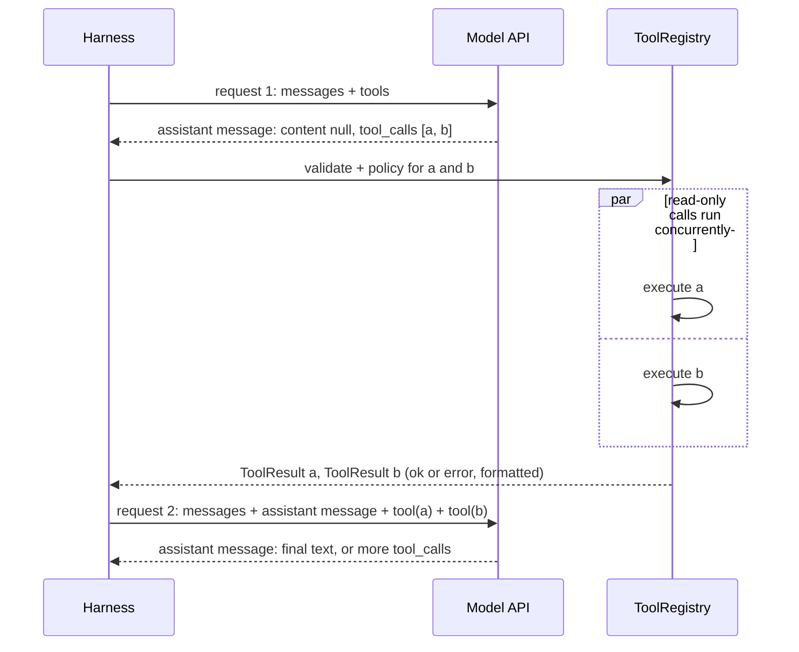
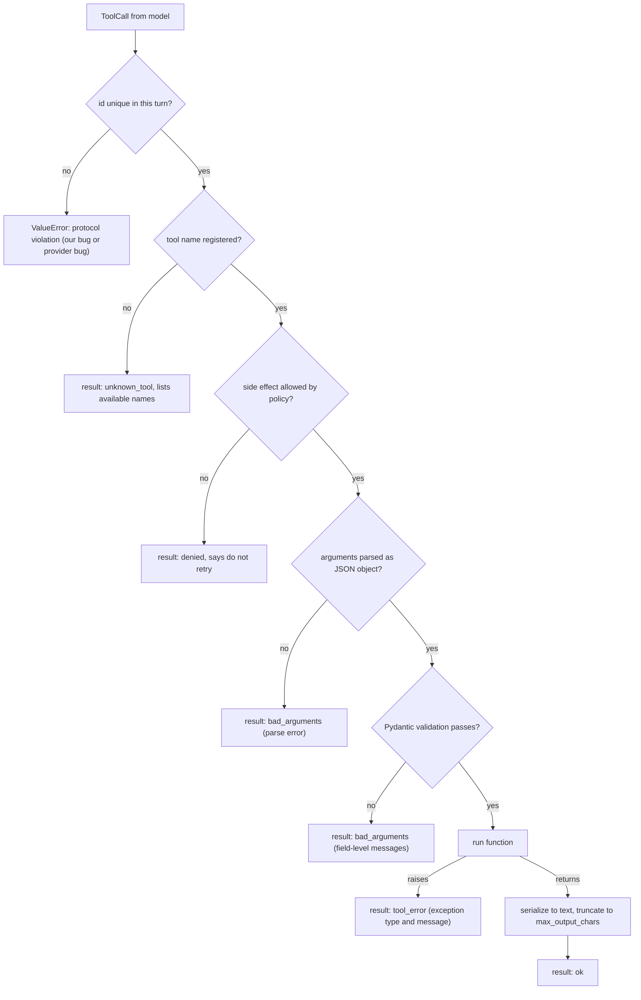

# Day 2 — Tool calling and function execution

> **Track:** Foundations · **Time:** ~40 min · **Builds on:** [Day 1](day-01-llm-apis-and-structured-outputs.md)

## 1. Learning objectives

By the end of this lesson you will be able to:

1. Write out the tool-calling wire protocol: the `tools` array in the request, an assistant message with `tool_calls` and `content: null`, one `role: "tool"` message per call linked by `tool_call_id`, and the second request that carries all of it back.
2. Generate a tool schema from a Pydantic model and explain which parts of it (name, description, field descriptions, enums, bounds, `additionalProperties: false`) are effectively prompt text.
3. Implement the **request → validate → execute → observe** contract so that unknown tools, malformed JSON arguments, schema violations and tool exceptions all become messages the model can react to, never uncaught exceptions.
4. Execute a batch of parallel tool calls with read-only calls concurrent, side-effecting calls sequential, a side-effect policy that can deny classes of tools, and results returned in request order.
5. Design a write tool that survives retries and duplicate calls using an idempotency key, and prove with a test that it does under concurrency.
6. Explain why a tool result must be *formatted* (summarised, truncated, labelled) for a reader that pays per token and can be misled by what it reads.

## 2. Why this matters in real-world agent engineering

Tools are where an agent stops being a text generator and starts touching your systems. Day 1 gave you one primitive, `messages -> message`. Day 2 adds the only other primitive agents need: the model can answer with *a request to run a function*, and you decide what happens. Almost every production incident involving agents is a tool-boundary incident:

- **The double ticket.** An on-call agent calls `create_ticket`, the ticketing API times out after actually creating the ticket, the harness retries, and the incident now has two tickets with two owners. The fix is not a smarter model; it is an idempotency key on the write and a registry that knows which tools are safe to retry.
- **The 60,000-token metrics dump.** A `query_metrics` tool returns every per-minute sample for a day. The next request is mostly numbers, the model reads "the peak was around 14:00" from a series whose peak is at 09:25, and the bill triples. Tool output is context; formatting it is part of the design (the demo prints the 2073-character raw series against a 209-character summary).
- **The hallucinated argument.** The model calls `get_incident` with `{"id": "1042", "verbose": true}`. A lenient parser drops `verbose`, coerces nothing, and calls the function with a missing id: a `TypeError` that crashes the run. A strict schema with an actionable error message turns the same mistake into one corrective turn.
- **The tool the model was never supposed to have.** The model requests `delete_ticket`, which exists in the codebase but was not offered. If dispatch is `getattr(module, name)(**args)`, you have just built a remote-code-execution primitive driven by text that an attacker can influence (Day 18). Dispatch must be an allow-list lookup.

For the Ops Report Agent, this lesson builds its hands: `get_incident`, `search_runbooks`, `query_metrics` (reads) and `create_ticket` (a write).

## 3. Mental model

> **The model never executes anything. It emits a *request* to call a function; your code is a trust boundary that decides whether, how and with what arguments that request runs, then reports back what happened as text.**

```text
 model                     your harness (the trust boundary)                     world
 ─────                     ─────────────────────────────────                     ─────
 "call get_incident  ──▶   parse JSON ─▶ validate against schema ─▶ policy ─▶   run function
  {incident_id: ...}"                                                              │
 ◀──── tool message ◀──── format result (summarise, truncate, label errors) ◀──────┘
```

Two invariants to carry forward:

1. **Every tool call gets exactly one result message with the same id**, even when the call was invalid, denied or crashed. Providers reject conversations with orphaned `tool_calls`, and a model that sees no outcome will often repeat the call.
2. **Errors are part of the protocol.** "Error: invalid arguments for 'create_ticket': severity: Input should be 'SEV1', 'SEV2' or 'SEV3'" is the cheapest, most reliable self-correction signal you have. Treat error text as carefully as the description.

## 4. Architecture and execution flow

One round of tool use, as the model and the harness experience it:



Inside the registry, every call travels the same funnel, and every exit produces a result for the model:



The second request is the part newcomers get wrong: you must send back the assistant message *that contained the tool calls*, unmodified, followed by the tool messages. The model's "memory" of having asked is that message.

## 5. Core concepts

### 5.1 What a tool is to the model

A tool is a name, a natural-language description and a JSON Schema for the arguments. The provider serialises these into the model's context (providers differ in exactly how; the details are in their docs). The model has no access to your function body, your docstrings, your types, or your database. That has three consequences:

- **Descriptions are prompts.** "Fetch one incident record by id. Use when the user names an incident id. Does not search; if you lack an id, say so." tells the model *when* to call, *what it returns* and *what it cannot do*. Compare `"Gets incident"`. In our experience reviewing agent traces, vague descriptions are a more common cause of wrong tool choice than model capability, but treat that as a heuristic to test, not a law: Day 20 shows how to measure it.
- **Schemas are constraints you enforce, not hints the model must obey.** Providers differ in whether they constrain decoding to the schema (some "strict" modes do; many endpoints do not). Even when they do, semantic validity (does INC-9999 exist?) is yours to check. Always validate, never trust.
- **Every token of every tool is paid on every request.** Four tools with terse descriptions cost little; forty tools with paragraph descriptions cost real money and measurably crowd the choice. Offer the smallest set the current task needs (Days 7, 11).

### 5.2 The protocol, concretely

The OpenAI-compatible shape (what `common.llm` speaks; Anthropic's Messages API uses `tool_use`/`tool_result` content blocks with the same logic — see references):

| Step | Direction | Shape |
|---|---|---|
| 1 | client → API | `{"messages": [...], "tools": [{"type": "function", "function": {name, description, parameters}}]}` |
| 2 | API → client | assistant message with `content: null` (or text) and `tool_calls: [{id, type: "function", function: {name, arguments: "<JSON string>"}}]`, `finish_reason: "tool_calls"` |
| 3 | you | parse `arguments` (a **string**, not an object), validate, execute |
| 4 | client → API | previous messages + that assistant message + one `{"role": "tool", "tool_call_id": id, "content": "<string>"}` per call |
| 5 | API → client | final assistant text, or another round of `tool_calls` |

Three details that bite:

- `arguments` arrives as a JSON **string** and can be invalid JSON (truncated by `max_tokens`, unescaped quotes, trailing commentary). `common.llm` parses it without raising and records `arguments_error`; the registry turns that into a `bad_arguments` result.
- Tool results are **strings**. Structured data must be serialised, and how you serialise is a design decision (5.5).
- Tools are sent on *every* request, including the one after the results. Dropping `tools` on request 2 changes what the model is allowed to do and, on some providers, is rejected when the history contains tool calls.

### 5.3 Schemas from Pydantic

One class gives you the schema for the model, the validator for the harness and the types for your function, so they cannot drift:

```python
class CreateTicketArgs(StrictArgs):          # extra="forbid" -> "additionalProperties": false
    title: str = Field(min_length=5, max_length=120)
    severity: Literal["SEV1", "SEV2", "SEV3"]  # -> "enum"
    idempotency_key: str = Field(min_length=8, max_length=64, description="Stable key ...")
```

`StrictArgs` sets `extra="forbid"`. Without it Pydantic silently ignores unknown keys, so a model that invents `priority` is never told. `Tool.openai_schema()` (in `common.tools`, embedded below) strips Pydantic's auto-generated `title` fields, which are noise tokens. Constraints (`min_length`, `ge`, `le`, `pattern`) appear in the schema *and* are enforced by validation. Treat provider support for each JSON Schema keyword as something to check in their docs, especially for strict modes, which accept only a subset.

Keep argument models flat and small. Deeply nested unions are where models (and strict-mode subsets) struggle most; if a tool needs a dozen optional knobs it is probably two tools.

### 5.4 Parallel tool calls

A model may return several `tool_calls` in one assistant message when it judges them independent ("fetch the incident *and* search runbooks"). Rules:

- You must answer all of them, each with its own `tool_call_id`, before the next model call. Order of the tool messages need not match on every provider, but keeping request order makes traces readable and is always safe.
- "Independent" is the model's *claim*. If two calls actually conflict (two writes to the same ticket), the harness, not the model, must be safe. We run reads concurrently and anything with side effects sequentially in the model's order.
- Concurrency here is `ThreadPoolExecutor` because tools are blocking I/O; the registry is stateless, but **your tool functions must be thread-safe** (the `TicketStore` takes a lock).
- Providers let you request or disable parallel calls, with parameter names and defaults that differ; check docs rather than assuming. Disabling is a sensible default for write-heavy agents.

### 5.5 Result formatting and truncation

The tool message is the model's only view of the world. Design it:

- **Summarise numeric series.** `query_metrics` returns min/max/mean/peak minute and six evenly spaced samples instead of 60 points. The model reasons from the summary; if it needs a narrower window it can call again with `start_minute`/`minutes`. The tool description says so.
- **Keep it parseable.** JSON text for records, short prose for status. Mixed formats make the model guess.
- **Truncate loudly.** The registry cuts at `max_output_chars` and appends `...[truncated N chars]` and sets `ToolResult.truncated`. Silent truncation is the dangerous variant: the model reasons as if it saw everything. Note the demo's clipped result is *no longer valid JSON*; truncation is a last-resort guard, and the real fix is a tool that returns less (pagination, filters, summaries — Day 12).
- **Do not leak.** Whatever the tool returns is shown to the model, and often logged. Redact secrets and PII in the tool, not in the prompt.
- **Distinguish "empty" from "failed".** `search_runbooks` returns `[]` for no match and the description says so; an exception means something broke. Otherwise the model may retry a successful empty search forever.

### 5.6 Errors as observations

| `error_type` | Cause | What the model should do | Typical message content |
|---|---|---|---|
| `unknown_tool` | Hallucinated or not offered | Pick a listed tool | The available names |
| `bad_arguments` | Invalid JSON, missing/extra/wrong-typed field, out-of-range value | Fix the call | Field-level reasons, first six |
| `tool_error` | The function raised | Retry differently, ask the user, or give up | `Type: message`, written to be actionable (the id lookup lists known ids) |
| `denied` | Policy forbids this side-effect class | Stop trying; tell the user | "Do not retry" |
| `timeout` | Reserved in `ToolResult`; not produced by this lesson's registry | — | Day 23 adds deadlines |

Two cautions. First, exception text is attacker- and bug-influenced: don't paste stack traces, SQL or file paths to the model (the registry sends only type and message). Second, `tool_error` is ambiguous between "your call was wrong" and "the world is broken"; if you can tell, say which.

### 5.7 Side-effect classes and idempotency

`common.tools` tags each tool `read`, `write` or `external` (a call that leaves your system, e.g. sending email) and an `idempotent` flag. Reads default to idempotent; writes must opt in, and should only do so with a mechanism behind the flag.

- **Reads** may be retried, cached and run in parallel.
- **Writes** need an idempotency key supplied by the *caller of the tool* — here the model, instructed by the description. Better where possible: the harness derives the key (for example `hash(run_id, step, tool, args)`) so the model cannot forget it. We let the model supply it to keep the lesson visible; Day 5 and Day 23 derive keys in the harness.
- **Side effects the model didn't ask for** are the harness's job: a policy (`allow=("read",)` by default) decides what a given run may do. The Ops Report Agent investigating an incident should be read-only until a human approves a ticket (Day 17).

Alternatives to a model-supplied key: dedupe by content hash (breaks when two legitimately identical tickets are wanted), or two-step "propose then commit" tools (more turns, safer). Pick by blast radius.

## 6. Implementation from scratch

**Step 1 — tools as data.** `common.tools` is the frozen core: `Tool` (name, description, args model, function, side-effect class), `ToolRegistry` (register, `schemas()`, `execute()`). Notice what `execute` does not do: it never raises. Its structure is the flowchart above: lookup, argument-parse check, Pydantic validation, call inside `try/except Exception`, then serialisation and truncation in one `done()` exit so every path is formatted the same way.

**Step 2 — the ops tools.** `day02/ops_tools.py` defines strict argument models and a registry builder. Design choices worth reading in the code: `GetIncidentArgs.incident_id` carries a regex pattern so `"1042"` fails *before* the function runs; `query_metrics` takes an enum for the metric and returns `summarize_series(...)`; the `get_incident` wrapper converts `KeyError` into a message that lists the known ids (an error the model can act on); `create_ticket` is registered `side_effect="write", idempotent=True` and delegates to `TicketStore.create`, which holds a lock around the key lookup *and* the insert (check-then-insert without a lock is the classic duplicate under concurrency).

**Step 3 — the manual round trip.** Before any loop, `day02/manual_call.py` does exactly one round by hand and returns every payload. It shows the second request's message order: `system, user, assistant(tool_calls), tool, tool`. If you can reproduce this by hand, the loop on Day 3 is only a `while` around it.

**Step 4 — batch execution and policy.** `day02/execution.py` sits between the model's turn and the registry: reject duplicate call ids, deny disallowed side-effect classes *without executing*, run reads in a thread pool, writes sequentially, and return results in request order (`results_to_messages` pairs each with its call's id). Unknown tools are routed through the registry so they get its standard error rather than a second code path.

The simplification to know about: `execute_batch` runs reads first, then writes, regardless of the model's order within the turn. For one assistant turn we treat the calls as unordered, which is what parallel calling means; if your model emits "read, then write based on the read" in one turn that is a prompt bug, not something the executor should paper over.

## 7. Complete runnable code

File tree for this lesson:

```text
code/
  common/
    tools.py          # frozen: Tool, ToolRegistry, ToolResult (embedded below)
  day02/
    __init__.py
    ops_tools.py      # args models, TicketStore, summarise_series, build_registry
    execution.py      # execute_batch (policy, concurrency, ordering) + results_to_messages
    manual_call.py    # one manual round trip returning the raw payloads
    demo.py           # five offline sections
    test_day02.py     # 31 tests
```

Run (from the repository root; nothing needs a key or the network):

```bash
export PYTHONPATH=code
python -m pytest code/day02 -q
LESSON_OFFLINE=1 python -m day02.demo
```

<!-- code:begin path="code/common/tools.py" -->
**`code/common/tools.py`**

```python
"""Tool registry: schema generation, argument validation, safe execution.

The model never executes anything. It *requests* a call; this module is the
trust boundary that decides whether and how that request runs (Days 2, 18, 19).
"""

from __future__ import annotations

import json
import time
from collections.abc import Callable
from typing import Any, Literal

from pydantic import BaseModel, ValidationError

from common.llm import ToolCall

SideEffect = Literal["read", "write", "external"]
MAX_OUTPUT_CHARS = 8_000


class ToolResult(BaseModel):
    """What goes back to the model (content) plus metadata for us (everything else)."""

    ok: bool
    content: str
    error_type: str | None = None  # unknown_tool | bad_arguments | tool_error | timeout | denied
    duration_s: float = 0.0
    truncated: bool = False


class Tool:
    def __init__(
        self,
        name: str,
        description: str,
        args_model: type[BaseModel],
        fn: Callable[..., Any],
        *,
        side_effect: SideEffect = "read",
        idempotent: bool | None = None,
    ) -> None:
        self.name = name
        self.description = description
        self.args_model = args_model
        self.fn = fn
        self.side_effect = side_effect
        # Reads are idempotent by default; writes/external calls must opt in (Day 23).
        self.idempotent = (side_effect == "read") if idempotent is None else idempotent

    def openai_schema(self) -> dict[str, Any]:
        params = self.args_model.model_json_schema()
        params.pop("title", None)
        for prop in params.get("properties", {}).values():
            prop.pop("title", None)
        return {
            "type": "function",
            "function": {"name": self.name, "description": self.description, "parameters": params},
        }


def _to_text(value: Any) -> str:
    if isinstance(value, str):
        return value
    if isinstance(value, BaseModel):
        return value.model_dump_json()
    return json.dumps(value, default=str, ensure_ascii=False)


class ToolRegistry:
    def __init__(self, max_output_chars: int = MAX_OUTPUT_CHARS) -> None:
        self._tools: dict[str, Tool] = {}
        self.max_output_chars = max_output_chars

    # -- registration -------------------------------------------------------
    def register(self, tool: Tool) -> Tool:
        if tool.name in self._tools:
            raise ValueError(f"tool already registered: {tool.name}")
        self._tools[tool.name] = tool
        return tool

    def tool(
        self,
        name: str,
        description: str,
        args_model: type[BaseModel],
        *,
        side_effect: SideEffect = "read",
        idempotent: bool | None = None,
    ) -> Callable[[Callable[..., Any]], Callable[..., Any]]:
        """Decorator form: the function receives the validated args model's fields as kwargs."""

        def deco(fn: Callable[..., Any]) -> Callable[..., Any]:
            self.register(Tool(name, description, args_model, fn, side_effect=side_effect, idempotent=idempotent))
            return fn

        return deco

    # -- introspection ------------------------------------------------------
    def get(self, name: str) -> Tool | None:
        return self._tools.get(name)

    def names(self) -> list[str]:
        return sorted(self._tools)

    def schemas(self, only: list[str] | None = None) -> list[dict[str, Any]]:
        tools = self._tools.values() if only is None else [self._tools[n] for n in only if n in self._tools]
        return [t.openai_schema() for t in tools]

    # -- execution ----------------------------------------------------------
    def execute(self, call: ToolCall) -> ToolResult:
        """Validate then run. Never raises: failures become results the model can react to."""
        started = time.perf_counter()

        def done(ok: bool, content: str, error_type: str | None = None) -> ToolResult:
            truncated = len(content) > self.max_output_chars
            if truncated:
                content = content[: self.max_output_chars] + f"\n...[truncated {len(content) - self.max_output_chars} chars]"
            return ToolResult(ok=ok, content=content, error_type=error_type,
                              duration_s=time.perf_counter() - started, truncated=truncated)

        tool = self._tools.get(call.name)
        if tool is None:
            return done(False, f"Error: unknown tool '{call.name}'. Available tools: {', '.join(self.names()) or 'none'}.", "unknown_tool")
        if call.arguments_error:
            return done(False, f"Error: could not parse arguments for '{call.name}': {call.arguments_error}", "bad_arguments")
        try:
            args = tool.args_model.model_validate(call.arguments)
        except ValidationError as exc:
            detail = "; ".join(f"{'.'.join(map(str, e['loc'])) or 'arguments'}: {e['msg']}" for e in exc.errors()[:6])
            return done(False, f"Error: invalid arguments for '{call.name}': {detail}", "bad_arguments")
        try:
            value = tool.fn(**args.model_dump())
        except Exception as exc:  # tool bugs and domain errors alike become observations
            return done(False, f"Error: {type(exc).__name__}: {exc}", "tool_error")
        return done(True, _to_text(value))
```
<!-- code:end -->

<!-- code:begin path="code/day02/ops_tools.py" -->
**`code/day02/ops_tools.py`**

```python
"""The Ops Report Agent's first tool set: three reads and one write.

Everything the model sees about a tool comes from three places, and all three are prompt text:
the tool *name*, its *description*, and the *schema* generated from the Pydantic args model
(field names, `Field(description=...)`, enums, bounds). Error strings are prompt text too.
"""

from __future__ import annotations

import re
import statistics
import threading
from typing import Any, Literal

from pydantic import BaseModel, ConfigDict, Field

from common.fixtures import INCIDENTS, RUNBOOKS, get_incident_record, list_incident_ids, metrics_for
from common.tools import ToolRegistry


class StrictArgs(BaseModel):
    """Reject unknown keys. A model that invents `severity_level` should learn that, not be ignored."""

    model_config = ConfigDict(extra="forbid")


class GetIncidentArgs(StrictArgs):
    incident_id: str = Field(pattern=r"^INC-\d{4}$", description="Incident id, e.g. INC-1042.")


class SearchRunbooksArgs(StrictArgs):
    query: str = Field(min_length=2, max_length=200, description="Keywords describing the symptom, e.g. 'queue backlog'.")
    limit: int = Field(default=3, ge=1, le=5, description="Maximum number of runbooks to return.")


class QueryMetricsArgs(StrictArgs):
    service: str = Field(description="Service name exactly as in an incident record, e.g. checkout-api.")
    metric: Literal["error_rate", "p95_latency_ms", "cpu_pct"]
    start_minute: int = Field(default=0, ge=0, le=1380, description="First minute of the window (minutes from the data epoch).")
    minutes: int = Field(default=60, ge=1, le=120, description="Window length in minutes.")


class CreateTicketArgs(StrictArgs):
    title: str = Field(min_length=5, max_length=120)
    severity: Literal["SEV1", "SEV2", "SEV3"]
    idempotency_key: str = Field(
        min_length=8, max_length=64,
        description="Stable key for this logical ticket. Re-sending the same key returns the existing ticket.",
    )


class TicketStore:
    """In-memory ticket system. `executions` counts real writes, so tests can prove dedup works."""

    def __init__(self) -> None:
        self._lock = threading.Lock()
        self.tickets: dict[str, dict[str, str]] = {}
        self._by_key: dict[str, str] = {}
        self.executions = 0

    def create(self, title: str, severity: str, key: str) -> tuple[dict[str, str], bool]:
        with self._lock:
            if key in self._by_key:
                return self.tickets[self._by_key[key]], False
            ticket_id = f"TCK-{len(self.tickets) + 1:03d}"
            ticket = {"id": ticket_id, "title": title, "severity": severity}
            self.tickets[ticket_id] = ticket
            self._by_key[key] = ticket_id
            self.executions += 1
            return ticket, True


_WORD = re.compile(r"[a-z0-9]+")
_STOPWORDS = frozenset("a an and are as at be by do for from how i in is it its of on or the to we what when with".split())


def keyword_search(query: str, limit: int) -> list[dict[str, Any]]:
    """Naive on purpose: count distinct non-stopword query words appearing in title/tags/text. Day 8-10 replace it."""
    words = set(_WORD.findall(query.lower())) - _STOPWORDS
    scored = []
    for doc in RUNBOOKS:
        haystack = set(_WORD.findall(f"{doc['title']} {' '.join(doc['tags'])} {doc['text']}".lower()))
        score = len(words & haystack)
        if score:
            scored.append((score, doc))
    scored.sort(key=lambda pair: (-pair[0], pair[1]["id"]))
    return [
        {"id": d["id"], "title": d["title"], "score": s, "snippet": d["text"][:160].rstrip() + "..."}
        for s, d in scored[:limit]
    ]


def summarize_series(points: list[dict[str, float]], max_points: int = 6) -> dict[str, Any]:
    """Compact a time series: statistics the model can reason about plus a few evenly spaced samples.

    Returning 60 raw points costs tokens and invites the model to 'read' numbers it will misread.
    """
    values = [p["value"] for p in points]
    peak = max(points, key=lambda p: p["value"])
    step = max(1, len(points) // max_points)
    return {
        "points": len(points),
        "first_minute": int(points[0]["minute"]),
        "last_minute": int(points[-1]["minute"]),
        "min": min(values),
        "max": max(values),
        "mean": round(statistics.fmean(values), 5),
        "peak_minute": int(peak["minute"]),
        "samples": [[int(p["minute"]), p["value"]] for p in points[::step]][:max_points],
    }


def build_registry(store: TicketStore | None = None, *, max_output_chars: int = 8_000) -> ToolRegistry:
    store = store if store is not None else TicketStore()
    reg = ToolRegistry(max_output_chars=max_output_chars)

    @reg.tool(
        "get_incident",
        "Fetch one incident record (title, severity, service, timeline, root cause if known) by id. "
        "Use when the user names an incident id. Does not search; if you lack an id, say so.",
        GetIncidentArgs,
    )
    def get_incident(incident_id: str) -> dict[str, Any]:
        try:
            return dict(get_incident_record(incident_id))
        except KeyError:
            raise ValueError(f"no incident {incident_id}. Known ids: {', '.join(list_incident_ids())}") from None

    @reg.tool(
        "search_runbooks",
        "Keyword search over the on-call runbooks. Returns ids, titles and a short snippet, best match first. "
        "Use to find procedures for a symptom or service. Returns an empty list when nothing matches.",
        SearchRunbooksArgs,
    )
    def search_runbooks(query: str, limit: int) -> list[dict[str, Any]]:
        return keyword_search(query, limit)

    @reg.tool(
        "query_metrics",
        "Summarise one per-minute metric for one service over a window: min, max, mean, peak minute and a few samples. "
        "Use to check whether a metric spiked. Known services: " + ", ".join(sorted({i["service"] for i in INCIDENTS})) + ".",
        QueryMetricsArgs,
    )
    def query_metrics(service: str, metric: str, start_minute: int, minutes: int) -> dict[str, Any]:
        return summarize_series(metrics_for(service, metric, start_minute, minutes))

    @reg.tool(
        "create_ticket",
        "WRITE: create a follow-up ticket in the tracker. Only call when the user asked for a ticket. "
        "Always pass an idempotency_key; retrying with the same key never creates a duplicate.",
        CreateTicketArgs,
        side_effect="write",
        idempotent=True,  # safe to retry *because* of the key, not because writes are safe
    )
    def create_ticket(title: str, severity: str, idempotency_key: str) -> dict[str, Any]:
        ticket, created = store.create(title, severity, idempotency_key)
        return {"ticket_id": ticket["id"], "created": created}

    return reg
```
<!-- code:end -->

<!-- code:begin path="code/day02/execution.py" -->
**`code/day02/execution.py`**

```python
"""Executing a *batch* of tool calls from one assistant turn.

Rules enforced here (the registry handles single-call validation):
  * call ids must be unique - they are the only link between a result and its request;
  * a side-effect policy decides which classes of tool may run at all (default: reads only);
  * read-only calls run concurrently, anything with side effects runs sequentially, in model order;
  * results are returned in the order the model requested them, one per call, never dropped.
"""

from __future__ import annotations

from collections.abc import Collection, Sequence
from concurrent.futures import ThreadPoolExecutor

from common.llm import Message, ToolCall, tool_result
from common.tools import SideEffect, ToolRegistry, ToolResult


def _denied(call: ToolCall, side_effect: str) -> ToolResult:
    return ToolResult(
        ok=False,
        error_type="denied",
        content=f"Error: tool '{call.name}' has side effect '{side_effect}' and is not allowed in this run. "
        "Do not retry; tell the user what you wanted to do instead.",
    )


def execute_batch(
    registry: ToolRegistry,
    calls: Sequence[ToolCall],
    *,
    allow: Collection[SideEffect] = ("read",),
    max_workers: int = 4,
) -> list[ToolResult]:
    ids = [c.id for c in calls]
    if len(set(ids)) != len(ids):
        raise ValueError(f"duplicate tool_call ids in one assistant turn: {ids}")

    results: list[ToolResult | None] = [None] * len(calls)
    parallel: list[int] = []
    serial: list[int] = []
    for i, call in enumerate(calls):
        tool = registry.get(call.name)
        if tool is None:  # unknown tool: let the registry produce its standard error
            parallel.append(i)
        elif tool.side_effect not in allow:
            results[i] = _denied(call, tool.side_effect)
        elif tool.side_effect == "read":
            parallel.append(i)
        else:
            serial.append(i)

    if parallel:
        with ThreadPoolExecutor(max_workers=max(1, min(max_workers, len(parallel)))) as pool:
            for i, res in zip(parallel, pool.map(lambda idx: registry.execute(calls[idx]), parallel), strict=True):
                results[i] = res
    for i in serial:
        results[i] = registry.execute(calls[i])

    return [r for r in results if r is not None]


def results_to_messages(calls: Sequence[ToolCall], results: Sequence[ToolResult]) -> list[Message]:
    """One `role="tool"` message per call, same order, each carrying its call's id."""
    if len(calls) != len(results):
        raise ValueError("every tool call needs exactly one result")
    return [tool_result(c, r.content) for c, r in zip(calls, results, strict=True)]
```
<!-- code:end -->

<!-- code:begin path="code/day02/manual_call.py" -->
**`code/day02/manual_call.py`**

```python
"""One manual tool-calling round trip, with no loop, so the raw protocol is visible.

    request 1: messages + tools           ->  assistant message with tool_calls (no text)
    we execute each call ourselves
    request 2: messages + assistant msg + one tool message per call  ->  assistant text

`one_round` returns every payload it sent so a lesson (or a test) can print the exact wire shapes.
"""

from __future__ import annotations

from typing import Any

from pydantic import BaseModel, Field

from common.llm import LLMClient, Message, system, user
from common.tools import ToolRegistry, ToolResult
from day02.execution import execute_batch, results_to_messages

SYSTEM_PROMPT = (
    "You are the Ops Report Agent. Use the tools to look facts up; never invent incident details. "
    "If a tool returns an error, read it and correct your call or tell the user."
)


class ManualTrace(BaseModel):
    request_1: dict[str, Any]
    assistant_1: dict[str, Any]
    tool_messages: list[dict[str, Any]] = Field(default_factory=list)
    results: list[ToolResult] = Field(default_factory=list)
    request_2: dict[str, Any] | None = None
    final_text: str | None = None
    needs_another_round: bool = False  # the model asked for more tools: exactly why Day 3 needs a loop


def _payload(messages: list[Message], registry: ToolRegistry) -> dict[str, Any]:
    return {"messages": [m.to_openai() for m in messages], "tools": registry.schemas()}


def one_round(client: LLMClient, registry: ToolRegistry, question: str) -> ManualTrace:
    messages: list[Message] = [system(SYSTEM_PROMPT), user(question)]
    resp1 = client.chat(messages, tools=registry.schemas())
    trace = ManualTrace(request_1=_payload(messages, registry), assistant_1=resp1.message.to_openai())

    if not resp1.tool_calls:  # the model answered directly; nothing to execute
        trace.final_text = resp1.content
        return trace

    trace.results = execute_batch(registry, resp1.tool_calls)
    tool_messages = results_to_messages(resp1.tool_calls, trace.results)
    trace.tool_messages = [m.to_openai() for m in tool_messages]

    # The assistant message that *contained* the tool_calls must be replayed verbatim before the results.
    messages = [*messages, resp1.message, *tool_messages]
    trace.request_2 = _payload(messages, registry)
    resp2 = client.chat(messages, tools=registry.schemas())
    trace.final_text = resp2.content or None
    trace.needs_another_round = bool(resp2.tool_calls)
    return trace
```
<!-- code:end -->

<!-- code:begin path="code/day02/demo.py" -->
**`code/day02/demo.py`**

```python
"""Day 2 demo: the tool-calling contract, offline.

    PYTHONPATH=code LESSON_OFFLINE=1 python -m day02.demo

Section 2 uses `get_client(script)`: with LLM_API_KEY set (and LESSON_OFFLINE unset) a real model
answers instead of the script, so its tool choices and wording will differ from the lesson.
Sections 1, 3, 4 and 5 call no model at all.
"""

from __future__ import annotations

import json

from common.fixtures import metrics_for
from common.llm import Message, ToolCall, get_client
from day02.execution import execute_batch
from day02.manual_call import one_round
from day02.ops_tools import TicketStore, build_registry


def banner(title: str) -> None:
    print(f"\n=== {title} ===")


def scripted_model() -> list[object]:
    first = Message(
        role="assistant",
        tool_calls=[
            ToolCall(id="call_a1", name="get_incident", arguments={"incident_id": "INC-1042"}),
            ToolCall(id="call_a2", name="search_runbooks", arguments={"query": "deploy rollback error rate", "limit": 2}),
        ],
    )
    final = (
        "INC-1042 (SEV1, checkout-api): error rate hit 31% minutes after release v2026.03.04-1; "
        "root cause was an unindexed query that saturated the connection pool. "
        "Relevant runbooks: rb-deploy-rollback, rb-db-connection-pool."
    )
    return [first, final]


def main() -> None:
    store = TicketStore()
    reg = build_registry(store)

    banner("1. What the model sees: the schema generated for create_ticket")
    print(json.dumps(reg.schemas(only=["create_ticket"])[0], indent=2))

    banner("2. One manual round trip (no loop)")
    client = get_client(scripted_model())
    trace = one_round(client, reg, "What happened in INC-1042 and which runbook applies?")
    print("assistant_1 :", json.dumps(trace.assistant_1)[:230], "...")
    for msg, res in zip(trace.tool_messages, trace.results, strict=True):
        print(f"tool message: id={msg['tool_call_id']} name={msg['name']} ok={res.ok} chars={len(msg['content'])}")
    print("request_2 roles:", [m["role"] for m in (trace.request_2 or {})["messages"]])
    print("final_text  :", trace.final_text)
    print("needs_another_round:", trace.needs_another_round)

    banner("3. Failures become observations, never exceptions")
    cases = [
        ToolCall(id="c1", name="get_incident_by_id", arguments={"incident_id": "INC-1042"}),
        ToolCall(id="c2", name="get_incident", arguments={}, raw_arguments='{"incident_id": "INC-1042"',
                 arguments_error="invalid JSON arguments: Expecting ',' delimiter (pos 27)"),
        ToolCall(id="c3", name="create_ticket", arguments={"title": "x", "severity": "SEV9", "idempotency_key": "k"}),
        ToolCall(id="c4", name="get_incident", arguments={"incident_id": "INC-1042", "verbose": True}),
        ToolCall(id="c5", name="get_incident", arguments={"incident_id": "INC-9999"}),
    ]
    for res in execute_batch(reg, cases, allow=("read", "write")):
        print(f"[{res.error_type}] {res.content[:200]}")

    banner("4. Result formatting: summary vs raw series")
    raw = json.dumps(metrics_for("checkout-api", "error_rate", 0, 60))
    summary = reg.execute(ToolCall(id="m1", name="query_metrics",
                                   arguments={"service": "checkout-api", "metric": "error_rate"}))
    print(f"raw series: {len(raw)} chars | summarised tool result: {len(summary.content)} chars")
    print(summary.content)
    tiny = build_registry(max_output_chars=120)
    clipped = tiny.execute(ToolCall(id="m2", name="get_incident", arguments={"incident_id": "INC-1042"}))
    print(f"clipped to 120 chars -> truncated={clipped.truncated}; tail: {clipped.content[-45:]!r}")

    banner("5. Side-effect policy and idempotent writes")
    write = ToolCall(id="w1", name="create_ticket",
                     arguments={"title": "Add index on orders", "severity": "SEV2", "idempotency_key": "inc-1042-index"})
    denied = execute_batch(reg, [write])[0]
    print(f"read-only run   : [{denied.error_type}] tickets={len(store.tickets)}")
    for call_id in ("w2", "w3"):
        res = execute_batch(reg, [write.model_copy(update={"id": call_id})], allow=("read", "write"))[0]
        print(f"write, call {call_id}  : {res.content}")
    print(f"tickets stored  : {len(store.tickets)}, real executions: {store.executions}")


if __name__ == "__main__":
    main()
```
<!-- code:end -->

<!-- code:begin path="code/day02/test_day02.py" -->
**`code/day02/test_day02.py`**

```python
"""Day 2 tests: schemas, validation failures as observations, manual protocol, batch execution, idempotency."""

from __future__ import annotations

import json
import threading
from concurrent.futures import ThreadPoolExecutor

import pytest
from pydantic import BaseModel

from common.llm import Message, ScriptedLLM, ToolCall
from common.tools import ToolRegistry
from day02.execution import execute_batch, results_to_messages
from day02.manual_call import one_round
from day02.ops_tools import TicketStore, build_registry, keyword_search, summarize_series


def call(name: str, call_id: str = "c1", **args: object) -> ToolCall:
    return ToolCall(id=call_id, name=name, arguments=dict(args))


TICKET = {"title": "Add index on orders", "severity": "SEV2", "idempotency_key": "inc-1042-index"}


# ------------------------------------------------------------------ schemas
def test_schemas_are_strict_and_carry_descriptions() -> None:
    schemas = {s["function"]["name"]: s["function"] for s in build_registry().schemas()}
    assert set(schemas) == {"get_incident", "search_runbooks", "query_metrics", "create_ticket"}
    params = schemas["create_ticket"]["parameters"]
    assert params["additionalProperties"] is False
    assert params["properties"]["severity"]["enum"] == ["SEV1", "SEV2", "SEV3"]
    assert set(params["required"]) == {"title", "severity", "idempotency_key"}
    assert "title" not in params  # Pydantic's model title is stripped to save tokens
    assert schemas["create_ticket"]["description"].startswith("WRITE:")
    assert "incident_id" in schemas["get_incident"]["parameters"]["required"]


def test_side_effect_metadata() -> None:
    reg = build_registry()
    assert reg.get("get_incident").side_effect == "read"
    assert reg.get("create_ticket").side_effect == "write"
    assert reg.get("create_ticket").idempotent is True


# ------------------------------------------------- failures are observations
@pytest.mark.parametrize(
    ("tool_call", "error_type", "needle"),
    [
        (call("get_incident", incident_id="INC-1042", verbose=True), "bad_arguments", "verbose"),
        (call("get_incident", incident_id="1042"), "bad_arguments", "incident_id"),
        (call("create_ticket", **{**TICKET, "severity": "SEV9"}), "bad_arguments", "severity"),
        (call("query_metrics", service="checkout-api", metric="disk"), "bad_arguments", "metric"),
        (call("get_incident", incident_id="INC-9999"), "tool_error", "Known ids"),
        (call("query_metrics", service="checkout-api", metric="cpu_pct", minutes=500), "bad_arguments", "minutes"),
        (call("nope"), "unknown_tool", "Available tools"),
    ],
)
def test_bad_calls_return_actionable_errors(tool_call: ToolCall, error_type: str, needle: str) -> None:
    res = build_registry().execute(tool_call)
    assert res.ok is False
    assert res.error_type == error_type
    assert needle in res.content


def test_malformed_json_arguments_are_reported_not_raised() -> None:
    bad = ToolCall(id="c1", name="get_incident", raw_arguments='{"incident_id": ', arguments_error="invalid JSON arguments")
    res = build_registry().execute(bad)
    assert (res.ok, res.error_type) == (False, "bad_arguments")
    assert "invalid JSON" in res.content


def test_tool_bug_does_not_escape_registry() -> None:
    class Empty(BaseModel):
        pass

    reg = ToolRegistry()

    @reg.tool("boom", "always fails", Empty)
    def boom() -> str:
        raise RuntimeError("db down")

    res = reg.execute(call("boom"))
    assert res.error_type == "tool_error"
    assert "RuntimeError: db down" in res.content


def test_duplicate_tool_name_is_rejected() -> None:
    reg = build_registry()
    with pytest.raises(ValueError, match="already registered"):
        reg.register(reg.get("get_incident"))


# ------------------------------------------------------------ tool behaviour
def test_get_incident_returns_json_record() -> None:
    res = build_registry().execute(call("get_incident", incident_id="INC-1042"))
    assert res.ok
    assert json.loads(res.content)["service"] == "checkout-api"


def test_keyword_search_ranks_by_overlap_and_limits() -> None:
    hits = keyword_search("queue backlog consumers restart", 2)
    assert hits[0]["id"] == "rb-queue-backlog"
    assert len(hits) <= 2
    assert keyword_search("zzzz qqqq", 3) == []


def test_keyword_search_is_lexical_and_misses_paraphrase() -> None:
    # Documents the limitation Days 8-10 fix: zero shared words means zero hits, even for the right document.
    assert keyword_search("memoisation layer wiped everything slowed", 5) == []
    assert keyword_search("the of and", 5) == []  # stopwords alone never match


def test_metrics_result_is_a_compact_summary() -> None:
    res = build_registry().execute(call("query_metrics", service="checkout-api", metric="error_rate"))
    data = json.loads(res.content)
    assert data["points"] == 60 and data["max"] == pytest.approx(0.31)
    assert len(data["samples"]) <= 6
    assert len(res.content) < 400


def test_summarize_series_peak_and_mean() -> None:
    s = summarize_series([{"minute": 0.0, "value": 1.0}, {"minute": 1.0, "value": 5.0}, {"minute": 2.0, "value": 3.0}])
    assert (s["peak_minute"], s["max"], s["min"], s["mean"]) == (1, 5.0, 1.0, 3.0)


def test_oversized_output_is_truncated_and_flagged() -> None:
    reg = build_registry(max_output_chars=100)
    res = reg.execute(call("get_incident", incident_id="INC-1042"))
    assert res.ok and res.truncated
    assert "[truncated" in res.content
    assert len(res.content) < 100 + 40


# --------------------------------------------------------- manual round trip
def _two_call_message() -> Message:
    return Message(role="assistant", tool_calls=[
        call("get_incident", "call_a", incident_id="INC-1042"),
        call("search_runbooks", "call_b", query="deploy rollback"),
    ])


def test_one_round_replays_assistant_message_then_one_tool_message_per_call() -> None:
    llm = ScriptedLLM([_two_call_message(), "Done."])
    trace = one_round(llm, build_registry(), "What happened in INC-1042?")
    assert len(llm.calls) == 2
    assert llm.calls[0]["tools"] and llm.calls[1]["tools"]  # tools are re-sent on every request
    roles = [m.role for m in llm.calls[1]["messages"]]
    assert roles == ["system", "user", "assistant", "tool", "tool"]
    tool_msgs = [m for m in llm.calls[1]["messages"] if m.role == "tool"]
    assert [m.tool_call_id for m in tool_msgs] == ["call_a", "call_b"]
    assert llm.calls[1]["messages"][2].tool_calls[0].id == "call_a"
    assert trace.final_text == "Done." and trace.needs_another_round is False
    assert trace.assistant_1["content"] is None
    assert json.loads(trace.assistant_1["tool_calls"][0]["function"]["arguments"]) == {"incident_id": "INC-1042"}


def test_one_round_without_tool_calls_makes_a_single_request() -> None:
    llm = ScriptedLLM(["I need an incident id."])
    trace = one_round(llm, build_registry(), "What happened?")
    assert len(llm.calls) == 1
    assert trace.final_text == "I need an incident id." and trace.request_2 is None


def test_one_round_flags_when_model_wants_another_round() -> None:
    llm = ScriptedLLM([_two_call_message(), ScriptedLLM.tool_call("query_metrics", "call_c", service="checkout-api", metric="cpu_pct")])
    trace = one_round(llm, build_registry(), "Investigate INC-1042")
    assert trace.needs_another_round is True
    assert trace.final_text is None


def test_one_round_feeds_tool_errors_back_to_the_model() -> None:
    bad = ScriptedLLM.tool_call("get_incident", "call_x", incident_id="INC-0000")
    seen: list[str] = []

    def second(messages: list[Message]) -> str:
        seen.append(messages[-1].content or "")
        return "That incident does not exist."

    trace = one_round(ScriptedLLM([bad, second]), build_registry(), "Look up INC-0000")
    assert "Known ids" in seen[0]
    assert trace.results[0].error_type == "tool_error"


# ------------------------------------------------------------ batch execution
def test_batch_preserves_order_and_one_result_per_call() -> None:
    reg = build_registry()
    calls = [call("get_incident", "a", incident_id="INC-1051"), call("nope", "b"), call("get_incident", "c", incident_id="INC-1042")]
    results = execute_batch(reg, calls)
    assert [r.error_type for r in results] == [None, "unknown_tool", None]
    assert "INC-1051" in results[0].content and "INC-1042" in results[2].content
    msgs = results_to_messages(calls, results)
    assert [m.tool_call_id for m in msgs] == ["a", "b", "c"]


def test_read_calls_really_run_concurrently() -> None:
    barrier = threading.Barrier(3, timeout=2)

    class Args(BaseModel):
        n: int

    reg = ToolRegistry()

    @reg.tool("slow_read", "waits for its siblings", Args)
    def slow_read(n: int) -> str:
        barrier.wait()  # raises BrokenBarrierError (-> tool_error) unless 3 calls are in flight together
        return f"ok {n}"

    results = execute_batch(reg, [call("slow_read", f"c{i}", n=i) for i in range(3)], max_workers=3)
    assert [r.content for r in results] == ["ok 0", "ok 1", "ok 2"]


def test_write_calls_run_sequentially_in_model_order() -> None:
    order: list[str] = []
    active = 0
    overlap = False
    lock = threading.Lock()

    class Args(BaseModel):
        tag: str

    reg = ToolRegistry()

    @reg.tool("w", "write", Args, side_effect="write")
    def w(tag: str) -> str:
        nonlocal active, overlap
        with lock:
            active += 1
            overlap = overlap or active > 1
        order.append(tag)
        with lock:
            active -= 1
        return tag

    execute_batch(reg, [call("w", f"c{i}", tag=t) for i, t in enumerate("xyz")], allow=("write",))
    assert order == ["x", "y", "z"] and overlap is False


def test_policy_denies_writes_without_executing_them() -> None:
    store = TicketStore()
    res = execute_batch(build_registry(store), [call("create_ticket", **TICKET)])[0]
    assert (res.ok, res.error_type) == (False, "denied")
    assert "Do not retry" in res.content
    assert store.executions == 0 and store.tickets == {}


def test_duplicate_call_ids_are_rejected() -> None:
    with pytest.raises(ValueError, match="duplicate tool_call ids"):
        execute_batch(build_registry(), [call("get_incident", "same", incident_id="INC-1042")] * 2)


def test_results_to_messages_requires_matching_lengths() -> None:
    with pytest.raises(ValueError, match="exactly one result"):
        results_to_messages([call("get_incident", incident_id="INC-1042")], [])


# ---------------------------------------------------------------- idempotency
def test_same_idempotency_key_creates_one_ticket() -> None:
    store = TicketStore()
    reg = build_registry(store)
    first = json.loads(reg.execute(call("create_ticket", "a", **TICKET)).content)
    second = json.loads(reg.execute(call("create_ticket", "b", **TICKET)).content)
    assert first == {"ticket_id": "TCK-001", "created": True}
    assert second == {"ticket_id": "TCK-001", "created": False}
    assert store.executions == 1


def test_different_keys_create_different_tickets() -> None:
    store = TicketStore()
    reg = build_registry(store)
    reg.execute(call("create_ticket", **TICKET))
    reg.execute(call("create_ticket", **{**TICKET, "idempotency_key": "another-key-1"}))
    assert store.executions == 2 and len(store.tickets) == 2


def test_idempotency_holds_under_concurrent_retries() -> None:
    store = TicketStore()
    with ThreadPoolExecutor(max_workers=8) as pool:
        list(pool.map(lambda _: store.create("Add index on orders", "SEV2", "same-key-123"), range(32)))
    assert store.executions == 1 and len(store.tickets) == 1
```
<!-- code:end -->

### Real output of the offline demo

Pasted from `LESSON_OFFLINE=1 python -m day02.demo`. The model in section 2 is a `ScriptedLLM`: it demonstrates the *protocol*, not what a real model would choose.

```text
=== 1. What the model sees: the schema generated for create_ticket ===
{
  "type": "function",
  "function": {
    "name": "create_ticket",
    "description": "WRITE: create a follow-up ticket in the tracker. Only call when the user asked for a ticket. Always pass an idempotency_key; retrying with the same key never creates a duplicate.",
    "parameters": {
      "additionalProperties": false,
      "properties": {
        "title": {
          "maxLength": 120,
          "minLength": 5,
          "type": "string"
        },
        "severity": {
          "enum": [
            "SEV1",
            "SEV2",
            "SEV3"
          ],
          "type": "string"
        },
        "idempotency_key": {
          "description": "Stable key for this logical ticket. Re-sending the same key returns the existing ticket.",
          "maxLength": 64,
          "minLength": 8,
          "type": "string"
        }
      },
      "required": [
        "title",
        "severity",
        "idempotency_key"
      ],
      "type": "object"
    }
  }
}

=== 2. One manual round trip (no loop) ===
assistant_1 : {"role": "assistant", "content": null, "tool_calls": [{"id": "call_a1", "type": "function", "function": {"name": "get_incident", "arguments": "{\"incident_id\": \"INC-1042\"}"}}, {"id": "call_a2", "type": "function", "function": { ...
tool message: id=call_a1 name=get_incident ok=True chars=718
tool message: id=call_a2 name=search_runbooks ok=True chars=509
request_2 roles: ['system', 'user', 'assistant', 'tool', 'tool']
final_text  : INC-1042 (SEV1, checkout-api): error rate hit 31% minutes after release v2026.03.04-1; root cause was an unindexed query that saturated the connection pool. Relevant runbooks: rb-deploy-rollback, rb-db-connection-pool.
needs_another_round: False

=== 3. Failures become observations, never exceptions ===
[unknown_tool] Error: unknown tool 'get_incident_by_id'. Available tools: create_ticket, get_incident, query_metrics, search_runbooks.
[bad_arguments] Error: could not parse arguments for 'get_incident': invalid JSON arguments: Expecting ',' delimiter (pos 27)
[bad_arguments] Error: invalid arguments for 'create_ticket': title: String should have at least 5 characters; severity: Input should be 'SEV1', 'SEV2' or 'SEV3'; idempotency_key: String should have at least 8 charac
[bad_arguments] Error: invalid arguments for 'get_incident': verbose: Extra inputs are not permitted
[tool_error] Error: ValueError: no incident INC-9999. Known ids: INC-1042, INC-1051, INC-1063, INC-1077, INC-1090

=== 4. Result formatting: summary vs raw series ===
raw series: 2073 chars | summarised tool result: 209 chars
{"points": 60, "first_minute": 0, "last_minute": 59, "min": 0.00194, "max": 0.31, "mean": 0.13033, "peak_minute": 25, "samples": [[0, 0.002], [10, 0.00199], [20, 0.002], [30, 0.31], [40, 0.31], [50, 0.00195]]}
clipped to 120 chars -> truncated=True; tail: 'heckout-api", "start\n...[truncated 598 chars]'

=== 5. Side-effect policy and idempotent writes ===
read-only run   : [denied] tickets=0
write, call w2  : {"ticket_id": "TCK-001", "created": true}
write, call w3  : {"ticket_id": "TCK-001", "created": false}
tickets stored  : 1, real executions: 1
```

What to notice: section 2's second request has five messages, with the assistant message holding both calls followed by two tool messages; section 3 shows five different failure classes, all returned as strings; section 4 is a measured 2073 versus 209 characters; section 5 shows a denied write leaving zero tickets, then two identical writes producing one real execution.

## 8. Implementation decisions explained

| Decision | Alternative | Why this one | When you would choose differently |
|---|---|---|---|
| Registry `execute` never raises | Let exceptions propagate to the loop | A crashed run teaches the model nothing; a result string gives it one retry. One funnel means one place to add logging and limits | If you want the harness to abort on a class of bug (e.g. a `PermissionError` that signals a misconfiguration), re-raise those specific types |
| Pydantic model per tool, `extra="forbid"` | Hand-written JSON Schema; lenient extras | Schema, validation and function signature come from one definition; the model is told when it invents fields | Large existing OpenAPI surface: generate tools from the spec, but keep the validation step |
| Validate before policy? No: policy first, then validate | Validate first | A denied tool should never even have its arguments inspected or leaked into errors | When you want argument-dependent policy (e.g. allow `create_ticket` only for SEV3); then policy needs the parsed args and runs after validation |
| Errors returned as text with field detail | Generic "invalid arguments" | Field-level messages are the correction signal; capped at six to bound tokens | Untrusted callers (public API): return less detail |
| Reads parallel, writes sequential | Everything parallel; everything sequential | Reads are safe to overlap and often dominate latency; ordering of writes is observable | Write tools that are proven commutative and slow: allow limited parallelism |
| Policy default `("read",)` | Allow everything | Least privilege by default: a mis-wired agent cannot write | Interactive tools with a human in the loop, where the approval step is the control (Day 17) |
| Model-supplied idempotency key | Harness-derived key | Visible in the schema and traces, no hidden state | Production: derive in the harness so the model cannot reuse or omit a key (Days 5, 23) |
| `search_runbooks` is naive keyword matching | Embedding search now | The lesson is about the tool contract; retrieval quality is Days 8-10. The tests document its limits | Any real knowledge base |
| Summarise metrics in the tool | Return raw series, truncate | Truncated JSON is garbage; a summary is smaller *and* more useful | Charting or export tools where raw data is the product: return a reference/file, not inline data |
| Manual round trip kept as separate code | Only show the loop | The raw protocol is what you debug at 3 a.m.; a loop hides it | Once you trust the shapes, never write it again — use the loop |

## 9. Failure scenarios and edge cases

| Failure | What happens | Detection | Handling here | What this code cannot handle |
|---|---|---|---|---|
| Hallucinated tool name | No such function | `test_bad_calls_return_actionable_errors[unknown_tool]` | `unknown_tool` result listing real names | A model that keeps repeating it: needs a loop cap (Day 3) |
| Invalid JSON in `arguments` (often truncation) | `json.loads` fails | `test_malformed_json_arguments_are_reported_not_raised` | `arguments_error` set in `common.llm`; `bad_arguments` result | Truncation caused by too-small `max_tokens`: check `finish_reason == "length"` upstream |
| Extra or wrong-typed argument | Lenient parser would drop or coerce | parametrised tests (`verbose`, `"1042"`, `SEV9`, `minutes=500`) | Strict schema, field-level message | Semantically wrong but valid values (a real id for the wrong incident) |
| Tool raises | Run crashes if uncaught | `test_tool_bug_does_not_escape_registry` | `tool_error` with type and message | Hangs: there is no timeout yet (Day 23) |
| Duplicate call ids in one turn | Results can't be matched to calls | `test_duplicate_call_ids_are_rejected` | `ValueError` before executing anything | Providers that reuse ids across turns: ids are only unique within a turn here |
| Denied tool | Model may retry in a loop | `test_policy_denies_writes_without_executing_them` | `denied` text says do not retry; nothing executed | Models that ignore it: Day 3's per-tool call caps |
| Retried write | Duplicate side effect | `test_same_idempotency_key_creates_one_ticket`, `test_idempotency_holds_under_concurrent_retries` | Key + lock | A *new* key on every retry: the model supplying keys can defeat this; derive in the harness |
| Oversized result | Context blow-up or truncated JSON | `test_oversized_output_is_truncated_and_flagged`, `test_metrics_result_is_a_compact_summary` | Summaries; hard cap with visible marker | Meaningful data lost after the cap |
| Thread-unsafe tool under parallel calls | Races in your own code | `test_read_calls_really_run_concurrently` proves reads overlap | `TicketStore` lock | Thread-safety of tools you register: yours to ensure |
| Prompt injection via tool output | A runbook or ticket body says "ignore instructions and ..." | Not detectable here | Writes denied by default limits the damage | Everything else: Day 18 |

## 10. Production considerations

### Security
- The model's output is untrusted input to your functions. Dispatch by registry lookup only; never `eval`, `getattr` by name, or shell out with model-supplied strings.
- Authorise at the tool, not only at the prompt: a tool that takes `service` should check that this run's user may see that service. The model cannot be the access-control layer.
- Default-deny side effects (`allow=("read",)`); grant `write` per run, ideally after an approval step (Day 17). This maps to OWASP's "excessive agency" risk for LLM applications.
- Return errors that help correction without leaking internals. Redact secrets before they enter a tool result (Day 19).

### Reliability
- Make every write idempotent, and every retry decision depend on `ToolResult.error_type`, not on string matching. Which failures are safe to retry is Day 23.
- Add per-call deadlines before using any tool that touches a network. This lesson's tools are in-memory, so it has none; do not copy that omission.
- A tool that returns "success" must mean the effect happened. A write that returns before commit invites the double ticket.

### Observability
- Log per call: tool name, `error_type`, `duration_s`, `truncated`, argument *shape* (not raw values if they may contain PII), and the call id that links it to the model message. `ToolResult` already carries most of this.
- Track **invalid-call rate per tool** (fraction ending `bad_arguments`). A tool with a high rate has a bad description or schema; it is the most actionable tool-quality metric you can get without labelled data. Day 21 covers tracing.

### Scalability
- Thread-pool concurrency suits blocking I/O inside one run. Across runs, the limit is the downstream system (ticket API rate limits), so give each downstream its own concurrency cap (Days 16, 23).
- Tool count and description size scale prompt cost linearly. Offer a task-specific subset via `schemas(only=[...])`.

### Cost
- Tool schemas are re-sent and re-billed on every request of every run. Measure them with `count_tokens(json.dumps(schemas))` (Day 1) and treat description length as a budget line.
- Every tool result is carried in the history of every later request. Summarising a 2 KB payload to 200 bytes saves its tokens on each subsequent call, so savings multiply by the number of remaining steps.

## 11. Hands-on exercises

1. **Add a tool.** Add `list_incidents(service: str | None)` returning ids, titles and severities, with a strict args model. *Acceptance:* tests for filtering, for a bad service, and one asserting its schema has `additionalProperties: false`; the `get_incident` description now says where to find an id.
2. **Argument-aware policy.** Extend `execute_batch` so a policy may be a callable `(tool, arguments) -> bool`, letting a run create `SEV3` tickets but deny `SEV1`. *Acceptance:* tests show a SEV1 call denied with zero executions and a SEV3 call allowed; validation errors still surface for malformed calls.
3. **Run a failure.** Script a `ScriptedLLM` whose first assistant message calls `get_incident` with `arguments_error` set (invalid JSON), then corrects itself. Drive it with `one_round` plus a second manual round. *Acceptance:* the first tool message begins `Error: could not parse arguments`, the second request contains it, and the corrected call succeeds; print both messages.
4. **Break idempotency on purpose.** Write a test where two calls carry *different* keys for the same logical ticket and observe two tickets. Then write `derive_key(run_id, title, severity)` and make `create_ticket` accept an optional harness-supplied key. *Acceptance:* two retries of the same logical call produce one execution even when the model's own key differs.
5. **Measure your schemas.** Use `count_tokens` on `json.dumps(registry.schemas())`, then shorten every description by half and re-count. *Acceptance:* a before/after table from your run, plus one sentence on which description you refuse to shorten and why.

## 12. Challenge task

Implement a **timeout and output-contract wrapper** around `ToolRegistry`: `GuardedRegistry(registry, timeout_s, max_result_chars)`.

Acceptance criteria:
- A tool that exceeds `timeout_s` yields `ToolResult(ok=False, error_type="timeout", ...)` and the caller gets control back within roughly `timeout_s` (state in a docstring what happens to the still-running thread, and why that matters for writes).
- A *write* tool that times out is never silently retried; the result tells the model the outcome is unknown and to verify before retrying.
- Results over the cap are replaced by a structured pointer (`{"truncated": true, "chars": N, "hint": "narrow the query"}`) that is valid JSON, unlike the registry's tail-cut text.
- Tests use fake slow tools with `threading.Event`, not `sleep`-based timing assertions that flake.

Hint: Python cannot kill a thread, so decide what "timeout" means for the *harness* (stop waiting) versus the *tool* (may still complete). That asymmetry is why timeouts on writes need idempotency, not just a clock.

## 13. Knowledge check

1. Why must the assistant message containing `tool_calls` be included in the next request?
   <details><summary>Answer</summary>The API is stateless and the tool messages refer to call ids that exist only in that assistant message. Without it the conversation has orphaned tool results, which providers reject, and the model has no record that it asked.</details>
2. A model returns three tool calls and your harness answers only two, because one was invalid. What happens and what should you do instead?
   <details><summary>Answer</summary>Typically the provider rejects the next request because a `tool_call_id` has no result, or the model repeats the call. Every call gets exactly one result message; invalid calls get an error result (`bad_arguments`, `unknown_tool`, `denied`).</details>
3. Why does the registry return `Error: ...` strings instead of raising?
   <details><summary>Answer</summary>The model is the one that can fix a bad call; an exception ends the run and teaches it nothing. Returning the error as an observation allows self-correction in one more turn. Genuinely unrecoverable harness bugs can still raise, as `execute_batch` does for duplicate ids.</details>
4. `create_ticket` times out *after* the ticket was created and the harness retries with the same arguments. What prevents a duplicate, and what if the model supplies a fresh idempotency key on the retry?
   <details><summary>Answer</summary>The idempotency key: the store returns the existing ticket for a repeated key. A fresh model-supplied key defeats it, which is why production harnesses derive the key deterministically from run id, step and arguments rather than trusting the model.</details>
5. Why is `extra="forbid"` on argument models worth the extra failures?
   <details><summary>Answer</summary>Without it unknown fields are silently dropped, so the model believes its `verbose=true` or `priority` took effect. Forbidding gives a corrective error, and the schema emits `additionalProperties: false`, which some providers use for stricter decoding.</details>
6. You run two parallel `create_ticket` calls with the same key in one turn. Which executes first and how many tickets exist after?
   <details><summary>Answer</summary>Writes run sequentially in the model's order, so the first creates the ticket and the second returns it with `created: false`. One ticket exists. Even if they were concurrent, the store's lock around check-and-insert would keep it at one (`test_idempotency_holds_under_concurrent_retries`).</details>
7. Your `query_metrics` returns 200 KB and the registry truncates at 8,000 characters. Why is that not a real fix?
   <details><summary>Answer</summary>The cut lands mid-structure, so the result is invalid JSON and the model may reason from partial data as if it were complete. You pay for 8,000 characters of mostly irrelevant samples. The real fix is a tool that summarises, filters or paginates.</details>
8. Does a strict-schema provider mode remove the need for validation in your registry?
   <details><summary>Answer</summary>No. Strict modes constrain shape (and only for a subset of JSON Schema), not truth: the id may not exist, the value may be semantically wrong, and not every endpoint you may switch to supports it. Validate in the harness regardless.</details>

## 14. References

- [OpenAI — Function calling guide](https://developers.openai.com/api/docs/guides/function-calling) — the `tools` / `tool_calls` / `tool` message contract this lesson implements, including strict mode and parallel calls for that provider.
- [Anthropic — Tool use with Claude](https://platform.claude.com/docs/en/agents-and-tools/tool-use/overview) — the same loop expressed as `tool_use` and `tool_result` content blocks; useful to see what differs between providers.
- [Anthropic — Parallel tool use](https://platform.claude.com/docs/en/agents-and-tools/tool-use/parallel-tool-use) — how to return results for multiple simultaneous calls and how to steer or disable parallelism.
- [Schick et al. — Toolformer: Language Models Can Teach Themselves to Use Tools](https://arxiv.org/abs/2302.04761) — the research origin of models deciding when to call APIs; background for why this capability exists.
- [Pydantic — JSON Schema](https://docs.pydantic.dev/latest/concepts/json_schema/) — how field constraints, enums and `extra="forbid"` become schema keywords.
- [OWASP — Top 10 for LLM Applications](https://genai.owasp.org/llm-top-10/) — the "excessive agency" and insecure output handling entries that motivate default-deny tool policies.

## 15. After this lesson you should be able to…

- [ ] Write the request, assistant `tool_calls`, tool message and second request of a tool call from memory, including why `arguments` is a string.
- [ ] Explain why descriptions, field descriptions and error messages are prompts, and rewrite a vague tool description.
- [ ] Implement a registry whose every failure path produces a result message with the right `error_type`.
- [ ] Debug a stuck tool call by reading the id linkage between the assistant message and tool messages.
- [ ] Implement batch execution with a side-effect policy, concurrent reads and sequential writes.
- [ ] Make a write tool idempotent and test it under concurrent retries.
- [ ] Shape a tool result (summary, truncation marker, empty versus error) so it is cheap and not misleading.
- [ ] Explain why this lesson's tools still need timeouts and approvals before production.

Next: [Day 3 — Agent loops and ReAct](day-03-agent-loops-and-react.md).
