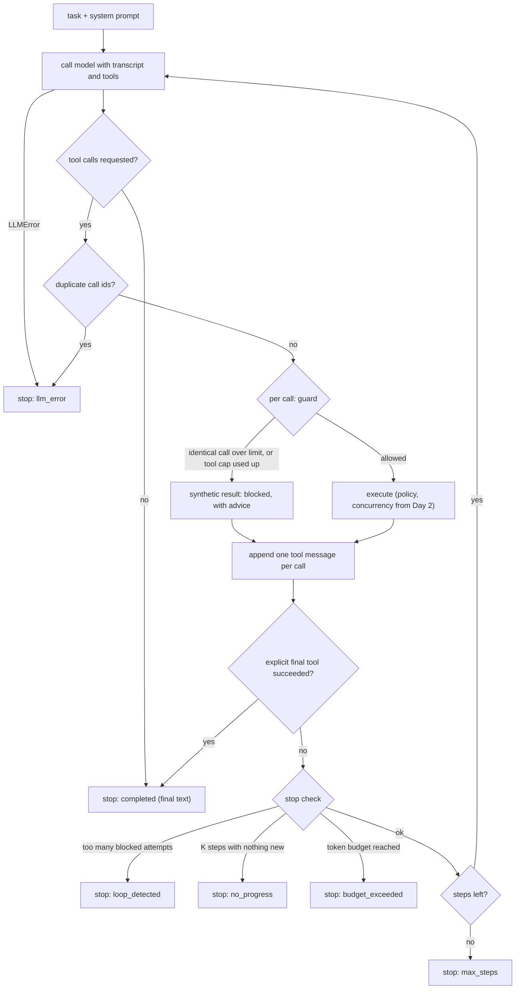
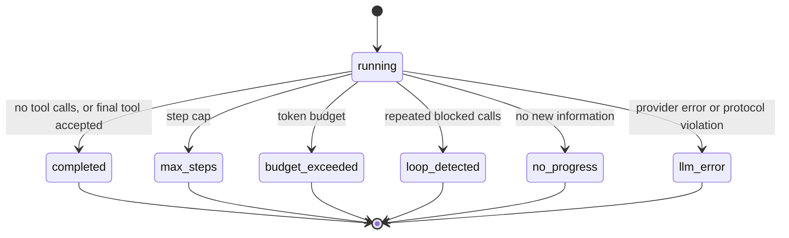

# Day 3 — Agent loops, ReAct and autonomous execution

> **Track:** Foundations · **Time:** ~40 min · **Builds on:** [Day 1](day-01-llm-apis-and-structured-outputs.md), [Day 2](day-02-tool-calling-and-function-execution.md)

## 1. Learning objectives

By the end of this lesson you will be able to:

1. Write the agent loop from memory (call the model, execute requested tools, append observations, repeat until it answers) and name the invariants it must keep.
2. Explain ReAct (Yao et al., 2022) and implement its text protocol (`Thought` / `Action` / `Action Input` / `Observation` / `Final Answer`) with a parser that survives malformed output and a model that writes its own observations.
3. Choose between native tool calling and a text protocol, and say what you lose and must rebuild when you go to text.
4. Enumerate stop conditions (answer, step cap, token budget, repeat detection, no-progress detection, per-tool caps, explicit final tool) and explain what failure each one catches that the others do not.
5. Implement a guarded loop and prove with tests that a stuck model is stopped cheaply while the baseline loop burns every step.
6. Argue concretely when a loop should *not* run autonomously.

## 2. Why this matters in real-world agent engineering

The loop is the smallest thing that deserves the word "agent", and it is where unbounded cost and unbounded behaviour come from. Typical incidents:

- **The 40-step search.** An agent can't find a runbook for a symptom. It searches "latency", then "latency spike", then "latency spike checkout", then "latency spike checkout api"; every call returns the same two irrelevant documents. Nothing is *wrong* by the standards of a loop with only `max_steps=50`. It simply spends 50 steps of a growing context before failing. The demo below replays the arithmetic on a script: eight steps for the baseline, four for the guarded loop.
- **The identical-call spin.** After one tool error the model retries the same call with the same arguments, forever, because the error text did not change its mind. Without repeat detection every iteration is a paid request that cannot produce new information.
- **The fabricated observation.** In a text protocol, a model writes `Action: get_incident ...` and then keeps generating, inventing the `Observation:` and a confident final answer. If the parser takes the whole text, the "evidence" was never fetched from anywhere.
- **The silent finish.** The model replies "I'll look into that." with no tool call. A loop that treats "no tool calls" as "done" returns that sentence as the answer of an investigation.

For the Ops Report Agent, the loop is what will let it investigate INC-1042 end to end: read the record, check metrics, find the runbook, then answer.

## 3. Mental model

> **An agent is a `while` loop around a stateless function. Each iteration the model sees the whole transcript so far, picks the next action, and the harness, not the model, decides whether it may run and whether the loop continues.**

```text
while budget remains:
    reply = model(transcript, tools)
    if reply asks for no tools: return reply          # the only "happy" exit
    for each requested tool: transcript += run(tool)  # observations are the model's only senses
```

Carry two ideas forward:

1. **The model never decides to stop *you*.** Every loop needs exits that do not depend on the model's cooperation. "Please stop if you are stuck" in a prompt is a request; a counter is a guarantee.
2. **Autonomy is a budget, not a mode.** Steps, tokens, tool calls and side effects are each a resource you grant; the loop's job is to enforce the grants and to say *which* one ran out.

## 4. Architecture and execution flow

The control flow of the guarded loop. The unguarded baseline is the same picture without the diamonds labelled *guard*.



How a run ends is data, not an exception: each exit sets `status` and, except for a clean answer, an `error` that says why.



## 5. Core concepts

### 5.1 The loop and its invariants

`common.loop.AgentLoop` (embedded below) is about forty lines of real logic. What it guarantees on every iteration:

- The transcript only grows; each model call receives all of it (statelessness from Day 1, so cost per step rises with length).
- Every tool call in an assistant message receives exactly one tool message before the next model call (Day 2).
- Termination is guaranteed by `max_steps`, plus an optional token budget checked after tools run.
- Errors from the model call are returned as a status, not raised.

Two honest caveats. The token budget is checked *after* a step, so a single step can overshoot it; a hard guarantee needs a pre-call estimate (Day 1's `guard_input`) as well. And `common.loop` has a known quirk you should not copy: it builds `RunResult(messages=messages)` and then appends to the original list, but Pydantic copies list fields at construction, so `RunResult.messages` of the baseline contains only the initial system/user messages. Use `RunResult.steps` for the baseline's trace; the loops written in this lesson assign the live list to `result.messages` after construction (reported to the course lead as a requested fix to `common`).

### 5.2 ReAct

Yao et al. propose interleaving *reasoning traces* with *actions*: the model writes a thought, takes an action, reads the observation, and thinks again. In the paper this was done by few-shot prompting a text model; the traces help the model plan and recover from surprises, and the observations ground it in external information instead of its own guesses. (The paper reports results on question answering, fact verification and interactive decision-making benchmarks; read it for the numbers rather than trusting a summary of them here.)

Modern APIs absorbed the *action* half of ReAct into native tool calling: the "Action / Action Input" lines became structured `tool_calls`. The *thought* half is optional and provider-specific: some models can emit reasoning text alongside tool calls, some have dedicated reasoning modes, and you can always ask for a short rationale in the prompt. The pattern survives even when the text protocol doesn't: *observe, then decide the next step based on what you saw*.

### 5.3 Native tool calling versus a text protocol

| | Native tool calling | Text ReAct |
|---|---|---|
| Call syntax | Separate channel, JSON arguments, call ids | Lines in free text you must parse |
| Reliability of format | Provider-supported; models are trained for it | Depends on prompt and model; needs repair paths |
| Parallel calls | Supported by the protocol | Not in the classic format (one action per turn) |
| Observation channel | `role: "tool"` messages | Usually a user-role message beginning `Observation:` |
| Works on | Endpoints that implement tools | Anything that generates text, including small local models |
| Main risks | Malformed argument JSON, wrong tool | Fabricated observations, format drift, parsing ambiguity, prompt-injection via the user role |

Use native calling when it is available and reliable for your model. Use the text protocol for models or endpoints without tool support, or when you need to inspect the exact text the model produced. The cost of the text path is everything the parser must now defend, as the tests in `test_day03.py` show. One privilege issue: a text observation is typically sent as a *user* message, which gives tool output the authority of user input; native `tool` messages are at least labelled as tool output. Treat both as untrusted (Day 18).

A production note: the classic way to prevent fabricated observations is a *stop sequence* on `Observation:` so the provider halts generation there. `common.llm`'s `chat()` does not expose stop sequences, so `parse_react` cuts the text at the first `Observation:` line client-side. That protects the transcript but not your token bill: the invented text was still generated and paid for.

### 5.4 Stop conditions: what each one catches

| Condition | Catches | Misses |
|---|---|---|
| No tool calls (implicit finish) | Normal completion | A model that stops without actually finishing |
| Explicit `submit_answer` tool | Premature stop; gives a typed, validated end state with required evidence | A model that never calls it (handle with a nudge or `max_steps`) |
| `max_steps` | Any infinite loop | Cheap-per-step waste: it fires only after every step is spent |
| Token budget | Runaway context growth and cost | A loop that is cheap per step but pointless |
| Repeat detection | Identical calls with unchanged results | The same intent with trivially different arguments |
| Per-tool call cap | One tool being hammered (search, a paid API) | Cheap loops spread across tools |
| No-progress detection | Varied calls that learn nothing new | Productive-looking but irrelevant progress (new but useless results) |
| Wall-clock deadline (Day 13, 23) | Slow tools and slow models | n/a |

Layer them. Each is a cheap counter, and they fail independently.

### 5.5 Detecting loops and stalls

Two different signals, implemented separately in `GuardedLoop`:

- **Repetition** is about *inputs*: the key is `(tool name, canonical JSON of arguments)` with sorted keys, so `{"a":1,"b":2}` and `{"b":2,"a":1}` count as the same call. The first N executions run; later ones are not executed. Instead the model receives a synthetic error that says why and what to do (change arguments, switch tool, or answer). That message is a prompt: it is the nudge. If the model keeps ignoring nudges, `max_blocked` aborts the run: nudge first, then stop.
- **Progress** is about *outputs*: a step makes progress if at least one tool call succeeded and returned content not seen before in this run (compared by hash). After K consecutive steps without progress, stop. Errors do not count as progress. This catches the wandering model that varies its arguments so repetition never triggers.

Both are heuristics with failure modes. Legitimate re-reads exist (re-querying a metric after a change); raise `max_identical_calls` for such tools. "New content" is not "useful content": a model that fetches ten different irrelevant incidents looks like progress. Semantic progress needs evaluation (Day 20). Tune thresholds on recorded runs, not on intuition.

### 5.6 Final answer patterns

1. **Implicit**: the first reply with no tool calls is the answer. Simplest, and the default in `common.loop`.
2. **Explicit tool**: the model must call `submit_answer(answer, evidence, confidence)`. The schema enforces non-empty evidence ids; an invalid submission is just another `bad_arguments` result and the run continues (tested). This turns "the model stopped talking" into a typed event. It costs an extra tool in every request and relies on the model calling it.
3. **Structured output**: run the loop with tools, then use `chat_structured` (Day 1) for a final typed report. Separates exploration from formatting; costs one more request.

Note that an explicit tool alone does not make the answer *true*: evidence ids are only checked for presence here. Verifying that each cited id was actually retrieved during the run is a natural extension (exercise 4) and the seed of grounding checks in Days 9 and 19.

### 5.7 When autonomy is a bad idea

Prefer a fixed workflow, or a human decision, when:

- the steps are known in advance (a deterministic pipeline is cheaper, faster and testable; Anthropic's "Building effective agents" makes the same argument for choosing workflows over agents when the path is predictable);
- an action is irreversible or expensive (paging leadership, rolling back production, deleting data) and there is no approval gate (Day 17);
- you cannot bound the blast radius with permissions (Day 18);
- you cannot evaluate outcomes, so you would not know whether the loop is getting better or worse (Day 20);
- latency matters more than flexibility: each loop step is a full model round trip.

A useful test: if you can write the sequence of tool calls as a function without an `if` that depends on a model's judgement, you do not need a loop.

## 6. Implementation from scratch

**Step 1 — the baseline.** Read `common/loop.py`. It is the whole idea: `messages`, a `for` over `max_steps`, `client.chat(messages, tools=schemas)`, exit when there are no tool calls, otherwise `registry.execute` for each call and append `tool_result`. It emits events (`llm_response`, `tool_result`) through a hook so a caller can watch without subclassing.

**Step 2 — the text protocol (`day03/react_text.py`).** Three pieces:

1. `parse_react(text)` is a pure function returning a `ParsedStep` of kind `action`, `final` or `invalid`. Order of operations matters: first cut at the first `Observation:` line (the harness writes observations, never the model), then look for `Final Answer:` and `Action:`; both present is invalid because it signals a model narrating a fantasy run; arguments come from `Action Input:` through the tolerant `extract_json` of Day 1, and a bad payload sets `arguments_error` (the same field `common.llm` uses for native calls) instead of raising.
2. `build_react_prompt(registry)` derives the tool list, with argument names, types, enums and optional markers, from the same Pydantic schemas as Day 2, so the text prompt cannot drift from the registry.
3. `ReActTextLoop` calls the model *without* `tools=`, keeps only the *cleaned* text in the transcript, executes the parsed action through the same `registry.execute`, and sends `Observation: ...` back. Format errors are not fatal: they come back as an observation naming the problem, bounded by `max_format_errors`.

**Step 3 — guards (`day03/guarded_loop.py`).** `GuardedLoop` re-implements the baseline loop with a `GuardConfig`. The design points to read in the code:

- `_decide` is the single place that can refuse a call, and it returns a synthetic `ToolResult` (`repeat_blocked` or `tool_cap`) so a blocked call still gets its tool message. That keeps the history valid on every exit path, which the tests assert with a helper.
- Allowed calls are executed through Day 2's `execute_batch`, so side-effect policy and concurrent reads apply unchanged; results are merged back into the model's original order.
- Progress is tracked with a set of content hashes, the stop checks run after all tool messages are appended, and each exit sets a distinct `status` (a widened `Literal`, defined by subclassing `RunResult`).
- `wrap_up=True` makes one extra tool-free call on a guard stop so the user gets "what we know so far". It is a separate field, `partial_answer`; it never populates `final_answer`, because a salvage summary is not a verified result.

**Step 4 — the explicit final tool (`day03/final_answer.py`).** One Pydantic model and one registry entry; the loop recognises the tool by name from `GuardConfig.final_tool`, and only an *accepted* call (valid arguments) ends the run.

## 7. Complete runnable code

File tree for this lesson:

```text
code/
  common/
    loop.py            # frozen baseline AgentLoop (embedded below)
  day02/               # tools reused here (ops_tools.py, execution.py)
  day03/
    __init__.py
    react_text.py      # ReAct parser, prompt builder, text loop
    guarded_loop.py    # repeat / cap / no-progress guards, wrap-up, explicit final tool
    final_answer.py    # submit_answer tool
    demo.py            # five offline sections
    test_day03.py      # 39 tests
```

Run (repository root; no key or network needed):

```bash
export PYTHONPATH=code
python -m pytest code/day03 -q
LESSON_OFFLINE=1 python -m day03.demo
```

<!-- code:begin path="code/common/loop.py" -->
**`code/common/loop.py`**

```python
"""The baseline agent loop: model -> tool calls -> observations -> model ... -> answer.

This is deliberately small. Day 3 explains it, Days 4-7 and 13 extend it, and
the capstone replaces it with a full runtime. Everything an agent "is" fits here:

    while not done:
        response = llm(messages, tools)
        if no tool calls: done
        for call in tool calls: messages += execute(call)
"""

from __future__ import annotations

from collections.abc import Callable, Sequence
from typing import Any, Literal

from pydantic import BaseModel, Field

from common.llm import LLMClient, LLMError, Message, ToolCall, Usage, system, tool_result, user
from common.tools import ToolRegistry, ToolResult

Status = Literal["completed", "max_steps", "budget_exceeded", "llm_error"]
EventHook = Callable[[dict[str, Any]], None]


class Step(BaseModel):
    index: int
    assistant: Message
    tool_results: list[tuple[ToolCall, ToolResult]] = Field(default_factory=list)
    usage: Usage = Field(default_factory=Usage)


class RunResult(BaseModel):
    status: Status
    final_answer: str | None = None
    messages: list[Message] = Field(default_factory=list)
    steps: list[Step] = Field(default_factory=list)
    usage: Usage = Field(default_factory=Usage)
    error: str | None = None

    @property
    def tool_call_count(self) -> int:
        return sum(len(s.tool_results) for s in self.steps)


class AgentLoop:
    def __init__(
        self,
        client: LLMClient,
        registry: ToolRegistry,
        system_prompt: str,
        *,
        max_steps: int = 10,
        max_total_tokens: int | None = None,
        on_event: EventHook | None = None,
    ) -> None:
        self.client = client
        self.registry = registry
        self.system_prompt = system_prompt
        self.max_steps = max_steps
        self.max_total_tokens = max_total_tokens
        self._emit = on_event or (lambda _e: None)

    def run(self, task: str, history: Sequence[Message] = ()) -> RunResult:
        messages: list[Message] = [system(self.system_prompt), *history, user(task)]
        result = RunResult(status="max_steps", messages=messages)
        schemas = self.registry.schemas() or None

        for index in range(self.max_steps):
            try:
                resp = self.client.chat(messages, tools=schemas)
            except LLMError as exc:
                result.status, result.error = "llm_error", f"{type(exc).__name__}: {exc}"
                self._emit({"type": "llm_error", "step": index, "error": result.error})
                return result

            result.usage.prompt_tokens += resp.usage.prompt_tokens
            result.usage.completion_tokens += resp.usage.completion_tokens
            step = Step(index=index, assistant=resp.message, usage=resp.usage)
            messages.append(resp.message)
            result.steps.append(step)
            self._emit({"type": "llm_response", "step": index, "tool_calls": [c.name for c in resp.tool_calls],
                        "tokens": resp.usage.total_tokens})

            if not resp.tool_calls:
                result.status, result.final_answer = "completed", resp.content
                return result

            for call in resp.tool_calls:
                outcome = self.registry.execute(call)
                step.tool_results.append((call, outcome))
                messages.append(tool_result(call, outcome.content))
                self._emit({"type": "tool_result", "step": index, "tool": call.name, "ok": outcome.ok,
                            "error_type": outcome.error_type, "duration_s": outcome.duration_s})

            if self.max_total_tokens and result.usage.total_tokens >= self.max_total_tokens:
                result.status = "budget_exceeded"
                result.error = f"token budget {self.max_total_tokens} reached ({result.usage.total_tokens} used)"
                return result

        result.error = f"no final answer within {self.max_steps} steps"
        return result
```
<!-- code:end -->

<!-- code:begin path="code/day03/react_text.py" -->
**`code/day03/react_text.py`**

```python
"""ReAct with a plain-text protocol, for models (or endpoints) without native tool calling.

Yao et al. (2022) interleave reasoning and acting as text:

    Thought: <reasoning>
    Action: <tool name>
    Action Input: <JSON object>
    Observation: <written by the HARNESS, never by the model>
    ... repeat ...
    Final Answer: <answer>

The model only ever produces text. Everything native tool calling gives you for free - a separate
channel for calls, JSON already parsed, call ids - we must rebuild: a parser, a repair path for
malformed output, and defence against the model *writing the Observation itself*.
"""

from __future__ import annotations

import json
import re
from collections.abc import Sequence
from typing import Any, Literal

from pydantic import BaseModel

from common.llm import LLMClient, LLMError, Message, ToolCall, assistant, system, user
from common.loop import RunResult, Step
from common.structured import extract_json
from common.tools import ToolRegistry

ReActStatus = Literal["completed", "max_steps", "budget_exceeded", "llm_error", "format_error"]

_OBSERVATION = re.compile(r"^\s*Observation\s*:", re.IGNORECASE | re.MULTILINE)
_FINAL = re.compile(r"^\s*Final Answer\s*:\s*(.*)", re.IGNORECASE | re.MULTILINE | re.DOTALL)
_ACTION = re.compile(r"^\s*Action\s*:\s*(.+?)\s*$", re.IGNORECASE | re.MULTILINE)
_INPUT = re.compile(r"^\s*Action Input\s*:\s*(.*)", re.IGNORECASE | re.MULTILINE | re.DOTALL)
_NEXT_SECTION = re.compile(r"^\s*(Thought|Action|Observation|Final Answer)\s*:", re.IGNORECASE | re.MULTILINE)


class ParsedStep(BaseModel):
    kind: Literal["action", "final", "invalid"]
    clean_text: str  # the model's text with any self-written Observation (and everything after) removed
    thought: str | None = None
    tool: str | None = None
    arguments: dict[str, Any] = {}
    arguments_error: str | None = None
    answer: str | None = None
    error: str | None = None


def parse_react(text: str) -> ParsedStep:
    """Parse one model turn. Never raises; malformed output becomes kind="invalid" with a reason."""
    cut = _OBSERVATION.search(text)
    clean = (text[: cut.start()] if cut else text).strip()  # the model must not author observations
    final, action = _FINAL.search(clean), _ACTION.search(clean)

    first = min((m.start() for m in (final, action) if m), default=len(clean))
    thought = re.sub(r"^\s*Thought\s*:\s*", "", clean[:first], flags=re.IGNORECASE).strip() or None

    if final and action:
        return ParsedStep(kind="invalid", clean_text=clean, thought=thought,
                          error="output contains both an Action and a Final Answer; produce exactly one")
    if final:
        answer = final.group(1).strip()
        if not answer:
            return ParsedStep(kind="invalid", clean_text=clean, thought=thought, error="Final Answer is empty")
        return ParsedStep(kind="final", clean_text=clean, thought=thought, answer=answer)
    if not action:
        return ParsedStep(kind="invalid", clean_text=clean, thought=thought,
                          error="no 'Action:' or 'Final Answer:' line found")

    tool = action.group(1).strip().strip("`'\"")
    args: dict[str, Any] = {}
    args_error: str | None = None
    after = clean[action.end():]
    inp = _INPUT.search(after)
    if inp:
        body = inp.group(1)
        nxt = _NEXT_SECTION.search(body)  # stop at a following Thought/Action line
        raw = (body[: nxt.start()] if nxt else body).strip()
        if raw:
            try:
                parsed = json.loads(extract_json(raw))
                if isinstance(parsed, dict):
                    args = parsed
                else:
                    args_error = f"Action Input must be a JSON object, got {type(parsed).__name__}"
            except json.JSONDecodeError as exc:
                args_error = f"Action Input is not valid JSON: {exc.msg} (pos {exc.pos})"
    return ParsedStep(kind="action", clean_text=clean, thought=thought, tool=tool,
                      arguments=args, arguments_error=args_error)


def _arg_summary(registry: ToolRegistry, name: str) -> str:
    schema = registry.get(name).args_model.model_json_schema()  # type: ignore[union-attr]
    required = set(schema.get("required", []))
    parts = []
    for key, prop in schema.get("properties", {}).items():
        kind = "|".join(map(str, prop["enum"])) if "enum" in prop else prop.get("type", "any")
        parts.append(f'"{key}": {kind}{"" if key in required else " (optional)"}')
    return "{" + ", ".join(parts) + "}"


def build_react_prompt(registry: ToolRegistry, role: str = "You are the Ops Report Agent.") -> str:
    tools = "\n".join(f"- {n}: {registry.get(n).description}\n  Action Input: {_arg_summary(registry, n)}"  # type: ignore[union-attr]
                      for n in registry.names())
    return (
        f"{role} Answer the user's request using these tools:\n{tools}\n\n"
        "Use EXACTLY this format, one step at a time:\n"
        "Thought: your reasoning about what to do next\n"
        "Action: one tool name from the list\n"
        "Action Input: a single JSON object\n"
        "Then STOP and wait. The system replies with a line starting 'Observation:'. Never write an Observation yourself.\n"
        "When you have enough evidence, reply with:\n"
        "Thought: I can answer now\n"
        "Final Answer: your answer, citing incident and runbook ids"
    )


class ReActResult(RunResult):
    status: ReActStatus  # type: ignore[assignment]  # widened: adds "format_error"
    format_errors: int = 0


class ReActTextLoop:
    def __init__(self, client: LLMClient, registry: ToolRegistry, *, max_steps: int = 8,
                 max_format_errors: int = 2, max_total_tokens: int | None = None) -> None:
        self.client, self.registry = client, registry
        self.max_steps, self.max_format_errors, self.max_total_tokens = max_steps, max_format_errors, max_total_tokens

    def run(self, task: str, history: Sequence[Message] = ()) -> ReActResult:
        messages: list[Message] = [system(build_react_prompt(self.registry)), *history, user(task)]
        result = ReActResult(status="max_steps")
        result.messages = messages  # Pydantic copies list fields at construction; share the live list instead
        for index in range(self.max_steps):
            try:
                resp = self.client.chat(messages)  # no `tools=`: this path works without native tool calling
            except LLMError as exc:
                result.status, result.error = "llm_error", f"{type(exc).__name__}: {exc}"
                return result
            result.usage.prompt_tokens += resp.usage.prompt_tokens
            result.usage.completion_tokens += resp.usage.completion_tokens

            parsed = parse_react(resp.content)
            # History keeps only the cleaned text, so an invented Observation never becomes "evidence".
            turn = assistant(parsed.clean_text or "(empty reply)")
            step = Step(index=index, assistant=turn, usage=resp.usage)
            result.steps.append(step)
            messages.append(turn)

            if parsed.kind == "final":
                result.status, result.final_answer = "completed", parsed.answer
                return result
            if parsed.kind == "invalid":
                result.format_errors += 1
                if result.format_errors > self.max_format_errors:
                    result.status, result.error = "format_error", f"unparseable output: {parsed.error}"
                    return result
                messages.append(user(f"Observation: format error - {parsed.error}. Reply using the exact format."))
                continue

            call = ToolCall(id=f"react-{index}", name=parsed.tool or "", arguments=parsed.arguments,
                            arguments_error=parsed.arguments_error)
            outcome = self.registry.execute(call)
            step.tool_results.append((call, outcome))
            messages.append(user(f"Observation: {outcome.content}"))

            if self.max_total_tokens and result.usage.total_tokens >= self.max_total_tokens:
                result.status = "budget_exceeded"
                result.error = f"token budget {self.max_total_tokens} reached ({result.usage.total_tokens} used)"
                return result
        result.error = f"no final answer within {self.max_steps} steps"
        return result
```
<!-- code:end -->

<!-- code:begin path="code/day03/guarded_loop.py" -->
**`code/day03/guarded_loop.py`**

```python
"""`common.loop.AgentLoop` plus the guards a production loop needs.

`AgentLoop` stops for three reasons: the model answers, `max_steps`, or a token budget. A model that is
stuck inside those limits - same search again and again, or ten different searches that all return nothing -
burns every step before anyone notices. This loop adds:

  * repeat-call detection   identical (tool, arguments) beyond N executions is blocked, not run
  * per-tool call caps      e.g. at most 3 `search_runbooks` per run
  * no-progress detection   K consecutive steps that produced no *new* successful information stop the run
  * an abort threshold      after M blocked attempts the nudges are clearly not working: stop
  * an optional explicit final tool, and an optional tool-free wrap-up call for a partial answer

Invariant kept on every exit path: each assistant `tool_calls` id has exactly one tool message, so the
returned history is always a valid conversation (resumable on Day 5, replayable on Day 22).
"""

from __future__ import annotations

import hashlib
import json
from collections import Counter
from collections.abc import Callable, Sequence
from typing import Any, Literal

from day02.execution import execute_batch
from pydantic import BaseModel, Field

from common.llm import LLMClient, LLMError, Message, ToolCall, system, tool_result, user
from common.loop import RunResult, Step
from common.tools import SideEffect, ToolRegistry, ToolResult

GuardedStatus = Literal[
    "completed", "max_steps", "budget_exceeded", "llm_error", "loop_detected", "no_progress"
]
EventHook = Callable[[dict[str, Any]], None]


class GuardConfig(BaseModel):
    max_steps: int = Field(default=10, ge=1)
    max_total_tokens: int | None = Field(default=None, ge=1)
    max_identical_calls: int = Field(default=2, ge=1, description="Executions allowed per identical (tool, args)")
    max_calls_per_tool: dict[str, int] = Field(default_factory=dict)
    max_blocked: int = Field(default=3, ge=1, description="Blocked attempts tolerated before the run is aborted")
    no_progress_steps: int = Field(default=3, ge=1)
    allow_side_effects: tuple[SideEffect, ...] = ("read",)
    final_tool: str | None = None
    wrap_up: bool = False


class GuardedRunResult(RunResult):
    status: GuardedStatus  # type: ignore[assignment]  # widened: adds loop_detected / no_progress
    blocked: int = 0
    executed_by_tool: dict[str, int] = Field(default_factory=dict)
    partial_answer: str | None = None


def _blocked(reason: str, message: str) -> ToolResult:
    return ToolResult(ok=False, error_type=reason, content=f"Error: {message}")


def _call_key(call: ToolCall) -> str:
    return f"{call.name}:{json.dumps(call.arguments, sort_keys=True, default=str)}"


def _digest(text: str) -> str:
    return hashlib.sha256(text.encode()).hexdigest()


class GuardedLoop:
    def __init__(self, client: LLMClient, registry: ToolRegistry, system_prompt: str,
                 config: GuardConfig | None = None, on_event: EventHook | None = None) -> None:
        self.client, self.registry, self.system_prompt = client, registry, system_prompt
        self.config = config or GuardConfig()
        self._emit = on_event or (lambda _e: None)

    # ------------------------------------------------------------------ guards
    def _decide(self, call: ToolCall, attempts: Counter[str], executed: Counter[str]) -> ToolResult | None:
        """Return a synthetic result if the call must NOT run, else None (and count it as scheduled)."""
        cfg = self.config
        key = _call_key(call)
        attempts[key] += 1
        if attempts[key] > cfg.max_identical_calls:
            return _blocked("repeat_blocked", f"you already called '{call.name}' with exactly these arguments "
                            f"{cfg.max_identical_calls} times and the result will not change. Change the arguments, "
                            "use a different tool, or give your final answer with what you have.")
        cap = cfg.max_calls_per_tool.get(call.name)
        if cap is not None and executed[call.name] >= cap:
            return _blocked("tool_cap", f"call budget for '{call.name}' ({cap}) is used up. "
                            "Work with the evidence you have and answer.")
        executed[call.name] += 1
        return None

    def _run_calls(self, calls: Sequence[ToolCall], attempts: Counter[str], executed: Counter[str]
                   ) -> tuple[list[ToolResult], list[bool]]:
        results: list[ToolResult | None] = [None] * len(calls)
        to_run: list[int] = []
        for i, call in enumerate(calls):
            results[i] = self._decide(call, attempts, executed)
            if results[i] is None:
                to_run.append(i)
        if to_run:
            ran = execute_batch(self.registry, [calls[i] for i in to_run], allow=self.config.allow_side_effects)
            for i, res in zip(to_run, ran, strict=True):
                results[i] = res
        was_blocked = [i not in to_run for i in range(len(calls))]
        return [r for r in results if r is not None], was_blocked

    # --------------------------------------------------------------------- run
    def run(self, task: str, history: Sequence[Message] = ()) -> GuardedRunResult:
        cfg = self.config
        messages: list[Message] = [system(self.system_prompt), *history, user(task)]
        result = GuardedRunResult(status="max_steps")
        result.messages = messages  # Pydantic copies list fields at construction; share the live list instead
        schemas = self.registry.schemas() or None
        attempts: Counter[str] = Counter()
        executed: Counter[str] = Counter()
        seen: set[str] = set()
        stale_steps = 0

        for index in range(cfg.max_steps):
            try:
                resp = self.client.chat(messages, tools=schemas)
            except LLMError as exc:
                result.status, result.error = "llm_error", f"{type(exc).__name__}: {exc}"
                return result
            result.usage.prompt_tokens += resp.usage.prompt_tokens
            result.usage.completion_tokens += resp.usage.completion_tokens
            step = Step(index=index, assistant=resp.message, usage=resp.usage)
            messages.append(resp.message)
            result.steps.append(step)
            self._emit({"type": "llm_response", "step": index, "tool_calls": [c.name for c in resp.tool_calls]})

            if not resp.tool_calls:
                result.status, result.final_answer = "completed", resp.content
                return result

            ids = [c.id for c in resp.tool_calls]
            if len(set(ids)) != len(ids):  # cannot answer ambiguous ids; history would be invalid
                result.status, result.error = "llm_error", f"protocol violation: duplicate tool call ids {ids}"
                return result

            outcomes, blocked_flags = self._run_calls(resp.tool_calls, attempts, executed)
            made_progress = False
            for call, outcome, was_blocked in zip(resp.tool_calls, outcomes, blocked_flags, strict=True):
                step.tool_results.append((call, outcome))
                messages.append(tool_result(call, outcome.content))
                result.blocked += was_blocked
                digest = _digest(outcome.content)
                if outcome.ok and digest not in seen:
                    made_progress = True
                    seen.add(digest)
                self._emit({"type": "tool_result", "step": index, "tool": call.name, "ok": outcome.ok,
                            "error_type": outcome.error_type, "blocked": was_blocked})
                if cfg.final_tool and call.name == cfg.final_tool and outcome.ok:
                    result.status, result.final_answer = "completed", str(call.arguments.get("answer", ""))
            result.executed_by_tool = dict(executed)
            if result.status == "completed":
                return result

            stale_steps = 0 if made_progress else stale_steps + 1
            reason: tuple[GuardedStatus, str] | None = None
            if result.blocked >= cfg.max_blocked:
                reason = ("loop_detected", f"{result.blocked} blocked repeat/cap attempts: the model is not changing course")
            elif stale_steps >= cfg.no_progress_steps:
                reason = ("no_progress", f"{stale_steps} consecutive steps produced no new successful result")
            elif cfg.max_total_tokens and result.usage.total_tokens >= cfg.max_total_tokens:
                reason = ("budget_exceeded", f"token budget {cfg.max_total_tokens} reached ({result.usage.total_tokens} used)")
            if reason:
                result.status, result.error = reason
                self._emit({"type": "guard_stop", "step": index, "status": reason[0], "detail": reason[1]})
                return self._wrap_up(result, messages)

        result.error = f"no final answer within {cfg.max_steps} steps"
        return self._wrap_up(result, messages)

    def _wrap_up(self, result: GuardedRunResult, messages: list[Message]) -> GuardedRunResult:
        """One tool-free call asking for what is known so far. Costs a request; off by default."""
        if not self.config.wrap_up:
            return result
        try:
            resp = self.client.chat([*messages, user(
                "Stop calling tools. In a few sentences, state what you established, cite ids, and say what remains unknown."
            )])
        except LLMError as exc:
            result.error = f"{result.error}; wrap-up failed: {type(exc).__name__}: {exc}"
            return result
        result.usage.prompt_tokens += resp.usage.prompt_tokens
        result.usage.completion_tokens += resp.usage.completion_tokens
        result.partial_answer = resp.content
        return result
```
<!-- code:end -->

<!-- code:begin path="code/day03/final_answer.py" -->
**`code/day03/final_answer.py`**

```python
"""An explicit "final answer" tool: the run ends when the model *submits*, not when it merely stops calling tools.

Implicit finish (no tool calls = done) is the default in `common.loop`. Its weakness: a model that simply
runs out of things to say, or emits a polite refusal, looks identical to a finished investigation. An explicit
submit tool gives the harness a validated, typed end state (and a place to demand evidence).
"""

from __future__ import annotations

from typing import Literal

from pydantic import BaseModel, ConfigDict, Field

from common.tools import ToolRegistry

FINAL_TOOL = "submit_answer"


class SubmitAnswerArgs(BaseModel):
    model_config = ConfigDict(extra="forbid")

    answer: str = Field(min_length=20, description="The complete answer for the on-call engineer.")
    evidence: list[str] = Field(
        min_length=1,
        description="Ids that support the answer, e.g. ['INC-1042', 'rb-deploy-rollback']. Required.",
    )
    confidence: Literal["low", "medium", "high"]


def add_final_tool(registry: ToolRegistry) -> ToolRegistry:
    @registry.tool(
        FINAL_TOOL,
        "Call exactly once when the investigation is complete, with the answer and the ids that support it. "
        "Do not write the answer as plain text instead.",
        SubmitAnswerArgs,
    )
    def submit_answer(answer: str, evidence: list[str], confidence: str) -> str:
        return f"Answer recorded with {len(evidence)} evidence id(s), confidence {confidence}."

    return registry
```
<!-- code:end -->

<!-- code:begin path="code/day03/demo.py" -->
**`code/day03/demo.py`**

```python
"""Day 3 demo: investigate INC-1042 three ways, then watch the guards stop two stuck agents. Offline.

    PYTHONPATH=code LESSON_OFFLINE=1 python -m day03.demo

The "models" are scripts, so this shows the *mechanics* of loops and guards - not how a real model
behaves. Token numbers come from ScriptedLLM's rough estimate (characters / 4), not a real tokenizer.
With LLM_API_KEY set (and LESSON_OFFLINE unset) sections 1-2 call a real model instead of the script.
"""

from __future__ import annotations

from day02.ops_tools import build_registry

from common.llm import Message, ScriptedLLM, ToolCall, get_client
from common.loop import AgentLoop
from day03.final_answer import FINAL_TOOL, add_final_tool
from day03.guarded_loop import GuardConfig, GuardedLoop
from day03.react_text import ReActTextLoop

TASK = "Investigate INC-1042: what happened, what does the data show, and which runbook applies?"
SYSTEM = "You are the Ops Report Agent. Use tools for facts; stop and answer once you have enough evidence."
ANSWER = (
    "INC-1042 (SEV1, checkout-api): error rate rose to 31% after release v2026.03.04-1 (peak minute 25 in the "
    "metrics window). Root cause per the record: an unindexed query saturated the DB connection pool. "
    "Follow rb-deploy-rollback, then rb-db-connection-pool."
)


def banner(title: str) -> None:
    print(f"\n=== {title} ===")


def native_script() -> list[object]:
    return [
        Message(role="assistant", tool_calls=[
            ToolCall(id="n1", name="get_incident", arguments={"incident_id": "INC-1042"}),
            ToolCall(id="n2", name="query_metrics", arguments={"service": "checkout-api", "metric": "error_rate"}),
        ]),
        ScriptedLLM.tool_call("search_runbooks", "n3", query="deploy rollback connection pool"),
        ANSWER,
    ]


def react_script() -> list[object]:
    return [
        # The model invents its own Observation: the parser must discard it.
        'Thought: I need the incident record first.\nAction: get_incident\nAction Input: {"incident_id": "INC-1042"}\n'
        "Observation: INC-1042 was a DNS outage.",
        "I will look at metrics now.",  # no Action line: a format error, repaired by feedback
        'Thought: check the error rate.\nAction: query_metrics\n'
        'Action Input: ```json\n{"service": "checkout-api", "metric": "error_rate"}\n```',
        'Thought: find the procedure.\nAction: search_runbooks\nAction Input: {"query": "deploy rollback"}',
        f"Thought: I can answer now.\nFinal Answer: {ANSWER}",
    ]


def show_events(event: dict) -> None:
    if event["type"] == "llm_response":
        print(f"  step {event['step']}: model requested {event['tool_calls'] or 'a final answer'}")
    elif event["type"] == "tool_result":
        extra = " (BLOCKED)" if event.get("blocked") else ""
        print(f"    {event['tool']:<16} ok={event['ok']} {event.get('error_type') or ''}{extra}")


def main() -> None:
    reg = build_registry()

    banner("1. Native tool-calling loop (common.loop.AgentLoop)")
    res = AgentLoop(get_client(native_script()), reg, SYSTEM, max_steps=6, on_event=show_events).run(TASK)
    print(f"status={res.status} steps={len(res.steps)} tool_calls={res.tool_call_count} tokens~{res.usage.total_tokens}")
    print("answer:", res.final_answer)

    banner("2. Text ReAct loop (no native tool calling)")
    react = ReActTextLoop(get_client(react_script()), reg).run(TASK)
    for m in react.messages[1:]:
        print(f"  [{m.role:<9}] {(m.content or '')[:96]!r}")
    print(f"status={react.status} steps={len(react.steps)} format_errors={react.format_errors}")
    leaked = any("DNS outage" in (m.content or "") for m in react.messages)
    print("model-invented Observation present in history:", leaked)

    banner("3. A stuck model: same search forever")
    stuck = [ScriptedLLM.tool_call("search_runbooks", f"s{i}", query="latency spike") for i in range(8)]
    base = AgentLoop(ScriptedLLM(stuck), build_registry(), SYSTEM, max_steps=8).run(TASK)
    print(f"AgentLoop   : status={base.status:<14} steps={len(base.steps)} tool executions={base.tool_call_count} "
          f"tokens~{base.usage.total_tokens}")
    guarded = GuardedLoop(ScriptedLLM(stuck), build_registry(), SYSTEM, GuardConfig(max_steps=8, max_blocked=2),
                          on_event=show_events).run(TASK)
    print(f"GuardedLoop : status={guarded.status:<14} steps={len(guarded.steps)} "
          f"tool executions={sum(guarded.executed_by_tool.values())} blocked={guarded.blocked} tokens~{guarded.usage.total_tokens}")
    print("detail:", guarded.error)

    banner("4. A wandering model: different queries, nothing new learned")
    wander = [ScriptedLLM.tool_call("search_runbooks", f"w{i}", query=f"zzqx{i} unknownterm") for i in range(4)]
    wander.append("So far no runbook matched my keyword searches; the incident id and service are still unconfirmed.")
    res = GuardedLoop(ScriptedLLM(wander), build_registry(), SYSTEM,
                      GuardConfig(max_steps=8, no_progress_steps=3, wrap_up=True)).run(TASK)
    print(f"status={res.status} steps={len(res.steps)} executed={res.executed_by_tool}")
    print("detail:", res.error)
    print("partial answer from wrap-up call:", res.partial_answer)

    banner("5. Per-tool cap, then an explicit final answer")
    capped_reg = add_final_tool(build_registry())
    script = [
        ScriptedLLM.tool_call("search_runbooks", "k1", query="deploy rollback"),
        ScriptedLLM.tool_call("search_runbooks", "k2", query="connection pool"),
        ScriptedLLM.tool_call("search_runbooks", "k3", query="queue backlog"),
        ScriptedLLM.tool_call(FINAL_TOOL, "k4", answer=ANSWER, evidence=["INC-1042", "rb-deploy-rollback"], confidence="medium"),
    ]
    cfg = GuardConfig(max_calls_per_tool={"search_runbooks": 2}, final_tool=FINAL_TOOL)
    res = GuardedLoop(ScriptedLLM(script), capped_reg, SYSTEM, cfg, on_event=show_events).run(TASK)
    third = next(r for s in res.steps for c, r in s.tool_results if c.id == "k3")
    print(f"status={res.status} blocked={res.blocked} executed={res.executed_by_tool}")
    print("model saw for the 3rd search:", third.content)


if __name__ == "__main__":
    main()
```
<!-- code:end -->

<!-- code:begin path="code/day03/test_day03.py" -->
**`code/day03/test_day03.py`**

```python
"""Day 3 tests: ReAct text parsing/loop, and every guard in GuardedLoop (plus the baseline's blind spot)."""

from __future__ import annotations

import pytest
from day02.ops_tools import TicketStore, build_registry
from pydantic import BaseModel

from common.llm import Message, PermanentLLMError, ScriptedLLM, ToolCall, TransientLLMError
from common.loop import AgentLoop
from common.tools import ToolRegistry
from day03.final_answer import FINAL_TOOL, add_final_tool
from day03.guarded_loop import GuardConfig, GuardedLoop
from day03.react_text import ReActTextLoop, build_react_prompt, parse_react

SYS = "You are the Ops Report Agent."
LONG_ANSWER = "INC-1042 was caused by an unindexed query after the release; follow rb-deploy-rollback."


def tc(name: str, call_id: str, **args: object) -> Message:
    return ScriptedLLM.tool_call(name, call_id, **args)


def history_is_valid(messages: list[Message]) -> bool:
    """Every assistant tool_call id has exactly one tool message, and no tool message is orphaned."""
    wanted = [c.id for m in messages if m.role == "assistant" for c in (m.tool_calls or [])]
    got = [m.tool_call_id for m in messages if m.role == "tool"]
    return sorted(wanted) == sorted(got)


# ============================================================ ReAct parsing
def test_parse_action_with_json_input() -> None:
    p = parse_react('Thought: need the record\nAction: get_incident\nAction Input: {"incident_id": "INC-1042"}')
    assert (p.kind, p.tool, p.arguments, p.thought) == ("action", "get_incident", {"incident_id": "INC-1042"}, "need the record")


def test_parse_final_answer_multiline() -> None:
    p = parse_react("Thought: done\nFinal Answer: Line one.\nLine two.")
    assert p.kind == "final" and p.answer == "Line one.\nLine two."


def test_model_written_observation_is_cut_off() -> None:
    p = parse_react('Action: get_incident\nAction Input: {"incident_id": "INC-1042"}\nObservation: it was DNS\nFinal Answer: DNS')
    assert p.kind == "action"  # the fabricated Final Answer after the fake Observation is discarded too
    assert "DNS" not in p.clean_text


def test_action_and_final_together_is_invalid() -> None:
    p = parse_react('Action: get_incident\nAction Input: {}\nFinal Answer: done already')
    assert p.kind == "invalid" and "both" in (p.error or "")


@pytest.mark.parametrize("text", ["I think the answer is 42.", "", "Thought: hmm"])
def test_no_action_or_final_is_invalid(text: str) -> None:
    assert parse_react(text).kind == "invalid"


def test_empty_final_answer_is_invalid() -> None:
    assert parse_react("Final Answer:   ").kind == "invalid"


def test_fenced_and_prose_wrapped_json_input() -> None:
    p = parse_react('Action: query_metrics\nAction Input: ```json\n{"service": "checkout-api", "metric": "cpu_pct"}\n```')
    assert p.arguments == {"service": "checkout-api", "metric": "cpu_pct"} and p.arguments_error is None


def test_bad_json_input_sets_arguments_error_not_exception() -> None:
    p = parse_react('Action: get_incident\nAction Input: {"incident_id": ')
    assert p.kind == "action" and p.arguments == {} and "not valid JSON" in (p.arguments_error or "")


def test_non_object_input_is_reported() -> None:
    p = parse_react('Action: get_incident\nAction Input: ["INC-1042"]')
    assert "must be a JSON object" in (p.arguments_error or "")


def test_tool_name_is_unquoted_and_input_stops_at_next_thought() -> None:
    p = parse_react('Action: `get_incident`\nAction Input: {"incident_id": "INC-1042"}\nThought: next')
    assert p.tool == "get_incident" and p.arguments == {"incident_id": "INC-1042"}


def test_prompt_lists_every_tool_with_argument_shapes() -> None:
    prompt = build_react_prompt(build_registry())
    for name in ("get_incident", "search_runbooks", "query_metrics", "create_ticket"):
        assert f"- {name}:" in prompt
    assert '"metric": error_rate|p95_latency_ms|cpu_pct' in prompt
    assert '"limit": integer (optional)' in prompt


# ============================================================ ReAct loop
def _react_happy() -> list[str]:
    return [
        'Thought: record\nAction: get_incident\nAction Input: {"incident_id": "INC-1042"}\nObservation: DNS outage',
        'Thought: runbook\nAction: search_runbooks\nAction Input: {"query": "deploy rollback"}',
        f"Thought: done\nFinal Answer: {LONG_ANSWER}",
    ]


def test_react_loop_completes_and_observations_come_from_the_harness() -> None:
    llm = ScriptedLLM(_react_happy())
    res = ReActTextLoop(llm, build_registry()).run("Investigate INC-1042")
    assert res.status == "completed" and res.final_answer == LONG_ANSWER
    assert len(llm.calls) == 3 and all(c["tools"] is None for c in llm.calls)  # no native tools used
    obs = [m.content for m in res.messages if m.role == "user" and (m.content or "").startswith("Observation:")]
    assert len(obs) == 2 and "Checkout API 5xx spike" in obs[0]
    assert not any("DNS outage" in (m.content or "") for m in res.messages)


def test_react_loop_recovers_from_one_format_error() -> None:
    script = ["Let me think.", *_react_happy()]
    res = ReActTextLoop(ScriptedLLM(script), build_registry()).run("t")
    assert res.status == "completed" and res.format_errors == 1
    assert "format error" in (res.messages[3].content or "")


def test_react_loop_gives_up_after_too_many_format_errors() -> None:
    llm = ScriptedLLM(["hmm"] * 5)
    res = ReActTextLoop(llm, build_registry(), max_format_errors=2).run("t")
    assert res.status == "format_error" and res.format_errors == 3 and len(llm.calls) == 3


def test_react_unknown_tool_and_bad_args_become_observations() -> None:
    script = ['Action: nope\nAction Input: {}', 'Action: get_incident\nAction Input: {"incident_id": ', "Final Answer: cannot proceed"]
    res = ReActTextLoop(ScriptedLLM(script), build_registry()).run("t")
    obs = [m.content for m in res.messages if (m.content or "").startswith("Observation:")]
    assert "unknown tool 'nope'" in obs[0] and "could not parse arguments" in obs[1]
    assert res.status == "completed"


def test_react_max_steps_and_budget_and_llm_error() -> None:
    action = 'Action: search_runbooks\nAction Input: {"query": "queue"}'
    assert ReActTextLoop(ScriptedLLM([action] * 3), build_registry(), max_steps=3).run("t").status == "max_steps"
    budget = ReActTextLoop(ScriptedLLM([action] * 3), build_registry(), max_total_tokens=1).run("t")
    assert budget.status == "budget_exceeded" and len(budget.steps) == 1
    err = ReActTextLoop(ScriptedLLM([TransientLLMError("boom")]), build_registry()).run("t")
    assert err.status == "llm_error" and "boom" in (err.error or "")


# ================================================== baseline loop's blind spot
def test_baseline_loop_happily_repeats_a_stuck_call_until_max_steps() -> None:
    stuck = [tc("search_runbooks", f"s{i}", query="latency") for i in range(6)]
    res = AgentLoop(ScriptedLLM(stuck), build_registry(), SYS, max_steps=6).run("t")
    assert res.status == "max_steps" and res.tool_call_count == 6


# ============================================================= guarded loop
class Counting(BaseModel):
    q: str


def counting_registry() -> tuple[ToolRegistry, list[str]]:
    reg, calls = ToolRegistry(), []

    @reg.tool("lookup", "look something up", Counting)
    def lookup(q: str) -> str:
        calls.append(q)
        return f"result for {q}"

    return reg, calls


def test_guarded_matches_baseline_on_the_happy_path() -> None:
    script = [tc("get_incident", "a", incident_id="INC-1042"), LONG_ANSWER]
    res = GuardedLoop(ScriptedLLM(script), build_registry(), SYS).run("t")
    assert (res.status, res.final_answer, len(res.steps), res.blocked) == ("completed", LONG_ANSWER, 2, 0)
    assert history_is_valid(res.messages) and res.messages[-1].content == LONG_ANSWER


def test_identical_call_is_blocked_not_executed() -> None:
    reg, executions = counting_registry()
    script = [tc("lookup", f"c{i}", q="same") for i in range(3)] + [LONG_ANSWER]
    res = GuardedLoop(ScriptedLLM(script), reg, SYS, GuardConfig(max_identical_calls=2, max_blocked=5, no_progress_steps=9)).run("t")
    assert executions == ["same", "same"]  # third attempt never reached the tool
    assert res.status == "completed" and res.blocked == 1
    blocked = [r for s in res.steps for _, r in s.tool_results if r.error_type == "repeat_blocked"]
    assert len(blocked) == 1 and "exactly these arguments" in blocked[0].content


def test_argument_order_does_not_defeat_repeat_detection() -> None:
    llm = ScriptedLLM([
        tc("query_metrics", "a", service="checkout-api", metric="cpu_pct"),
        tc("query_metrics", "b", metric="cpu_pct", service="checkout-api"),
        tc("query_metrics", "c", metric="cpu_pct", service="checkout-api"),
        LONG_ANSWER,
    ])
    res = GuardedLoop(llm, build_registry(), SYS, GuardConfig(no_progress_steps=9, max_blocked=9)).run("t")
    assert res.blocked == 1 and res.executed_by_tool == {"query_metrics": 2}


def test_repeated_blocking_aborts_with_loop_detected() -> None:
    reg, executions = counting_registry()
    stuck = [tc("lookup", f"c{i}", q="same") for i in range(10)]
    res = GuardedLoop(ScriptedLLM(stuck), reg, SYS, GuardConfig(max_steps=10, max_blocked=3, no_progress_steps=9)).run("t")
    assert res.status == "loop_detected" and res.blocked == 3 and len(executions) == 2
    assert len(res.steps) == 5 < 10
    assert history_is_valid(res.messages)


def test_per_tool_cap_blocks_even_with_different_arguments() -> None:
    reg, executions = counting_registry()
    script = [tc("lookup", f"c{i}", q=f"q{i}") for i in range(3)] + [LONG_ANSWER]
    res = GuardedLoop(ScriptedLLM(script), reg, SYS, GuardConfig(max_calls_per_tool={"lookup": 2}, max_blocked=9)).run("t")
    assert executions == ["q0", "q1"] and res.blocked == 1 and res.status == "completed"
    capped = [r for s in res.steps for _, r in s.tool_results if r.error_type == "tool_cap"]
    assert "(2) is used up" in capped[0].content


def test_no_progress_detects_varied_calls_that_learn_nothing() -> None:
    script = [tc("search_runbooks", f"w{i}", query=f"zzqx{i} nothing") for i in range(8)]
    res = GuardedLoop(ScriptedLLM(script), build_registry(), SYS, GuardConfig(max_steps=8, no_progress_steps=3)).run("t")
    assert res.status == "no_progress" and len(res.steps) == 4  # 1 new "[]" result, then 3 stale steps
    assert res.blocked == 0  # nothing was repeated, so only this guard could catch it


def test_new_information_resets_the_no_progress_counter() -> None:
    script = [
        tc("search_runbooks", "a", query="zzqx"), tc("search_runbooks", "b", query="zzqy"),
        tc("get_incident", "c", incident_id="INC-1042"),  # new info resets
        tc("search_runbooks", "d", query="zzqz"), tc("search_runbooks", "e", query="zzqw"),
        LONG_ANSWER,
    ]
    res = GuardedLoop(ScriptedLLM(script), build_registry(), SYS, GuardConfig(no_progress_steps=3)).run("t")
    assert res.status == "completed"


def test_errors_are_not_progress() -> None:
    script = [tc("get_incident", f"e{i}", incident_id=f"INC-000{i}") for i in range(6)]
    res = GuardedLoop(ScriptedLLM(script), build_registry(), SYS, GuardConfig(no_progress_steps=3)).run("t")
    assert res.status == "no_progress" and len(res.steps) == 3


def test_wrap_up_returns_partial_answer_without_tools() -> None:
    script = [tc("search_runbooks", f"w{i}", query=f"zzqx{i}") for i in range(4)] + ["Nothing matched; incident unknown."]
    llm = ScriptedLLM(script)
    res = GuardedLoop(llm, build_registry(), SYS, GuardConfig(no_progress_steps=3, wrap_up=True)).run("t")
    assert res.status == "no_progress" and res.partial_answer == "Nothing matched; incident unknown."
    assert llm.calls[-1]["tools"] is None and (llm.calls[-1]["messages"][-1].content or "").startswith("Stop calling tools")
    assert res.final_answer is None  # a partial answer is not a final answer


def test_wrap_up_failure_is_recorded_not_raised() -> None:
    script = [tc("search_runbooks", f"w{i}", query=f"zzqx{i}") for i in range(4)] + [TransientLLMError("down")]
    res = GuardedLoop(ScriptedLLM(script), build_registry(), SYS, GuardConfig(no_progress_steps=3, wrap_up=True)).run("t")
    assert res.status == "no_progress" and "wrap-up failed" in (res.error or "") and res.partial_answer is None


def test_max_steps_exit_keeps_history_valid() -> None:
    script = [tc("get_incident", f"g{i}", incident_id="INC-1042" if i % 2 else "INC-1051") for i in range(3)]
    res = GuardedLoop(ScriptedLLM(script), build_registry(), SYS, GuardConfig(max_steps=3, no_progress_steps=9)).run("t")
    assert res.status == "max_steps" and "no final answer within 3 steps" in (res.error or "")
    assert history_is_valid(res.messages)


def test_token_budget_stops_the_run() -> None:
    script = [tc("get_incident", "a", incident_id="INC-1042"), LONG_ANSWER]
    res = GuardedLoop(ScriptedLLM(script), build_registry(), SYS, GuardConfig(max_total_tokens=10)).run("t")
    assert res.status == "budget_exceeded" and len(res.steps) == 1


def test_llm_error_is_reported_with_type() -> None:
    res = GuardedLoop(ScriptedLLM([PermanentLLMError("bad key")]), build_registry(), SYS).run("t")
    assert res.status == "llm_error" and res.error == "PermanentLLMError: bad key"


def test_duplicate_call_ids_abort_without_executing() -> None:
    msg = Message(role="assistant", tool_calls=[
        ToolCall(id="dup", name="get_incident", arguments={"incident_id": "INC-1042"}),
        ToolCall(id="dup", name="get_incident", arguments={"incident_id": "INC-1051"}),
    ])
    res = GuardedLoop(ScriptedLLM([msg]), build_registry(), SYS).run("t")
    assert res.status == "llm_error" and "duplicate tool call ids" in (res.error or "") and res.executed_by_tool == {}


def test_blocked_and_executed_calls_in_one_parallel_turn_keep_order() -> None:
    reg, executions = counting_registry()
    two = Message(role="assistant", tool_calls=[
        ToolCall(id="x1", name="lookup", arguments={"q": "a"}),
        ToolCall(id="x2", name="lookup", arguments={"q": "b"}),
    ])
    cfg = GuardConfig(max_calls_per_tool={"lookup": 1}, max_blocked=9, no_progress_steps=9)
    res = GuardedLoop(ScriptedLLM([two, LONG_ANSWER]), reg, SYS, cfg).run("t")
    tool_msgs = [m for m in res.messages if m.role == "tool"]
    assert [m.tool_call_id for m in tool_msgs] == ["x1", "x2"]
    assert tool_msgs[0].content == "result for a" and tool_msgs[1].content.startswith("Error: call budget")
    assert executions == ["a"]


def test_writes_are_denied_by_default_policy_and_allowed_when_granted() -> None:
    args = {"title": "Add index on orders", "severity": "SEV2", "idempotency_key": "inc-1042-index"}
    store = TicketStore()
    denied = GuardedLoop(ScriptedLLM([tc("create_ticket", "t1", **args), LONG_ANSWER]), build_registry(store), SYS).run("t")
    assert store.executions == 0
    assert denied.steps[0].tool_results[0][1].error_type == "denied"
    GuardedLoop(ScriptedLLM([tc("create_ticket", "t1", **args), LONG_ANSWER]), build_registry(store), SYS,
                GuardConfig(allow_side_effects=("read", "write"))).run("t")
    assert store.executions == 1


def test_explicit_final_tool_ends_the_run_with_validated_answer() -> None:
    reg = add_final_tool(build_registry())
    submit = tc(FINAL_TOOL, "f1", answer=LONG_ANSWER, evidence=["INC-1042"], confidence="high")
    llm = ScriptedLLM([submit, "never reached"])
    res = GuardedLoop(llm, reg, SYS, GuardConfig(final_tool=FINAL_TOOL)).run("t")
    assert res.status == "completed" and res.final_answer == LONG_ANSWER and len(llm.calls) == 1
    assert history_is_valid(res.messages)


def test_invalid_final_submission_does_not_end_the_run() -> None:
    reg = add_final_tool(build_registry())
    bad = tc(FINAL_TOOL, "f1", answer=LONG_ANSWER, evidence=[], confidence="high")
    good = tc(FINAL_TOOL, "f2", answer=LONG_ANSWER, evidence=["INC-1042"], confidence="high")
    res = GuardedLoop(ScriptedLLM([bad, good]), reg, SYS, GuardConfig(final_tool=FINAL_TOOL)).run("t")
    assert res.status == "completed" and len(res.steps) == 2
    assert res.steps[0].tool_results[0][1].error_type == "bad_arguments"


def test_events_report_blocked_calls_and_guard_stop() -> None:
    events: list[dict] = []
    reg, _ = counting_registry()
    stuck = [tc("lookup", f"c{i}", q="same") for i in range(6)]
    GuardedLoop(ScriptedLLM(stuck), reg, SYS, GuardConfig(max_blocked=1, no_progress_steps=9), on_event=events.append).run("t")
    assert any(e["type"] == "tool_result" and e["blocked"] for e in events)
    assert events[-1]["type"] == "guard_stop" and events[-1]["status"] == "loop_detected"


def test_config_rejects_nonsense() -> None:
    with pytest.raises(ValueError):
        GuardConfig(max_steps=0)
```
<!-- code:end -->

### Real output of the offline demo

Pasted from `LESSON_OFFLINE=1 python -m day03.demo`. Every "model" here is a script, so this shows mechanics, not model behaviour. Token figures are `ScriptedLLM`'s estimate (characters / 4), useful only for comparing the two loops on the *same* script.

```text
=== 1. Native tool-calling loop (common.loop.AgentLoop) ===
  step 0: model requested ['get_incident', 'query_metrics']
    get_incident     ok=True 
    query_metrics    ok=True 
  step 1: model requested ['search_runbooks']
    search_runbooks  ok=True 
  step 2: model requested a final answer
status=completed steps=3 tool_calls=3 tokens~918
answer: INC-1042 (SEV1, checkout-api): error rate rose to 31% after release v2026.03.04-1 (peak minute 25 in the metrics window). Root cause per the record: an unindexed query saturated the DB connection pool. Follow rb-deploy-rollback, then rb-db-connection-pool.

=== 2. Text ReAct loop (no native tool calling) ===
  [user     ] 'Investigate INC-1042: what happened, what does the data show, and which runbook applies?'
  [assistant] 'Thought: I need the incident record first.\nAction: get_incident\nAction Input: {"incident_id": "I'
  [user     ] 'Observation: {"id": "INC-1042", "title": "Checkout API 5xx spike after deploy", "severity": "SEV'
  [assistant] 'I will look at metrics now.'
  [user     ] "Observation: format error - no 'Action:' or 'Final Answer:' line found. Reply using the exact fo"
  [assistant] 'Thought: check the error rate.\nAction: query_metrics\nAction Input: ```json\n{"service": "checkout'
  [user     ] 'Observation: {"points": 60, "first_minute": 0, "last_minute": 59, "min": 0.00194, "max": 0.31, "'
  [assistant] 'Thought: find the procedure.\nAction: search_runbooks\nAction Input: {"query": "deploy rollback"}'
  [user     ] 'Observation: [{"id": "rb-deploy-rollback", "title": "Rolling back a bad deploy", "score": 2, "sn'
  [assistant] 'Thought: I can answer now.\nFinal Answer: INC-1042 (SEV1, checkout-api): error rate rose to 31% a'
status=completed steps=5 format_errors=1
model-invented Observation present in history: False

=== 3. A stuck model: same search forever ===
AgentLoop   : status=max_steps      steps=8 tool executions=8 tokens~6208
  step 0: model requested ['search_runbooks']
    search_runbooks  ok=True 
  step 1: model requested ['search_runbooks']
    search_runbooks  ok=True 
  step 2: model requested ['search_runbooks']
    search_runbooks  ok=False repeat_blocked (BLOCKED)
  step 3: model requested ['search_runbooks']
    search_runbooks  ok=False repeat_blocked (BLOCKED)
GuardedLoop : status=loop_detected  steps=4 tool executions=2 blocked=2 tokens~1308
detail: 2 blocked repeat/cap attempts: the model is not changing course

=== 4. A wandering model: different queries, nothing new learned ===
status=no_progress steps=4 executed={'search_runbooks': 4}
detail: 3 consecutive steps produced no new successful result
partial answer from wrap-up call: So far no runbook matched my keyword searches; the incident id and service are still unconfirmed.

=== 5. Per-tool cap, then an explicit final answer ===
  step 0: model requested ['search_runbooks']
    search_runbooks  ok=True 
  step 1: model requested ['search_runbooks']
    search_runbooks  ok=True 
  step 2: model requested ['search_runbooks']
    search_runbooks  ok=False tool_cap (BLOCKED)
  step 3: model requested ['submit_answer']
    submit_answer    ok=True 
status=completed blocked=1 executed={'search_runbooks': 2, 'submit_answer': 1}
model saw for the 3rd search: Error: call budget for 'search_runbooks' (2) is used up. Work with the evidence you have and answer.
```

How to read it. Section 1 is the happy path: a parallel pair of calls, one follow-up call, a final answer. Section 2 shows the text transcript: the first assistant turn is stored *without* the invented "DNS outage" observation, the second turn is a format error that is repaired, and the history contains the real observation from the harness. Section 3 is the cost argument: on the same eight-step stuck script, the baseline executes the tool eight times (about 6208 estimated tokens) while the guarded loop executes it twice, blocks two attempts and stops after four steps (about 1308); it ended as `loop_detected` because `max_blocked=2` was set for the demo, and with the defaults `no_progress` would have fired at the same step. Section 4 shows a guard that only the progress check can trigger (no repeated call exists) plus the wrap-up summary. Section 5 shows the cap message the model actually receives and an explicit final submission ending the run.

## 8. Implementation decisions explained

| Decision | Alternative | Why this one | When you would choose differently |
|---|---|---|---|
| Re-implement the loop in `GuardedLoop` instead of subclassing `AgentLoop` | Subclass and override hooks | `AgentLoop.run` is one method with no extension points for "refuse this call"; adding hooks would mean editing the frozen core | Once Day 13's runtime has policy hooks, guards plug in there instead |
| Block with a synthetic tool result | Raise, or silently skip | The model needs an explanation to change course, and the history stays valid | If a blocked call indicates an attack, abort immediately instead of nudging |
| Nudge first, abort after `max_blocked` | Abort on first repeat | Many repeats are a model recovering from a bad observation; one nudge usually costs one step | High-cost tools: abort on the first repeat |
| Progress = new successful content hash | Compare parsed facts; use an LLM judge | Cheap, deterministic, no extra calls | When "new" is noisy (timestamps in every result): normalise or hash selected fields |
| Errors don't count as progress | Count any new content | Error text is new but carries no information about the task | Tools whose errors *are* the information (a probe that reports "not found") |
| Per-tool caps by config | Global tool-call budget only | Different tools have different cost and risk | Uniform cost across tools: one global cap is simpler |
| `wrap_up` is opt-in and goes in `partial_answer` | Always summarise on stop; reuse `final_answer` | Costs a request on already-troubled runs; mixing unverified summaries with answers corrupts downstream checks | User-facing chat where some answer beats none, with the partial label shown in the UI |
| Text loop keeps only the cleaned model text | Keep the raw text | Fabricated observations must not become context for later turns | Debugging: log the raw text separately |
| One action per text turn | Parse several actions | The classic format is sequential; parsing several invites executing fabricated ones | Models that reliably support native parallel calls: use native |
| Observation sent as a user message | A tool role | Chat APIs without tool support only have user/assistant | Native path available: use it |

## 9. Failure scenarios and edge cases

| Failure | What happens | Detection | Handling here | What this code cannot handle |
|---|---|---|---|---|
| Identical call repeated | Paid steps, no new data | `test_identical_call_is_blocked_not_executed`, `test_argument_order_does_not_defeat_repeat_detection` | Executions capped, nudge returned | Semantically identical calls with different strings ("latency" vs "latency spike") |
| Nudges ignored | Loop continues while blocked | `test_repeated_blocking_aborts_with_loop_detected` | Abort at `max_blocked` | Models that alternate between two stuck calls: no-progress catches them |
| Varied calls that learn nothing | Repetition never triggers | `test_no_progress_detects_varied_calls_that_learn_nothing` | Hash-based progress, stop after K stale steps | Irrelevant but novel results look like progress |
| Errors as the only output | Retrying a broken call | `test_errors_are_not_progress` | Counted as no progress | Errors that are transient (Day 23 handles retries; guard thresholds must be above retry counts) |
| Tool hammered with different args | Cost/rate-limit blowup | `test_per_tool_cap_blocks_even_with_different_arguments` | Cap, advice to answer | A cap too low stops legitimate work: tune per tool |
| Model fabricates an observation (text) | Parser might accept it | `test_model_written_observation_is_cut_off`, `test_react_loop_completes_and_observations_come_from_the_harness` | Cut at first `Observation:`, store cleaned text | Fabrication that avoids the literal word; stop sequences are stronger |
| Action and final answer together | Ambiguous intent | `test_action_and_final_together_is_invalid` | Invalid, with a format message | Persistent offenders hit `format_error` |
| Reply with neither | Silent non-answer | `test_react_loop_gives_up_after_too_many_format_errors` | Bounded repair, then `format_error` | A model that cannot follow the format at all: use native tools or a different model |
| Bad JSON in `Action Input` | Crash or wrong call | `test_bad_json_input_sets_arguments_error_not_exception` | `arguments_error`, tool returns an actionable error | Python-style dicts with single quotes: `json.loads` rejects them (feedback tells the model why) |
| Invalid final submission | Run ends on garbage | `test_invalid_final_submission_does_not_end_the_run` | Validation failure keeps the loop going | Evidence ids that do not exist (exercise 4) |
| Protocol violation (duplicate ids) | Unmatchable results | `test_duplicate_call_ids_abort_without_executing` | Abort, nothing executed | n/a |
| History corruption on early stop | Resume or replay breaks | `history_is_valid` asserted in several tests | Blocked calls still get results | Crashes mid-step: checkpointing is Day 5 |
| Token budget overshoot | One step crosses the line | `test_token_budget_stops_the_run` | Stop after the step | Hard cap needs a pre-call estimate |

## 10. Production considerations

### Security
- Every iteration widens the attack surface: observations are untrusted text fed back as context, so a poisoned runbook in step 2 can steer step 3 (Day 18). Keep the side-effect policy (`allow_side_effects`) at read-only unless the task needs more, and put approvals in front of writes (Day 17).
- Do not let the model choose its own limits. `GuardConfig` is set by the caller; no tool should be able to raise a cap.
- In the text protocol the observation arrives with user-role authority. Wrap observations in clear delimiters and say in the system prompt that observation content is data, knowing this is hygiene rather than a defence.

### Reliability
- Make exits explicit and typed (`status`), and make the caller handle every one. `loop_detected` and `no_progress` should reach a human or a fallback, not be shown as answers.
- Keep the transcript valid at every exit so a run can be resumed or replayed (Day 5, Day 22).
- Set guard thresholds from recorded runs. A cap that is too tight turns healthy runs into failures; too loose recovers nothing.

### Observability
- Emit one event per model call and per tool call, including `blocked`, `error_type` and the stop reason (the hook in both loops). Track: steps per run, blocked-call rate, status distribution, and tokens per completed run. A rising `loop_detected` share after a prompt or model change is the earliest regression signal available without labels. Tracing arrives on Day 21.
- Log the raw text of rejected ReAct turns (redacted): they are your format-repair test cases.

### Scalability
- A loop is sequential by design: latency is the sum of model round trips plus tool time, so ten steps cost roughly ten times one. Parallel tool calls within a step (Day 2) and fewer steps are the levers; fan-out across agents is Days 15-16.
- Context grows each step, so the per-step input cost rises. Budget and compaction are Day 7.

### Cost
- Cost per run is roughly the sum over steps of the input size at that step, which grows with the transcript; guards that remove wasted steps save money superlinearly because the *last* steps are the most expensive. The demo's 6208 versus 1308 are estimates on a script, not measurements of any model.
- The wrap-up call and any explicit-final tool add tokens; weigh them against the value of a typed, evidenced end state.

## 11. Hands-on exercises

1. **Run the demo with a real model.** Export `LLM_API_KEY`, `LLM_BASE_URL`, `LLM_MODEL`, unset `LESSON_OFFLINE`, and run sections 1 and 2. *Acceptance:* you record whether your model completed the INC-1042 task in each mode, the number of steps, and whether the ReAct output ever contained a self-written `Observation:`. Report it as a handful of runs, not a rate.
2. **Tune a guard.** Make `max_identical_calls` per-tool (a dict, falling back to the default) so `query_metrics` may be repeated three times but `search_runbooks` only once. *Acceptance:* tests show both limits, and the blocked message names the limit that applied.
3. **Break the progress heuristic.** Script a tool that appends a timestamp to every result so every result is "new". *Acceptance:* a test showing `no_progress` never fires, then a fix that hashes a normalised version of the content; the original test still passes.
4. **Ground the final answer.** In `submit_answer`, reject any `evidence` id that no tool result in this run contained. The tool does not see the transcript, so decide how to pass it (closure, or check in the loop). *Acceptance:* a test where citing `INC-9999` is rejected with a message listing ids that *were* retrieved, and a test where valid citations pass.
5. **Run a failure on purpose.** Give `ReActTextLoop` a script where every reply is `Action: get_incident` with unquoted single-quote JSON. *Acceptance:* you observe the exact feedback the model receives, and `format_error` is not reached because the tool-level `bad_arguments` observation is returned each time; explain why this still ends at `max_steps` and which guard from `GuardedLoop` you would port to the text loop.

## 12. Challenge task

Port the guards to the text loop and unify them: build `GuardedReActLoop` so that repeat detection, per-tool caps, no-progress detection and the abort threshold apply to text-protocol runs, **without duplicating the guard logic**.

Acceptance criteria:
- Guard state and decisions live in one class used by both `GuardedLoop` and `GuardedReActLoop` (extract it; the existing tests for `GuardedLoop` must still pass unchanged).
- A scripted stuck ReAct model (same `Action` repeated) ends with `loop_detected` and the model saw the block message as an `Observation:`.
- A fabricated-observation attempt still never enters the transcript.
- A test shows the identical stuck script costs fewer calls than `ReActTextLoop` alone.
- Status values are shared between the two result types.

Hint: the guards need only `(tool name, arguments)` going in and `(ToolResult, was_blocked)` coming out; separate that decision object from the message plumbing, which is the part that differs between native and text protocols.

## 13. Knowledge check

1. Why is `max_steps` alone an insufficient stop condition?
   <details><summary>Answer</summary>It only fires after every allowed step has been spent. A stuck agent pays for all of them, with a growing transcript each time. Repeat, progress and per-tool guards stop the waste early; `max_steps` is the backstop for everything else.</details>
2. A ReAct reply contains `Action: get_incident`, then `Observation: ...`, then `Final Answer: ...`. What should the harness execute, and what goes into the transcript?
   <details><summary>Answer</summary>Text from the first `Observation:` onward is discarded, leaving only the Action, which is executed; the real observation then comes from the tool. The transcript keeps only the cleaned text so the invented observation and answer never become context.</details>
3. Two calls: `{"a": 1, "b": 2}` then `{"b": 2, "a": 1}` to the same tool. Does repeat detection treat them as identical, and why does that matter?
   <details><summary>Answer</summary>Yes: arguments are serialised with sorted keys before keying. Otherwise a model could evade detection by reordering keys. It does not catch semantically equal arguments with different values.</details>
4. Why does a blocked call still return a tool message instead of being skipped?
   <details><summary>Answer</summary>Each assistant tool call needs exactly one tool message, or the next request is invalid on most providers. The message also carries the explanation the model needs to change course.</details>
5. An agent calls ten different `get_incident` ids that all return "no such incident". Which guards fire and which don't?
   <details><summary>Answer</summary>Repeat detection does not (arguments differ). Errors count as no progress, so `no_progress` fires after K steps. A per-tool cap would also fire if set. This is why the guards are layered.</details>
6. What does `wrap_up` return, and why isn't it stored in `final_answer`?
   <details><summary>Answer</summary>A tool-free summary of what the run established, in `partial_answer`. It is unverified salvage after a guard stop, so mixing it with `final_answer` would let downstream code treat an aborted run as a completed one.</details>
7. When would you choose text ReAct over native tool calling?
   <details><summary>Answer</summary>When the endpoint or model has no reliable tool support, or you need to see and control the exact generated text. Otherwise native calling gives structured calls, ids and parallelism, and avoids building a parser and defences against fabricated observations.</details>
8. Your token budget is 50,000 and a step takes the run from 49,000 to 58,000. What happened and how would you prevent it?
   <details><summary>Answer</summary>The budget is checked after a step, so one large step overshoots it. Estimate the next request's input before sending it (Day 1's guard) and cap `max_tokens`, so the worst case for a step is known in advance.</details>

## 14. References

- [Yao et al. — ReAct: Synergizing Reasoning and Acting in Language Models](https://arxiv.org/abs/2210.03629) — the original paper; read the prompt formats and the discussion of how reasoning traces and observations interact.
- [Anthropic — Building effective agents](https://www.anthropic.com/engineering/building-effective-agents) — workflow-versus-agent guidance and the argument for the simplest loop that works, including stop conditions and human checkpoints.
- [Lilian Weng — LLM Powered Autonomous Agents](https://lilianweng.github.io/posts/2023-06-23-agent/) — a widely read overview of planning, memory and tool use in agent designs.
- [OpenAI — Function calling guide](https://developers.openai.com/api/docs/guides/function-calling) — the native tool-calling conversation flow that replaces the text protocol where available.
- [Anthropic — Tool use with Claude](https://platform.claude.com/docs/en/agents-and-tools/tool-use/overview) — the same loop with `tool_use` / `tool_result` blocks and notes on `stop_reason` handling.
- [OWASP — Top 10 for LLM Applications](https://genai.owasp.org/llm-top-10/) — "excessive agency" and unbounded consumption are the risks the loop guards address.

## 15. After this lesson you should be able to…

- [ ] Write the agent loop and name each way it can terminate.
- [ ] Explain ReAct and say which of its parts native tool calling replaced.
- [ ] Implement and test a text-protocol parser that rejects fabricated observations and malformed output.
- [ ] Choose and justify native versus text tool calling for a given endpoint.
- [ ] Implement repeat detection, per-tool caps and no-progress detection, and say what each misses.
- [ ] Debug a stuck run from its events and `status`, and state which guard should have fired.
- [ ] Keep the transcript valid on every exit path and say why that matters for Day 5.
- [ ] Decide when a task should be a fixed workflow or a human decision instead of an autonomous loop.

Next: [Day 4 — Planning and task decomposition](day-04-planning-and-task-decomposition.md).
