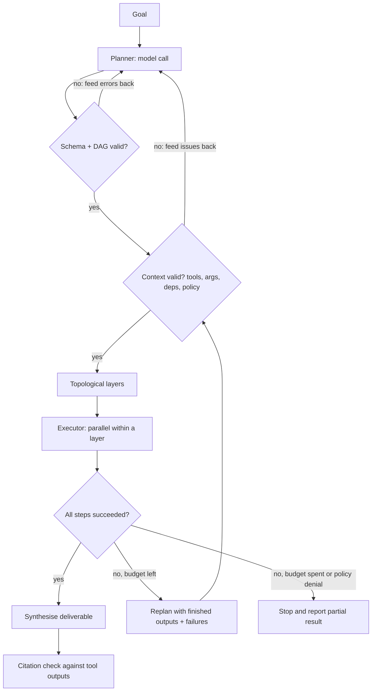
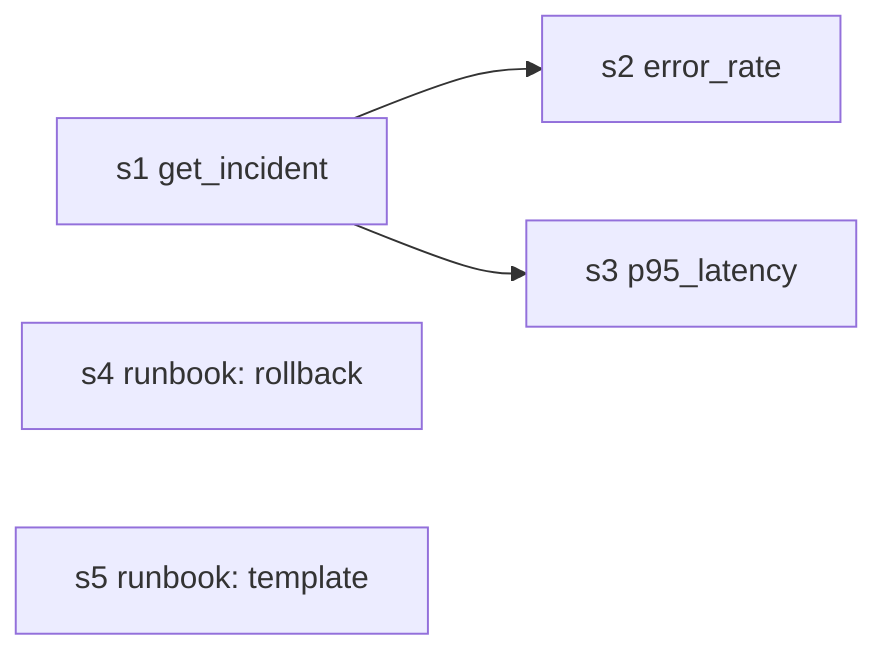

# Day 4: Planning, task decomposition, and dependency management

> **Track:** Foundations · **Time:** ~40 min · **Builds on:** [Day 2](day-02-tool-calling-and-function-execution.md), [Day 3](day-03-agent-loops-and-react.md)

## 1. Learning objectives

By the end of this lesson you will be able to:

- Explain when plan-then-execute beats a ReAct loop, and when it does not.
- Represent a plan as validated data (a Pydantic DAG) instead of free text.
- Detect cycles, duplicate ids, undeclared references, unknown tools and policy violations *before* anything runs.
- Compute execution layers with a topological sort and run independent steps in parallel.
- Implement failure propagation: skip only the dependents of a failed step, keep unrelated work.
- Replan after a partial failure while reusing finished work, with a bounded budget.
- Check a synthesised report mechanically against the evidence the run actually retrieved.

## 2. Why this matters in real-world agent engineering

An incident-response agent is asked to "draft a postmortem for INC-1042". A pure ReAct loop (Day 3) will usually find its way, but it decides one step at a time. It cannot see that three lookups are independent, so it runs them serially and pays for every round trip. It has no global view, so it may spend ten steps on the metrics and never fetch the postmortem template. And when step four fails, nothing in the system records which later work depended on it.

Writing the plan down as data fixes those problems, and adds a property that matters more in production: **a plan can be validated before it has any effect.** A typo in a tool name, a dependency cycle, or a plan that quietly includes a write tool the run is not allowed to use is rejected at plan time, with zero side effects. In a loop, the same mistake surfaces as a half-finished incident response.

Plans have a cost too. A plan made up front is made with the least information it will ever have. This lesson builds both sides: the machinery that makes plans safe to execute, and the replanning loop that recovers when the plan meets reality.

## 3. Mental model

> **A plan is a program the model writes and your code runs.**

Treat the model as a compiler front end. Its output must parse (schema), type-check (tools and arguments exist), link (dependencies resolve) and pass policy review (allowed side effects) before the runtime is allowed to execute any of it. The runtime then owns ordering, parallelism and failure handling. The model never schedules anything.

## 4. Architecture and execution flow





Layer 0 is `{s1, s4, s5}`; layer 1 is `{s2, s3}`. Everything inside a layer runs concurrently.

## 5. Core concepts

**Plan-and-execute versus ReAct.** ReAct interleaves thinking and acting, so it adapts to every observation but cannot parallelise or be reviewed in advance. Plan-and-execute commits to a structure first, which allows validation, parallelism, cost estimation and human review of the plan, but it is brittle when early observations change what should happen. In practice the useful design is hybrid: plan, execute, and replan on failure. Use plain ReAct when the path genuinely depends on each observation; use a plan when the shape of the work is knowable up front.

**Plan as data.** A `Plan` is a goal plus up to 12 `PlanStep`s. Each step has an id, a tool, arguments, `depends_on`, and a one-sentence `purpose` (which doubles as documentation in traces). `extra="forbid"` means a model that invents fields gets a validation error rather than silently ignored input.

**The dependency graph is the only ordering.** If step B needs step A's output, B lists A in `depends_on`. Data flows through references: an argument that is *exactly* the string `"${s1.service}"` is replaced at run time with the `service` field of `s1`'s JSON output. Every referenced step must also be declared in `depends_on`; otherwise two things could disagree about order, and the `undeclared_ref` check rejects it.

**Two validation tiers.** Intrinsic checks (duplicate ids, self-dependency, cycles, undeclared references) live inside the `Plan` validator, so the existing structured-output repair loop from Day 1 feeds them back to the model for free. Contextual checks need the outside world: do these tools exist, do the arguments validate, do the dependencies resolve given already-finished work, and is this tool's side-effect class allowed for this run. Those live in `validate_plan` and drive a second repair loop.

**Layers.** Kahn's algorithm, grouped by depth. Steps in one layer have no path between them, so they can run in parallel. Declaration order within a layer keeps runs deterministic.

**Failure semantics.** A step runs only if all its dependencies *succeeded*. Otherwise it is `skipped` with the reason naming the broken dependency. Unrelated branches keep running: one bad lookup should not discard the other useful results.

**Replanning.** After a partial failure, the planner is called again with the outputs of finished steps and a description of what failed. The new plan may depend on finished steps by id, must use new ids, and is bounded by `max_replans`. A policy denial is never replanned: no new plan can make a forbidden action allowed.

**False dependencies.** Every unnecessary edge removes parallelism. `plan_quality` reports `depth` (critical path length), `width` (best-case parallelism), duplicate calls, and "ordering-only" edges where the dependent never reads the dependency's output. Some are legitimate ("create the ticket after the checks pass"); each deserves a look.

## 6. Implementation from scratch

We build it in five small modules.

1. **`plan.py`** defines the data model and every check that needs nothing but the plan itself, plus `validate_plan` for the contextual checks, `topological_layers`, and `transitive_dependents`. Keeping intrinsic checks inside the Pydantic model is a deliberate choice: it means *any* code that constructs a `Plan`, including the model-output repair loop, gets them automatically.
2. **`planner.py`** runs two nested repair loops. The inner one is `chat_structured` (schema and DAG errors). The outer one calls `validate_plan` and feeds the issues back. The planner prompt lists only the tools this run may use, so a read-only run never even sees `create_ticket`.
3. **`executor.py`** validates first (an invalid plan executes nothing), computes layers, and for each layer skips broken dependents, resolves references, then calls the Day 2 `execute_batch` for the runnable steps.
4. **`replan.py`** wraps planning and execution in a bounded loop and carries finished outputs across attempts.
5. **`verify.py`** adds the deterministic checks: plan quality metrics and citation grounding.

A note on what is simplified: references only support whole-string substitution (`"${s1.field}"`), not interpolation inside larger strings. That limitation is intentional: it keeps resolution unambiguous and makes type errors obvious. The dependency on JSON outputs is also deliberate; tools whose output a later step must read should return JSON objects.

## 7. Complete runnable code

```text
code/day04/
├── plan.py          data model, validation, layering
├── planner.py       model call + two repair loops
├── executor.py      layered execution, references, failure propagation
├── replan.py        bounded replanning
├── verify.py        plan quality, citation check, synthesis
├── demo.py          five scenarios, offline
└── test_day04.py    22 tests
```

Run (from the repository root, after the Day 1 setup):

```bash
PYTHONPATH=code LESSON_OFFLINE=1 python -m day04.demo
pytest code/day04
```

<!-- code:begin path="code/day04/plan.py" -->
**`code/day04/plan.py`**

```python
"""A plan is data: a validated DAG of tool steps, not a paragraph of intent.

Validation is split on purpose:
  * intrinsic checks live in `Plan` itself (duplicate ids, self-dependency, cycles, undeclared references),
    so `common.structured.chat_structured` feeds them back to the model through its normal repair loop;
  * checks that need the outside world (missing dependencies given already-completed work, unknown tools,
    bad arguments, side-effect policy) live in `validate_plan`, which the planner calls after parsing.

Data flows between steps through references: an argument value that is exactly the string "${s1.service}"
is replaced at run time by the `service` field of step `s1`'s JSON output. Every referenced step must also be
listed in `depends_on`: the dependency graph is the *only* thing that orders execution.
"""

from __future__ import annotations

import re
from collections import defaultdict
from collections.abc import Collection, Iterable
from typing import Any

from pydantic import BaseModel, ConfigDict, Field, ValidationError, model_validator

from common.tools import SideEffect, ToolRegistry

MAX_STEPS = 12
REF_RE = re.compile(r"^\$\{([a-z][a-z0-9_]*)((?:\.[A-Za-z0-9_]+)*)\}$")


class PlanError(ValueError):
    """The plan cannot be ordered (cycle or unresolved dependency)."""


class PlanIssue(BaseModel):
    code: str  # duplicate_id | self_dependency | cycle | missing_dependency | undeclared_ref | unknown_tool | bad_args | tool_not_allowed
    step_id: str | None = None
    message: str

    def __str__(self) -> str:
        return f"[{self.code}] {self.message}"


class PlanStep(BaseModel):
    model_config = ConfigDict(extra="forbid")

    id: str = Field(pattern=r"^[a-z][a-z0-9_]{0,31}$", description="Unique step id, e.g. s1 or fetch_incident")
    tool: str = Field(description="Name of one registered tool")
    args: dict[str, Any] = Field(default_factory=dict, description="Tool arguments; may contain '${step_id.field}' references")
    depends_on: list[str] = Field(default_factory=list, description="Ids of steps that must succeed first")
    purpose: str = Field(min_length=3, max_length=200, description="Why this step exists, in one sentence")


def find_refs(value: Any) -> list[tuple[str, str]]:
    """All (step_id, dotted_path) references anywhere inside an args structure."""
    if isinstance(value, str):
        m = REF_RE.match(value)
        return [(m.group(1), m.group(2).lstrip("."))] if m else []
    if isinstance(value, dict):
        return [r for v in value.values() for r in find_refs(v)]
    if isinstance(value, list):
        return [r for v in value for r in find_refs(v)]
    return []


def step_refs(step: PlanStep) -> set[str]:
    return {sid for sid, _ in find_refs(step.args)}


def _find_cycle(steps: Iterable[PlanStep]) -> list[str] | None:
    graph = {s.id: [d for d in s.depends_on] for s in steps}
    state: dict[str, int] = {}  # 1 = visiting, 2 = done
    stack: list[str] = []

    def visit(node: str) -> list[str] | None:
        state[node] = 1
        stack.append(node)
        for dep in graph.get(node, []):
            if dep not in graph:
                continue  # missing deps are reported elsewhere
            if state.get(dep) == 1:
                return [*stack[stack.index(dep):], dep]
            if state.get(dep) is None and (cyc := visit(dep)):
                return cyc
        stack.pop()
        state[node] = 2
        return None

    for node in graph:
        if state.get(node) is None and (cyc := visit(node)):
            return cyc
    return None


def intrinsic_issues(steps: list[PlanStep]) -> list[PlanIssue]:
    issues: list[PlanIssue] = []
    seen: set[str] = set()
    for s in steps:
        if s.id in seen:
            issues.append(PlanIssue(code="duplicate_id", step_id=s.id, message=f"step id '{s.id}' is used more than once"))
        seen.add(s.id)
        if s.id in s.depends_on:
            issues.append(PlanIssue(code="self_dependency", step_id=s.id, message=f"step '{s.id}' depends on itself"))
        for ref in sorted(step_refs(s) - set(s.depends_on)):
            issues.append(PlanIssue(code="undeclared_ref", step_id=s.id,
                                    message=f"step '{s.id}' references '${{{ref}...}}' but does not list '{ref}' in depends_on"))
    if not any(i.code == "duplicate_id" for i in issues) and (cycle := _find_cycle(steps)):
        issues.append(PlanIssue(code="cycle", step_id=cycle[0], message="dependency cycle: " + " -> ".join(cycle)))
    return issues


class Plan(BaseModel):
    model_config = ConfigDict(extra="forbid")

    goal: str = Field(min_length=3, max_length=300)
    steps: list[PlanStep] = Field(min_length=1, max_length=MAX_STEPS)

    @model_validator(mode="after")
    def _structure_is_sound(self) -> Plan:
        issues = intrinsic_issues(self.steps)
        if issues:
            raise ValueError("; ".join(str(i) for i in issues))
        return self

    def step(self, step_id: str) -> PlanStep:
        return next(s for s in self.steps if s.id == step_id)

    @property
    def ids(self) -> list[str]:
        return [s.id for s in self.steps]


def parse_plan(data: dict[str, Any]) -> Plan | list[PlanIssue]:
    """Validate raw data; return the Plan or the list of intrinsic issues (never raises on bad plans)."""
    try:
        return Plan.model_validate(data)
    except ValidationError as exc:
        return [PlanIssue(code="schema", message=e["msg"].removeprefix("Value error, ")) for e in exc.errors()]


def validate_plan(
    plan: Plan,
    registry: ToolRegistry | None = None,
    *,
    known: Collection[str] = (),
    reserved: Collection[str] = (),
    allow: Collection[SideEffect] = ("read",),
) -> list[PlanIssue]:
    """Everything that needs context beyond the plan itself.

    known     ids of steps that already succeeded (their outputs are available, so depending on them is fine)
    reserved  ids used by earlier plans; a replan must not reuse them
    allow     side-effect classes this run may execute; a disallowed tool is rejected *before anything runs*
    """
    issues = intrinsic_issues(plan.steps)
    for s in plan.steps:
        if s.id in reserved or s.id in known:
            issues.append(PlanIssue(code="duplicate_id", step_id=s.id, message=f"step id '{s.id}' was used by an earlier plan"))
        for dep in s.depends_on:
            if dep not in plan.ids and dep not in known:
                issues.append(PlanIssue(code="missing_dependency", step_id=s.id,
                                        message=f"step '{s.id}' depends on '{dep}', which does not exist"))
        if registry is None:
            continue
        tool = registry.get(s.tool)
        if tool is None:
            issues.append(PlanIssue(code="unknown_tool", step_id=s.id,
                                    message=f"step '{s.id}' uses unknown tool '{s.tool}'; available: {', '.join(registry.names())}"))
            continue
        if tool.side_effect not in allow:
            issues.append(PlanIssue(code="tool_not_allowed", step_id=s.id,
                                    message=f"step '{s.id}' uses '{s.tool}' (side effect '{tool.side_effect}') which this run may not execute"))
        if not find_refs(s.args):  # with references the arguments are only complete at run time
            try:
                tool.args_model.model_validate(s.args)
            except ValidationError as exc:
                detail = "; ".join(f"{'.'.join(map(str, e['loc']))}: {e['msg']}" for e in exc.errors()[:4])
                issues.append(PlanIssue(code="bad_args", step_id=s.id, message=f"step '{s.id}' has invalid args for '{s.tool}': {detail}"))
    return issues


def topological_layers(plan: Plan, known: Collection[str] = ()) -> list[list[PlanStep]]:
    """Kahn's algorithm, grouped into layers: every step in a layer depends only on earlier layers.

    Steps in one layer are mutually independent, so they may run in parallel. Order inside a layer is the
    plan's declaration order, which keeps runs deterministic.
    """
    remaining = {s.id: {d for d in s.depends_on if d not in known} for s in plan.steps}
    unknown = {d for deps in remaining.values() for d in deps} - set(remaining)
    if unknown:
        raise PlanError(f"unresolved dependencies: {sorted(unknown)}")
    layers: list[list[PlanStep]] = []
    done: set[str] = set()
    while remaining:
        ready = [s for s in plan.steps if s.id in remaining and remaining[s.id] <= done]
        if not ready:
            raise PlanError(f"dependency cycle among {sorted(remaining)}")
        layers.append(ready)
        for s in ready:
            done.add(s.id)
            del remaining[s.id]
    return layers


def transitive_dependents(plan: Plan, step_id: str) -> set[str]:
    children: dict[str, set[str]] = defaultdict(set)
    for s in plan.steps:
        for d in s.depends_on:
            children[d].add(s.id)
    out: set[str] = set()
    todo = [step_id]
    while todo:
        for child in children[todo.pop()]:
            if child not in out:
                out.add(child)
                todo.append(child)
    return out
```
<!-- code:end -->

<!-- code:begin path="code/day04/planner.py" -->
**`code/day04/planner.py`**

```python
"""Turn a goal into a validated `Plan` with a model, using two nested repair loops.

  inner  (`chat_structured`)   schema + intrinsic DAG errors  -> fed back by common.structured
  outer  (`make_plan`)         unknown tools, bad args, missing deps, policy -> fed back here

A plan that still fails after the repair budget raises `PlanValidationError`: executing a plan nobody
validated is how a typo in a tool name becomes a half-finished incident response.
"""

from __future__ import annotations

from collections.abc import Collection, Mapping

from pydantic import BaseModel, Field

from common.llm import LLMClient, PermanentLLMError, Usage, assistant, system, user
from common.structured import chat_structured
from common.tools import SideEffect, ToolRegistry
from day04.plan import MAX_STEPS, Plan, PlanIssue, validate_plan


class PlanValidationError(PermanentLLMError):
    def __init__(self, issues: list[PlanIssue]) -> None:
        super().__init__("invalid plan: " + "; ".join(str(i) for i in issues))
        self.issues = issues


class PlanResult(BaseModel):
    plan: Plan
    usage: Usage = Field(default_factory=Usage)
    semantic_repairs: int = 0


def planner_prompt(registry: ToolRegistry, allow: Collection[SideEffect]) -> str:
    tools = "\n".join(
        f"- {t.name} [{t.side_effect}]: {t.description}"
        for t in (registry.get(n) for n in registry.names())
        if t is not None and t.side_effect in allow
    )
    return (
        "You are the planning module of an ops assistant. Produce a plan as JSON; do not execute anything.\n"
        f"Available tools (use ONLY these):\n{tools}\n"
        f"Rules: at most {MAX_STEPS} steps; ids like s1, s2; list in depends_on every step whose output you need or that must "
        "happen first; steps with no dependency between them run in parallel, so do not add dependencies you do not need. "
        "To use an earlier step's output write the argument as the exact string '${step_id.field}' (JSON object outputs only) "
        "and list that step in depends_on. Do not plan side-effecting tools unless the goal asks for them."
    )


def make_plan(
    client: LLMClient,
    goal: str,
    registry: ToolRegistry,
    *,
    allow: Collection[SideEffect] = ("read",),
    known_outputs: Mapping[str, str] | None = None,
    reserved: Collection[str] = (),
    failures: list[str] | None = None,
    max_plan_repairs: int = 2,
    max_schema_repairs: int = 2,
) -> PlanResult:
    known = dict(known_outputs or {})
    request = f"Goal: {goal}"
    if known or failures:
        request += "\nThis is a REPLAN. Do not repeat finished work.\n"
        if known:
            request += "Finished steps you may depend on (id: output preview):\n" + "\n".join(
                f"- {i}: {out[:200]}" for i, out in known.items()) + "\n"
        if failures:
            request += "Problems from the previous attempt:\n" + "\n".join(f"- {f}" for f in failures) + "\n"
        request += "Use new step ids that do not collide with: " + ", ".join(sorted({*known, *reserved})) + "."
    messages = [system(planner_prompt(registry, allow)), user(request)]

    total, repairs = Usage(), 0
    for attempt in range(max_plan_repairs + 1):
        plan, usage = chat_structured(client, messages, Plan, max_repairs=max_schema_repairs)
        total.prompt_tokens += usage.prompt_tokens
        total.completion_tokens += usage.completion_tokens
        issues = validate_plan(plan, registry, known=known.keys(), reserved=reserved, allow=allow)
        if not issues:
            return PlanResult(plan=plan, usage=total, semantic_repairs=repairs)
        if attempt == max_plan_repairs:
            raise PlanValidationError(issues)
        repairs += 1
        messages += [
            assistant(plan.model_dump_json()),
            user("That plan cannot run:\n" + "\n".join(f"- {i}" for i in issues) + "\nReturn the corrected plan."),
        ]
    raise AssertionError("unreachable")  # pragma: no cover
```
<!-- code:end -->

<!-- code:begin path="code/day04/executor.py" -->
**`code/day04/executor.py`**

```python
"""Run a validated plan layer by layer: parallel inside a layer, failures propagate to dependents only.

Semantics (the part worth reading closely):
  * a step runs only if every dependency *succeeded*; otherwise it is `skipped` and says which dependency broke it;
  * independent branches keep running after a failure - one bad lookup does not discard unrelated work;
  * references like "${s1.service}" are resolved from the JSON output of the step they name, and a bad
    reference is a step failure (`bad_reference`), not an exception;
  * the plan is validated first: an invalid plan executes nothing.
"""

from __future__ import annotations

import json
from collections.abc import Collection, Mapping
from typing import Any, Literal

from day02.execution import execute_batch
from pydantic import BaseModel, Field

from common.llm import ToolCall
from common.tools import SideEffect, ToolRegistry
from day04.plan import REF_RE, Plan, PlanStep, topological_layers, validate_plan
from day04.planner import PlanValidationError

StepStatus = Literal["succeeded", "failed", "skipped"]


class StepOutcome(BaseModel):
    step_id: str
    status: StepStatus
    content: str = ""
    error_type: str | None = None
    reason: str | None = None
    layer: int = 0


class PlanRun(BaseModel):
    outcomes: dict[str, StepOutcome] = Field(default_factory=dict)
    layers: list[list[str]] = Field(default_factory=list)

    @property
    def status(self) -> Literal["succeeded", "partial", "failed"]:
        statuses = [o.status for o in self.outcomes.values()]
        if all(s == "succeeded" for s in statuses):
            return "succeeded"
        return "partial" if any(s == "succeeded" for s in statuses) else "failed"

    def ids_with(self, status: StepStatus) -> list[str]:
        return [i for i, o in self.outcomes.items() if o.status == status]

    def outputs(self) -> dict[str, str]:
        return {i: o.content for i, o in self.outcomes.items() if o.status == "succeeded"}


class PlanReferenceError(ValueError):
    """A ${step.path} reference could not be resolved."""


def _lookup(data: Any, path: str, ref: str) -> Any:
    for part in [p for p in path.split(".") if p]:
        if isinstance(data, dict) and part in data:
            data = data[part]
        elif isinstance(data, list) and part.isdigit() and int(part) < len(data):
            data = data[int(part)]
        else:
            raise PlanReferenceError(f"{ref}: no field '{part}' in the output")
    return data


def resolve_args(value: Any, outputs: Mapping[str, str]) -> Any:
    """Replace whole-string references with values from earlier outputs (which must be JSON)."""
    if isinstance(value, str) and (m := REF_RE.match(value)):
        step_id, path = m.group(1), m.group(2).lstrip(".")
        if step_id not in outputs:
            raise PlanReferenceError(f"{value}: step '{step_id}' has no output")
        try:
            parsed = json.loads(outputs[step_id])
        except json.JSONDecodeError:
            raise PlanReferenceError(f"{value}: output of '{step_id}' is not valid JSON (truncated or plain text?)") from None
        return _lookup(parsed, path, value)
    if isinstance(value, dict):
        return {k: resolve_args(v, outputs) for k, v in value.items()}
    if isinstance(value, list):
        return [resolve_args(v, outputs) for v in value]
    return value


class PlanExecutor:
    def __init__(self, registry: ToolRegistry, *, allow: Collection[SideEffect] = ("read",), max_workers: int = 4) -> None:
        self.registry, self.allow, self.max_workers = registry, tuple(allow), max_workers

    def run(self, plan: Plan, completed: Mapping[str, str] | None = None) -> PlanRun:
        """`completed` maps ids of already-succeeded steps (from an earlier plan) to their outputs."""
        done = dict(completed or {})
        issues = validate_plan(plan, self.registry, known=done.keys(), allow=self.allow)
        if issues:
            raise PlanValidationError(issues)

        layers = topological_layers(plan, known=done.keys())
        run = PlanRun(layers=[[s.id for s in layer] for layer in layers])
        outputs = dict(done)
        for depth, layer in enumerate(layers):
            runnable: list[tuple[PlanStep, dict[str, Any]]] = []
            for step in layer:
                broken = next((d for d in step.depends_on if d in run.outcomes and run.outcomes[d].status != "succeeded"), None)
                if broken:
                    run.outcomes[step.id] = StepOutcome(
                        step_id=step.id, status="skipped", layer=depth,
                        reason=f"dependency '{broken}' {run.outcomes[broken].status}")
                    continue
                try:
                    runnable.append((step, resolve_args(step.args, outputs)))
                except PlanReferenceError as exc:
                    run.outcomes[step.id] = StepOutcome(step_id=step.id, status="failed", layer=depth,
                                                        error_type="bad_reference", reason=str(exc))
            calls = [ToolCall(id=s.id, name=s.tool, arguments=args) for s, args in runnable]
            for (step, _), result in zip(runnable, execute_batch(self.registry, calls, allow=self.allow,
                                                                  max_workers=self.max_workers), strict=True):
                run.outcomes[step.id] = StepOutcome(
                    step_id=step.id, status="succeeded" if result.ok else "failed", content=result.content,
                    error_type=result.error_type, reason=None if result.ok else result.content, layer=depth)
                if result.ok:
                    outputs[step.id] = result.content
        return run
```
<!-- code:end -->

<!-- code:begin path="code/day04/replan.py" -->
**`code/day04/replan.py`**

```python
"""Replanning: when a plan partly fails, ask for a *revised* plan for the remaining work.

What carries over: outputs of steps that already succeeded (the new plan may depend on them by id).
What does not: failed and skipped steps are superseded, and their ids are reserved so the trace stays unambiguous.
Replanning is bounded (`max_replans`) and never attempted for policy denials, which no new plan can fix.
"""

from __future__ import annotations

from collections.abc import Collection

from pydantic import BaseModel, Field

from common.llm import LLMClient
from common.tools import SideEffect, ToolRegistry
from day04.executor import PlanExecutor, PlanRun
from day04.plan import Plan
from day04.planner import make_plan


class ReplanResult(BaseModel):
    plans: list[Plan] = Field(default_factory=list)
    runs: list[PlanRun] = Field(default_factory=list)
    completed: dict[str, str] = Field(default_factory=dict)
    replans: int = 0
    stopped_because: str = "succeeded"

    @property
    def succeeded(self) -> bool:
        return bool(self.runs) and self.runs[-1].status == "succeeded"


def describe_failures(run: PlanRun) -> list[str]:
    lines = []
    for sid in run.ids_with("failed"):
        o = run.outcomes[sid]
        lines.append(f"step {sid} failed ({o.error_type}): {(o.reason or '')[:240]}")
    lines += [f"step {sid} was skipped: {run.outcomes[sid].reason}" for sid in run.ids_with("skipped")]
    return lines


def run_with_replanning(
    client: LLMClient,
    registry: ToolRegistry,
    goal: str,
    plan: Plan,
    *,
    allow: Collection[SideEffect] = ("read",),
    max_replans: int = 1,
) -> ReplanResult:
    executor = PlanExecutor(registry, allow=allow)
    result = ReplanResult()
    used_ids: set[str] = set()
    current = plan
    while True:
        run = executor.run(current, completed=result.completed)
        result.plans.append(current)
        result.runs.append(run)
        used_ids |= set(current.ids)
        result.completed.update(run.outputs())
        if run.status == "succeeded":
            return result
        if any(o.error_type == "denied" for o in run.outcomes.values()):
            result.stopped_because = "policy denial: replanning cannot fix it"
            return result
        if result.replans >= max_replans:
            result.stopped_because = f"replan budget ({max_replans}) exhausted"
            return result
        result.replans += 1
        current = make_plan(client, goal, registry, allow=allow, known_outputs=result.completed,
                            reserved=used_ids, failures=describe_failures(run)).plan
```
<!-- code:end -->

<!-- code:begin path="code/day04/verify.py" -->
**`code/day04/verify.py`**

```python
"""Judging plans and their results without a model: static quality metrics and citation checking.

These are cheap, deterministic checks. They cannot tell you a plan is *good*, only that it is not
obviously wasteful (false dependencies serialise work) or that a written report cites only evidence
the run actually retrieved.
"""

from __future__ import annotations

import re
from collections.abc import Collection, Mapping

from pydantic import BaseModel, Field

from common.llm import LLMClient, Usage, system, user
from common.tools import ToolRegistry
from day04.plan import Plan, step_refs, topological_layers

ID_RE = re.compile(r"\bINC-\d{4}\b|\brb-[a-z0-9]+(?:-[a-z0-9]+)*\b")


class PlanQuality(BaseModel):
    steps: int
    depth: int  # number of layers = length of the critical path in steps
    width: int  # largest layer = best-case parallelism
    side_effect_steps: list[str] = Field(default_factory=list)
    duplicate_calls: list[tuple[str, str]] = Field(default_factory=list)
    ordering_only_edges: list[tuple[str, str]] = Field(default_factory=list)


def plan_quality(plan: Plan, registry: ToolRegistry | None = None, known: Collection[str] = ()) -> PlanQuality:
    layers = topological_layers(plan, known)
    seen: dict[str, str] = {}
    dupes: list[tuple[str, str]] = []
    for s in plan.steps:
        key = f"{s.tool}:{sorted(s.args.items(), key=lambda kv: kv[0])}"
        if key in seen:
            dupes.append((seen[key], s.id))
        seen.setdefault(key, s.id)
    # An edge is "ordering only" when the dependent never reads the dependency's output. Sometimes legitimate
    # (do X after Y), but each one removes parallelism, so a reviewer should look at them.
    ordering = [(d, s.id) for s in plan.steps for d in s.depends_on if d not in step_refs(s) and d not in known]
    writes = [s.id for s in plan.steps if registry and (t := registry.get(s.tool)) and t.side_effect != "read"]
    return PlanQuality(steps=len(plan.steps), depth=len(layers), width=max(len(layer) for layer in layers),
                       side_effect_steps=writes, duplicate_calls=dupes, ordering_only_edges=ordering)


class CitationReport(BaseModel):
    cited: list[str]
    unknown: list[str]  # cited ids that appear in no tool output of this run: fabricated or stale

    @property
    def grounded(self) -> bool:
        return not self.unknown


def verify_citations(text: str, outputs: Mapping[str, str]) -> CitationReport:
    evidence = {m for out in outputs.values() for m in ID_RE.findall(out)}
    cited = sorted(set(ID_RE.findall(text)))
    return CitationReport(cited=cited, unknown=[c for c in cited if c not in evidence])


class Synthesis(BaseModel):
    text: str
    citations: CitationReport
    usage: Usage = Field(default_factory=Usage)


def synthesize(client: LLMClient, goal: str, outputs: Mapping[str, str], *, per_step_chars: int = 1500) -> Synthesis:
    """One model call that writes the deliverable from step outputs, then a mechanical citation check."""
    evidence = "\n\n".join(f"[{sid}]\n{out[:per_step_chars]}" for sid, out in outputs.items())
    resp = client.chat([
        system("Write the requested document using ONLY the evidence below. Cite incident and runbook ids "
               "exactly as they appear. If evidence is missing for a section, say so instead of guessing."),
        user(f"Goal: {goal}\n\nEvidence from tool steps:\n{evidence}"),
    ])
    return Synthesis(text=resp.content, citations=verify_citations(resp.content, outputs), usage=resp.usage)
```
<!-- code:end -->

<!-- code:begin path="code/day04/demo.py" -->
**`code/day04/demo.py`**

```python
"""Day 4 demo: plan "draft a postmortem for INC-1042", validate it, run it, break it, replan it. Offline.

    PYTHONPATH=code LESSON_OFFLINE=1 python -m day04.demo

The planner and writer "models" are scripts, so this shows the machinery around a plan - validation,
layering, parallel execution, failure propagation, replanning, citation checking - not how good a real
model's plans are. With LLM_API_KEY set (and LESSON_OFFLINE unset) sections 1, 2 and 5 call a real model.
"""

from __future__ import annotations

import json

from day02.ops_tools import TicketStore, build_registry

from common.llm import get_client
from day04.executor import PlanExecutor
from day04.plan import Plan, topological_layers
from day04.planner import PlanValidationError, make_plan
from day04.replan import run_with_replanning
from day04.verify import plan_quality, synthesize

GOAL = "Draft a postmortem for INC-1042"


def step(sid: str, tool: str, args: dict, deps: list[str], purpose: str) -> dict:
    return {"id": sid, "tool": tool, "args": args, "depends_on": deps, "purpose": purpose}


def plan_json(incident: str = "INC-1042") -> str:
    return json.dumps({"goal": GOAL, "steps": [
        step("s1", "get_incident", {"incident_id": incident}, [], "Load the incident record"),
        step("s2", "query_metrics", {"service": "${s1.service}", "metric": "error_rate"}, ["s1"], "Quantify error-rate impact"),
        step("s3", "query_metrics", {"service": "${s1.service}", "metric": "p95_latency_ms"}, ["s1"], "Quantify latency impact"),
        step("s4", "search_runbooks", {"query": "deploy rollback"}, [], "Find the rollback procedure"),
        step("s5", "search_runbooks", {"query": "postmortem template"}, [], "Find the postmortem structure"),
    ]})


def banner(title: str) -> None:
    print(f"\n=== {title} ===")


def show_run(run) -> None:
    for sid, o in run.outcomes.items():
        note = f"  <- {o.reason[:70]}" if o.reason else ""
        print(f"  layer {o.layer} {sid}: {o.status}{note}")


def main() -> None:
    store = TicketStore()
    reg = build_registry(store)

    banner("1. Planning: two kinds of repair before a plan is accepted")
    cyclic = json.loads(plan_json())
    cyclic["steps"][1]["depends_on"], cyclic["steps"][2]["depends_on"] = ["s1", "s3"], ["s1", "s2"]
    wrong_tool = json.loads(plan_json())
    wrong_tool["steps"][3]["tool"] = "runbook_search"
    wrong_tool["steps"][4]["depends_on"] = ["s9"]
    client = get_client([json.dumps(cyclic), json.dumps(wrong_tool), plan_json()])
    planned = make_plan(client, GOAL, reg)
    plan = planned.plan
    if hasattr(client, "calls"):
        print("model calls:", len(client.calls), "| semantic repairs:", planned.semantic_repairs)
        print("feedback after call 1 (schema/DAG):", client.calls[1]["messages"][-1].content.splitlines()[1][:140])
        print("feedback after call 2 (semantic)  :", " | ".join(client.calls[2]["messages"][-1].content.splitlines()[1:3])[:210])
    layers = topological_layers(plan)
    print("layers:", [[s.id for s in layer] for layer in layers])
    print("quality:", plan_quality(plan, reg).model_dump())

    banner("2. Executing: parallel inside a layer, references resolved from earlier outputs")
    run = PlanExecutor(reg).run(plan)
    show_run(run)
    print("s2 args were resolved to service =", json.loads(run.outcomes["s1"].content)["service"], "| run status:", run.status)
    writer = get_client([
        "Postmortem INC-1042 (SEV1, checkout-api). Impact: error rate peaked at 0.31 (metrics s2). Root cause: unindexed "
        "query after release. Actions: follow rb-deploy-rollback and rb-db-connection-pool. Related: INC-1099."])
    draft = synthesize(writer, GOAL, run.outputs())
    print("citations:", draft.citations.cited, "| not found in any tool output:", draft.citations.unknown)

    banner("3. Failure propagation: INC-9999 does not exist")
    bad_plan = Plan.model_validate_json(plan_json("INC-9999"))
    bad_run = PlanExecutor(reg).run(bad_plan)
    show_run(bad_run)
    print("run status:", bad_run.status)

    banner("4. Replanning from the failure, reusing finished work")
    fix = json.dumps({"goal": GOAL, "steps": [
        step("r1_inc", "get_incident", {"incident_id": "INC-1042"}, [], "Load the correct incident record"),
        step("r1_err", "query_metrics", {"service": "${r1_inc.service}", "metric": "error_rate"}, ["r1_inc"], "Error-rate impact"),
    ]})
    rc = get_client([fix])
    out = run_with_replanning(rc, reg, GOAL, bad_plan)
    print("replans:", out.replans, "| final run:")
    show_run(out.runs[-1])
    print("reused from run 1 without re-executing:", sorted(set(out.completed) & set(out.runs[0].ids_with('succeeded'))))
    if hasattr(rc, "calls"):
        print("replanner was told:", rc.calls[0]["messages"][-1].content.split("Problems from the previous attempt:")[1].strip().splitlines()[0][:120])

    banner("5. Policy is checked before anything runs")
    risky = Plan.model_validate_json(json.dumps({"goal": GOAL, "steps": [
        step("s1", "get_incident", {"incident_id": "INC-1042"}, [], "Load the incident record"),
        step("s2", "create_ticket", {"title": "Add index on orders", "severity": "SEV2", "idempotency_key": "inc-1042-index"},
             ["s1"], "File the follow-up ticket"),
    ]}))
    try:
        PlanExecutor(reg).run(risky)
    except PlanValidationError as exc:
        print("rejected:", exc.issues[0])
    print("tickets created:", len(store.tickets), "| read-only steps executed: 0")
    allowed = PlanExecutor(reg, allow=("read", "write")).run(risky)
    print("with write allowed:", allowed.status, "| tickets created:", len(store.tickets))


if __name__ == "__main__":
    main()
```
<!-- code:end -->

<!-- code:begin path="code/day04/test_day04.py" -->
**`code/day04/test_day04.py`**

```python
"""Day 4 tests: plan validation, layering, execution semantics, planner repair, replanning, verification."""

from __future__ import annotations

import json
from typing import Any

import pytest
from day02.ops_tools import TicketStore, build_registry

from common.llm import ScriptedLLM
from day04.executor import PlanExecutor, PlanReferenceError, resolve_args
from day04.plan import Plan, PlanError, find_refs, parse_plan, topological_layers, transitive_dependents, validate_plan
from day04.planner import PlanValidationError, make_plan
from day04.replan import run_with_replanning
from day04.verify import plan_quality, verify_citations

GOAL = "Draft a postmortem for INC-1042"


def step(sid: str, tool: str, args: dict[str, Any], deps: list[str] | None = None) -> dict[str, Any]:
    return {"id": sid, "tool": tool, "args": args, "depends_on": deps or [], "purpose": f"purpose of {sid}"}


def good_plan(incident: str = "INC-1042") -> dict[str, Any]:
    return {"goal": GOAL, "steps": [
        step("s1", "get_incident", {"incident_id": incident}),
        step("s2", "query_metrics", {"service": "${s1.service}", "metric": "error_rate"}, ["s1"]),
        step("s3", "query_metrics", {"service": "${s1.service}", "metric": "p95_latency_ms"}, ["s1"]),
        step("s4", "search_runbooks", {"query": "deploy rollback"}),
    ]}


def plan_of(data: dict[str, Any]) -> Plan:
    result = parse_plan(data)
    assert isinstance(result, Plan), result
    return result


# ------------------------------------------------------------------ structure --
def codes(data: dict[str, Any]) -> list[str]:
    result = parse_plan(data)
    return [] if isinstance(result, Plan) else [i.message for i in result]


def test_valid_plan_parses_and_exposes_ids() -> None:
    assert plan_of(good_plan()).ids == ["s1", "s2", "s3", "s4"]


def test_duplicate_ids_self_dependency_and_cycles_are_rejected() -> None:
    dup = good_plan()
    dup["steps"][3]["id"] = "s1"
    assert any("[duplicate_id]" in m for m in codes(dup))

    selfdep = good_plan()
    selfdep["steps"][3]["depends_on"] = ["s4"]
    assert any("[self_dependency]" in m for m in codes(selfdep))

    cyc = good_plan()
    cyc["steps"][1]["depends_on"], cyc["steps"][2]["depends_on"] = ["s1", "s3"], ["s1", "s2"]
    msgs = codes(cyc)
    assert any("[cycle]" in m and "->" in m for m in msgs)


def test_reference_must_be_declared_as_dependency() -> None:
    bad = good_plan()
    bad["steps"][1]["depends_on"] = []
    assert any("[undeclared_ref]" in m for m in codes(bad))


def test_schema_limits_and_unknown_fields_rejected() -> None:
    extra = good_plan()
    extra["steps"][0]["surprise"] = 1
    assert codes(extra)
    assert codes({"goal": GOAL, "steps": []})
    too_many = {"goal": GOAL, "steps": [step(f"s{i}", "get_incident", {"incident_id": "INC-1042"}) for i in range(13)]}
    assert codes(too_many)
    bad_id = good_plan()
    bad_id["steps"][0]["id"] = "S 1"
    assert codes(bad_id)


def test_find_refs_walks_nested_structures_but_only_matches_whole_strings() -> None:
    assert find_refs({"a": ["${s1.x.y}", {"b": "${s2}"}], "c": "prefix ${s3.z}"}) == [("s1", "x.y"), ("s2", "")]


# ------------------------------------------------------------ context checks --
def test_validate_plan_catches_unknown_tool_bad_args_and_missing_dependency() -> None:
    reg = build_registry(TicketStore())
    data = good_plan()
    data["steps"][3]["tool"] = "runbook_search"
    data["steps"].append(step("s5", "get_incident", {"incident_id": 5}, ["s9"]))
    found = {i.code for i in validate_plan(plan_of(data), reg)}
    assert {"unknown_tool", "missing_dependency", "bad_args"} <= found


def test_validate_plan_allows_dependency_on_known_completed_steps_and_blocks_id_reuse() -> None:
    reg = build_registry(TicketStore())
    follow_up = plan_of({"goal": GOAL, "steps": [step("n1", "query_metrics", {"service": "${s1.service}", "metric": "cpu_pct"}, ["s1"])]})
    assert validate_plan(follow_up, reg, known={"s1"}) == []
    assert [i.code for i in validate_plan(follow_up, reg)] == ["missing_dependency"]
    reuse = plan_of({"goal": GOAL, "steps": [step("s1", "search_runbooks", {"query": "x y"})]})
    assert [i.code for i in validate_plan(reuse, reg, reserved={"s1"})] == ["duplicate_id"]


def test_side_effect_policy_rejects_write_tools_by_default() -> None:
    reg = build_registry(TicketStore())
    data = {"goal": GOAL, "steps": [step("s1", "create_ticket", {"title": "Add index", "severity": "SEV2", "idempotency_key": "inc-1042-idx"})]}
    assert [i.code for i in validate_plan(plan_of(data), reg)] == ["tool_not_allowed"]
    assert validate_plan(plan_of(data), reg, allow=("read", "write")) == []


# --------------------------------------------------------------------- layers --
def test_topological_layers_group_independent_steps() -> None:
    layers = topological_layers(plan_of(good_plan()))
    assert [[s.id for s in layer] for layer in layers] == [["s1", "s4"], ["s2", "s3"]]


def test_layers_with_known_and_unresolved_dependencies() -> None:
    follow_up = plan_of({"goal": GOAL, "steps": [step("n1", "get_incident", {"incident_id": "INC-1042"}, ["s1"])]})
    assert [[s.id for s in layer] for layer in topological_layers(follow_up, known={"s1"})] == [["n1"]]
    with pytest.raises(PlanError, match="unresolved"):
        topological_layers(follow_up)


def test_transitive_dependents() -> None:
    chain = plan_of({"goal": GOAL, "steps": [
        step("a", "get_incident", {"incident_id": "INC-1042"}),
        step("b", "get_incident", {"incident_id": "INC-1051"}, ["a"]),
        step("c", "get_incident", {"incident_id": "INC-1063"}, ["b"]),
        step("d", "search_runbooks", {"query": "x y"}),
    ]})
    assert transitive_dependents(chain, "a") == {"b", "c"}
    assert transitive_dependents(chain, "d") == set()


# ------------------------------------------------------------------ execution --
def test_executor_runs_layers_and_resolves_references() -> None:
    run = PlanExecutor(build_registry(TicketStore())).run(plan_of(good_plan()))
    assert run.status == "succeeded"
    assert run.layers == [["s1", "s4"], ["s2", "s3"]]
    assert json.loads(run.outcomes["s2"].content)  # query_metrics got service resolved from s1's output
    assert run.outcomes["s2"].layer == 1 and run.outcomes["s4"].layer == 0


def test_failure_skips_only_dependents_and_independent_work_continues() -> None:
    run = PlanExecutor(build_registry(TicketStore())).run(plan_of(good_plan("INC-9999")))
    assert run.status == "partial"
    assert run.outcomes["s1"].status == "failed"
    assert run.ids_with("skipped") == ["s2", "s3"]
    assert "dependency 's1' failed" in (run.outcomes["s2"].reason or "")
    assert run.outcomes["s4"].status == "succeeded"
    assert set(run.outputs()) == {"s4"}


def test_invalid_plan_executes_nothing() -> None:
    store = TicketStore()
    data = {"goal": GOAL, "steps": [
        step("s1", "search_runbooks", {"query": "deploy rollback"}),
        step("s2", "create_ticket", {"title": "Add index", "severity": "SEV2", "idempotency_key": "inc-1042-idx"}, ["s1"]),
    ]}
    with pytest.raises(PlanValidationError) as ei:
        PlanExecutor(build_registry(store)).run(plan_of(data))
    assert ei.value.issues[0].code == "tool_not_allowed"
    assert store.executions == 0
    run = PlanExecutor(build_registry(store), allow=("read", "write")).run(plan_of(data))
    assert run.status == "succeeded" and store.executions == 1


def test_bad_reference_is_a_step_failure_not_an_exception() -> None:
    data = {"goal": GOAL, "steps": [
        step("s1", "get_incident", {"incident_id": "INC-1042"}),
        step("s2", "query_metrics", {"service": "${s1.no_such_field}", "metric": "error_rate"}, ["s1"]),
    ]}
    run = PlanExecutor(build_registry(TicketStore())).run(plan_of(data))
    assert run.outcomes["s2"].status == "failed" and run.outcomes["s2"].error_type == "bad_reference"
    assert "no_such_field" in (run.outcomes["s2"].reason or "")


def test_resolve_args_errors() -> None:
    with pytest.raises(PlanReferenceError, match="no output"):
        resolve_args("${s1.x}", {})
    with pytest.raises(PlanReferenceError, match="not valid JSON"):
        resolve_args("${s1.x}", {"s1": "plain text, maybe truncated"})
    assert resolve_args({"k": ["${s1.a.0}", 3]}, {"s1": '{"a": ["v"]}'}) == {"k": ["v", 3]}


# -------------------------------------------------------------------- planner --
def test_planner_repairs_schema_then_semantic_errors() -> None:
    reg = build_registry(TicketStore())
    cyclic = good_plan()
    cyclic["steps"][1]["depends_on"], cyclic["steps"][2]["depends_on"] = ["s1", "s3"], ["s1", "s2"]
    wrong_tool = good_plan()
    wrong_tool["steps"][3]["tool"] = "runbook_search"
    llm = ScriptedLLM([json.dumps(cyclic), json.dumps(wrong_tool), json.dumps(good_plan())])
    result = make_plan(llm, GOAL, reg)
    assert result.plan.ids == ["s1", "s2", "s3", "s4"]
    assert len(llm.calls) == 3 and result.semantic_repairs == 1
    assert "cycle" in llm.calls[1]["messages"][-1].content
    assert "unknown_tool" in llm.calls[2]["messages"][-1].content


def test_planner_gives_up_with_issues_and_hides_disallowed_tools_from_the_prompt() -> None:
    reg = build_registry(TicketStore())
    wrong = good_plan()
    wrong["steps"][3]["tool"] = "runbook_search"
    llm = ScriptedLLM([json.dumps(wrong)] * 3)
    with pytest.raises(PlanValidationError) as ei:
        make_plan(llm, GOAL, reg, max_plan_repairs=2)
    assert ei.value.issues[0].code == "unknown_tool"
    prompt = llm.calls[0]["messages"][1].content  # [0] is the schema message added by chat_structured
    assert "create_ticket" not in prompt and "get_incident" in prompt


# ------------------------------------------------------------------- replanning --
def test_replanning_reuses_finished_work_and_reserves_old_ids() -> None:
    reg = build_registry(TicketStore())
    first = plan_of(good_plan("INC-9999"))
    revised = {"goal": GOAL, "steps": [
        step("r1", "get_incident", {"incident_id": "INC-1042"}),
        step("r2", "query_metrics", {"service": "${r1.service}", "metric": "error_rate"}, ["r1"]),
    ]}
    llm = ScriptedLLM([json.dumps(revised)])
    result = run_with_replanning(llm, reg, GOAL, first)
    assert result.succeeded and result.replans == 1
    assert {"s4", "r1", "r2"} <= set(result.completed) and "s1" not in result.completed
    request = llm.calls[0]["messages"][-1].content
    assert "REPLAN" in request and "step s1 failed" in request and "s4" in request


def test_replan_budget_is_bounded_and_policy_denials_are_not_replanned() -> None:
    reg = build_registry(TicketStore())
    still_bad = {"goal": GOAL, "steps": [step("r1", "get_incident", {"incident_id": "INC-0000"})]}
    llm = ScriptedLLM([json.dumps(still_bad)])
    result = run_with_replanning(llm, reg, GOAL, plan_of(good_plan("INC-9999")), max_replans=1)
    assert not result.succeeded and result.replans == 1 and "budget" in result.stopped_because

    never = ScriptedLLM([])
    denied = {"goal": GOAL, "steps": [step("s1", "search_runbooks", {"query": "x y"})]}
    ok = run_with_replanning(never, reg, GOAL, plan_of(denied))
    assert ok.succeeded and ok.replans == 0 and never.calls == []


# ---------------------------------------------------------------------- verify --
def test_plan_quality_flags_false_dependencies_and_duplicates() -> None:
    data = {"goal": GOAL, "steps": [
        step("a", "search_runbooks", {"query": "deploy rollback"}),
        step("b", "search_runbooks", {"query": "deploy rollback"}, ["a"]),  # duplicate call AND ordering-only edge
        step("c", "get_incident", {"incident_id": "INC-1042"}),
    ]}
    q = plan_quality(plan_of(data), build_registry(TicketStore()))
    assert q.depth == 2 and q.width == 2
    assert q.duplicate_calls == [("a", "b")] and q.ordering_only_edges == [("a", "b")]
    good = plan_quality(plan_of(good_plan()))
    assert good.ordering_only_edges == [] and (good.depth, good.width) == (2, 2)


def test_citation_check_flags_ids_absent_from_tool_output() -> None:
    outputs = {"s1": '{"id": "INC-1042", "related_docs": ["rb-deploy-rollback"]}'}
    report = verify_citations("See INC-1042, rb-deploy-rollback and INC-1099.", outputs)
    assert report.unknown == ["INC-1099"] and not report.grounded
    assert verify_citations("See INC-1042.", outputs).grounded
```
<!-- code:end -->

### Real demo output

This is the output of `python -m day04.demo` with the scripted model (copied from an actual run):

```text
=== 1. Planning: two kinds of repair before a plan is accepted ===
model calls: 3 | semantic repairs: 1
feedback after call 1 (schema/DAG): - field '<root>': Value error, [cycle] dependency cycle: s2 -> s3 -> s2
feedback after call 2 (semantic)  : - [unknown_tool] step 's4' uses unknown tool 'runbook_search'; available: create_ticket, get_incident, query_metrics, search_runbooks | - [missing_dependency] step 's5' depends on 's9', which does not exist
layers: [['s1', 's4', 's5'], ['s2', 's3']]

=== 3. Failure propagation: INC-9999 does not exist ===
  layer 0 s1: failed  <- Error: ValueError: no incident INC-9999. Known ids: INC-1042, INC-1051
  layer 0 s4: succeeded
  layer 1 s2: skipped  <- dependency 's1' failed
  layer 1 s3: skipped  <- dependency 's1' failed
run status: partial

=== 5. Policy is checked before anything runs ===
rejected: [tool_not_allowed] step 's2' uses 'create_ticket' (side effect 'write') which this run may not execute
tickets created: 0 | read-only steps executed: 0
```

The scripted "planner" returns a plan with a cycle, then one with an unknown tool and a missing dependency, then a good one. That demonstrates the *repair machinery*. It says nothing about how often a real model produces bad plans; measure that with your own evals (Day 20).

The citation scenario in the full demo is worth running: the scripted writer cites `INC-1099`, which appears in no tool output, and `verify_citations` flags it.

## 8. Implementation decisions explained

| Decision | Alternative | Why this one | When to choose differently |
|---|---|---|---|
| Plan is a Pydantic model with `extra="forbid"` | Free-text plan or loose dict | Validation, repair feedback, stable traces | Exploratory agents where structure would be guessed anyway |
| Intrinsic checks inside the model validator | Separate validator function | Every construction path gets them, including repair loops | If checks are expensive or need I/O, keep them out |
| Dependencies are the only ordering | Implicit list order | Makes parallelism and failure scope computable | Strictly sequential workflows where list order is clearer |
| Whole-string references only | Template interpolation | Unambiguous resolution and clear errors | If you need composed strings, add a typed formatter step |
| Invalid plan executes nothing | Run valid prefix | A partly-run invalid plan is hard to reason about | Idempotent read-only plans where best-effort is acceptable |
| Independent branches continue after a failure | Fail fast | Keeps partial results that are still useful | When a failure means the whole result is meaningless |
| Replan is bounded; denials never replanned | Unlimited replanning | Prevents loops and wasted spend; forbidden stays forbidden | Interactive tools where a human reviews each replan |
| Planner prompt lists only allowed tools | List all, rely on validation | Reduces wasted repair rounds and avoids exposing write tools | Validation still runs either way; this is an optimisation |

## 9. Failure scenarios and edge cases

- **Cycle.** `s2 -> s3 -> s2`. Caught by the plan validator with the cycle path in the message; the repair loop shows it to the model. Tested in `test_duplicate_ids_self_dependency_and_cycles_are_rejected`.
- **Hallucinated tool or dependency.** Caught by `validate_plan`; after `max_plan_repairs` the planner raises `PlanValidationError` with all issues rather than returning something unrunnable.
- **Undeclared reference.** A step reads `${s1.x}` without depending on `s1`. Rejected, because without the edge the executor could run it before `s1`.
- **Reference to a missing field or non-JSON output.** Becomes a `bad_reference` step failure with a precise message, not an exception. A truncated tool output (Day 2's cap) is the common real cause: its JSON no longer parses.
- **Write tool in a read-only run.** Rejected with `tool_not_allowed` before any step executes; tested to leave the ticket store untouched.
- **Replan loop.** Bounded by `max_replans`; a persistent failure stops with an explicit reason. Not handled: a replan that "succeeds" by quietly dropping the failed requirement. The citation check and the plan's `goal` are the only defences; real systems add a completeness check against the goal (an exercise below).
- **Duplicate and wasteful plans.** Identical calls and ordering-only edges are reported by `plan_quality`, not rejected, because some are intentional.
- **Plan drift.** Observations may make the remaining plan wrong without any step failing (the incident turns out to be a different service). This design only replans on failure. Detecting semantic drift needs either a model judgement step or checkpoints where the plan is re-confirmed.

## 10. Production considerations

**Security.** Treat the plan as untrusted model output. Policy is enforced from the registry's declared side-effect class, never from what the plan claims. Arguments containing references are resolved from tool output, which is itself untrusted content (Day 18): a retrieved document could contain text that ends up as an argument to a later step. Validate resolved arguments again at execution (the registry does, via Pydantic).

**Reliability.** Steps need timeouts and retries that respect idempotency (Day 23). Write steps in a plan should carry idempotency keys so a resumed or replanned run cannot repeat them. Persist the plan and per-step outcomes so a crashed run can resume at the right layer (Day 5).

**Observability.** Log the plan, each validation issue, the layer each step ran in, and each outcome. The `purpose` field makes traces readable. Track repair rounds per plan and replans per run as quality signals.

**Scalability.** Layers bound concurrency by plan width, and `max_workers` bounds it by resources. Parallel steps that hit the same rate-limited API need a shared limiter, not just a thread count.

**Cost.** Planning adds at least one extra model call and repair rounds multiply it. The payoff is parallel execution and fewer wandering steps. Measure total tokens and wall-clock against a ReAct baseline on your own tasks before assuming plans are cheaper; for short tasks they often are not.

## 11. Hands-on exercises

1. **Run it.** Run the demo and the tests. In scenario 3, change `INC-9999` to a valid id and confirm the status becomes `succeeded`. *Acceptance:* you can state which layer each step ran in and why.
2. **Break the validator.** Write three plans that are wrong in different ways (a three-step cycle, a reference without a dependency, a tool outside the allowed side-effect set) and confirm each produces the expected issue code. *Acceptance:* three new passing tests.
3. **Add a completeness check.** Add a `verify` function that checks whether the goal's required sections (from the postmortem template) are each backed by at least one succeeded step, and fail loudly when a replan dropped one. *Acceptance:* a test where a replan omits the metrics step and is flagged.
4. **Measure parallelism.** Add a fake slow tool (sleep 0.2s) and show that a width-3 layer takes about one sleep, not three. *Acceptance:* a timing test with a generous tolerance, not an exact value.

## 12. Challenge task

Implement **plan repair without a full replan**: when one step fails with a retryable error class, re-run only that step and its dependents (using `transitive_dependents`), and only fall back to a model replan when a retry also fails. *Acceptance criteria:* finished steps are never re-executed; a retried write step cannot create a second ticket; the total number of model calls is lower than the full-replan path on the same scripted scenario; all existing tests still pass. *Hint:* extend `PlanRun` with attempt counts, and decide how a step's idempotency key is derived from the plan id and step id.

## 13. Knowledge check

1. Why must every `${step.field}` reference also appear in `depends_on`?
   <details><summary>Answer</summary>The dependency graph is the only thing that orders execution. A reference without an edge lets the dependent run before the step that produces its input.</details>
2. A plan has a cycle. Where is it caught, and what does the model see?
   <details><summary>Answer</summary>In the `Plan` model validator (an intrinsic check). The structured-output repair loop sends the validation message, including the cycle path, back to the model.</details>
3. Step `s1` fails. Which steps are skipped, and which still run?
   <details><summary>Answer</summary>Only steps that transitively depend on `s1` are skipped. Independent steps, in the same or other layers, still run.</details>
4. Why is a policy denial excluded from replanning?
   <details><summary>Answer</summary>The block comes from the run's permissions, not from a flawed plan. A new plan cannot change that, so replanning would only burn model calls.</details>
5. When is ReAct better than plan-and-execute?
   <details><summary>Answer</summary>When each next action depends on what the previous observation revealed, so the shape of the work cannot be known in advance.</details>
6. What does `plan_quality` tell you that validation does not?
   <details><summary>Answer</summary>Whether the plan is wasteful: critical-path depth, available parallelism, duplicate calls, and edges that serialise work without any data dependency. Valid plans can still be inefficient.</details>
7. What does the citation check prove, and what does it not?
   <details><summary>Answer</summary>It proves every cited id appeared in some tool output of this run. It does not prove the claim attached to the citation is true, or that important evidence was not omitted.</details>

## 14. References

- [Yao et al.: ReAct](https://arxiv.org/abs/2210.03629): the interleaved reasoning and acting baseline this lesson contrasts with.
- [Anthropic: Building effective agents](https://www.anthropic.com/engineering/building-effective-agents): when to use workflows versus agents, including prompt chaining and parallelisation patterns.
- [Pydantic: Validators](https://docs.pydantic.dev/latest/concepts/validators/): `model_validator(mode="after")`, which the plan structure checks use.
- [Python `graphlib` (stdlib)](https://docs.python.org/3/library/graphlib.html): the standard library's topological sorter, a useful comparison with the hand-written layering.
- [OWASP: Top 10 for LLM Applications](https://genai.owasp.org/llm-top-10/): excessive agency, the risk that plan-time policy checks mitigate.

## 15. After this lesson you should be able to…

- [ ] Explain the trade-off between plan-and-execute and ReAct, and name a case for each.
- [ ] Implement a validated plan DAG with cycle, reference and policy checks.
- [ ] Compute execution layers and explain what runs in parallel and why.
- [ ] Implement failure propagation that skips only transitive dependents.
- [ ] Add a bounded replanning loop that reuses finished work.
- [ ] Debug a plan that is valid but slow by reading `plan_quality`.

Next: [Day 5](day-05-agent-state-and-checkpoints.md) makes runs durable, so a crash in the middle of a plan can be resumed without repeating its side effects.
